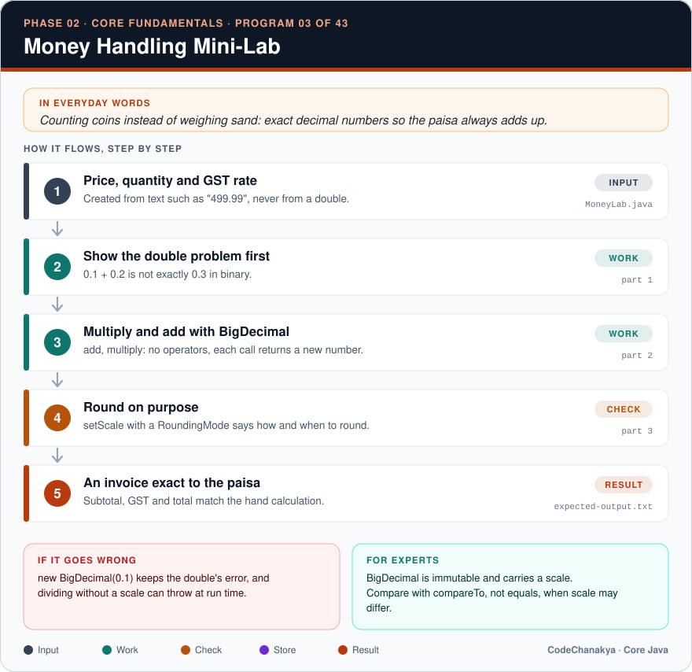

# 03 · Money Handling Mini-Lab

**Phase 02 · Core Fundamentals** &nbsp;|&nbsp; **Level:** Beginner &nbsp;|&nbsp; **Java:** 21 or newer

Concepts: why `double` is wrong for money, `BigDecimal`, scale, rounding, `equals` versus `compareTo`.

---

## The problem

A shop prints an invoice: 3 items at 499.99, plus 18% GST. The total must be exactly right to the paisa, every time, because customers and auditors will check it.

In Program 2 the salary slip kept rupees in `double`. That was fine for learning arithmetic, but it is a known source of real bugs. This lab shows the problem, then the fix.

<!--flow-->
## The flow at a glance

<p align="center"><a href="../../docs/flows/program-03.svg"></a></p>

| If you are | Read it like this |
|---|---|
| New to coding | Counting coins instead of weighing sand: exact decimal numbers so the paisa always adds up. |
| Learning | Follow the numbered cards from top to bottom. Open the file named on each card, run the program, and match its output to the last card. |
| Experienced | BigDecimal is immutable and carries a scale. Compare with compareTo, not equals, when scale may differ. |

<details>
<summary>Text version of the flow</summary>

1. **Price, quantity and GST rate** (input): Created from text such as "499.99", never from a double. (`MoneyLab.java`)
2. **Show the double problem first** (work): 0.1 + 0.2 is not exactly 0.3 in binary. (`part 1`)
3. **Multiply and add with BigDecimal** (work): add, multiply: no operators, each call returns a new number. (`part 2`)
4. **Round on purpose** (check): setScale with a RoundingMode says how and when to round. (`part 3`)
5. **An invoice exact to the paisa** (result): Subtotal, GST and total match the hand calculation. (`expected-output.txt`)

</details>
<!--/flow-->

## Read in this order

| Step | File | What to look for |
|---|---|---|
| 1 | [`src/main/java/MoneyLab.java`](src/main/java/MoneyLab.java) | Five short parts. Each answers a question the part before it raised. |
| 2 | [`expected-output.txt`](expected-output.txt) | Match each printed block to its part of the code. |

## Run it

```bash
./run.sh            # compile and run
./run.sh --check    # run, then compare with expected-output.txt
```

Expected output:

```text
PART 1: double
0.1 + 0.2        = 0.30000000000000004
0.1 + 0.2 == 0.3 : false
1.10 x 3         = 3.3000000000000003

PART 2: BigDecimal
0.1 + 0.2        = 0.3
From a String    : 0.1
From a double    : 0.1000000000000000055511151231257827021181583404541015625

PART 3: invoice
Subtotal         : 1499.97
GST before round : 269.9946
GST (18%)        : 269.99
Total            : 1769.96

PART 4: comparing
2.0 equals 2.00    : false
2.0 compareTo 2.00 : 0

PART 5: dividing
1000 / 3         = 333.33
Three shares     = 999.99
```

## Why `double` goes wrong

A `double` stores numbers in binary. Some decimal numbers, like `0.1`, cannot be written exactly in binary, in the same way that one third cannot be written exactly in decimal (`0.3333...`). The computer stores the closest number it can, and tiny errors appear:

```text
0.1 + 0.2   gives   0.30000000000000004
```

One bad cent on one invoice is annoying. Millions of transactions are a reconciliation problem.

## What to use instead

| | `double` | `BigDecimal` |
|---|---|---|
| Stores | the closest binary number | the exact decimal digits you gave it |
| Arithmetic | `a + b` | `a.add(b)` |
| Speed | very fast | slower, which does not matter for money |
| Right for | measurements, science, graphics | money |

`BigDecimal` is an *object*, so it has no `+` or `*` operator. You call methods instead: `add`, `subtract`, `multiply`, `divide`. Phase 3 explains objects properly. For now, read `a.add(b)` as "the result of adding b to a".

## Three rules for money

1. **Create a `BigDecimal` from a `String`.** `new BigDecimal("0.1")` is exactly 0.1. `new BigDecimal(0.1)` copies the double's error, as the output of Part 2 shows.
2. **Round once, when an amount becomes a real charge.** `setScale(2, RoundingMode.HALF_UP)` keeps 2 decimals and rounds halves upward. Do not round in the middle of a calculation.
3. **Say how to round when dividing.** `1000 / 3` never ends, so `divide` needs the number of places and a rounding mode, or it throws an exception.

## Scale: why 2.0 is not equal to 2.00

A `BigDecimal` remembers how many digits come after the point. That count is its *scale*. `equals` compares scale too, so `2.0` and `2.00` are different. `compareTo` compares only the value and returns `0` when they match. For money comparisons, use `compareTo`.

## New syntax in this program

| Piece | Meaning |
|---|---|
| `import java.math.BigDecimal;` | Tells Java which `BigDecimal` you mean. `java.math` is the *package* it lives in. Program 1 needed no import because `String` and `System` are always available. |
| `RoundingMode.HALF_UP` | A named choice of how to round. `HALF_UP` rounds `.5` upward, the usual school rule. |
| `BigDecimal.valueOf(quantity)` | Turns an `int` into a `BigDecimal` so it can be multiplied. |
| `// Part 2: ...` | Comments. Java ignores everything after `//` on that line. |

## Common mistakes

| Mistake | What you see |
|---|---|
| `first + second` on two `BigDecimal` values | `error: bad operand types for binary operator '+'` |
| `amount.divide(people)` with a non-terminating result | `ArithmeticException: Non-terminating decimal expansion` |
| `new BigDecimal(19.99)` | No error. The value carries a long tail of wrong digits. |

Try all three yourself in [`broken/`](broken/README.md).

## Practice

- [`exercises/`](exercises/README.md) has six tasks: three beginner, two intermediate, one challenge.
- [`solutions/MyInvoice.java`](solutions/MyInvoice.java) is one answer to all six. Try them first.

## Verification

Compiled and run with OpenJDK 21.0.13 on Linux. `./run.sh --check` passes. The solution file also compiles and runs. Not yet run on Java 25, Windows or macOS.

## Next

Program 4 applies this directly: an electricity bill whose amounts are `BigDecimal`, with the first real decisions in the course (`if` and `else`).
