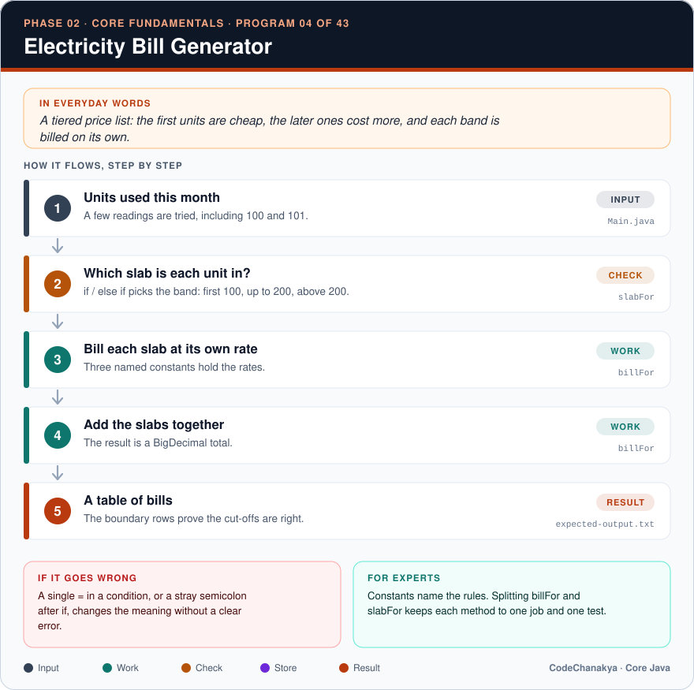

# 04 · Electricity Bill Generator

**Phase 02 · Core Fundamentals** &nbsp;|&nbsp; **Level:** Beginner &nbsp;|&nbsp; **Java:** 21 or newer

Concepts: `if` / `else if` / `else`, constants, methods, parameters and return values, two classes in one program.

---

## The problem

An electricity company charges different rates for different bands of consumption, called *slabs*:

| Units used | Rate per unit |
|---|---|
| First 100 | 3.50 |
| 101 to 200 | 5.25 |
| Above 200 | 7.80 |

Given the units a customer used in a month, work out the bill.

The trap is applying one rate to every unit. A customer who used 250 units pays the low rate on the first 100, not the high rate on all 250.

<!--flow-->
## The flow at a glance

<p align="center"><a href="../../docs/flows/program-04.svg"></a></p>

| If you are | Read it like this |
|---|---|
| New to coding | A tiered price list: the first units are cheap, the later ones cost more, and each band is billed on its own. |
| Learning | Follow the numbered cards from top to bottom. Open the file named on each card, run the program, and match its output to the last card. |
| Experienced | Constants name the rules. Splitting billFor and slabFor keeps each method to one job and one test. |

<details>
<summary>Text version of the flow</summary>

1. **Units used this month** (input): A few readings are tried, including 100 and 101. (`Main.java`)
2. **Which slab is each unit in?** (check): if / else if picks the band: first 100, up to 200, above 200. (`slabFor`)
3. **Bill each slab at its own rate** (work): Three named constants hold the rates. (`billFor`)
4. **Add the slabs together** (work): The result is a BigDecimal total. (`billFor`)
5. **A table of bills** (result): The boundary rows prove the cut-offs are right. (`expected-output.txt`)

</details>
<!--/flow-->

## Read in this order

| Step | File | What to look for |
|---|---|---|
| 1 | [`src/main/java/BillCalculator.java`](src/main/java/BillCalculator.java) | The three rate constants, then `billFor`, then `slabFor`. |
| 2 | [`src/main/java/Main.java`](src/main/java/Main.java) | Calls the calculator for a few readings and prints a table. |
| 3 | [`expected-output.txt`](expected-output.txt) | Check the boundary rows (100 and 101). |

## Run it

```bash
./run.sh            # compile and run
./run.sh --check    # run, then compare with expected-output.txt
```

Expected output:

```text
Units  Slab    Bill
0  slab 1  0.00
50  slab 1  175.00
100  slab 1  350.00
101  slab 2  355.25
150  slab 2  612.50
250  slab 3  1265.00
```

## How 250 units are billed

```text
250 units
 |-- above 200   :  50 units x 7.80  =  390.00
 |-- 101 to 200  : 100 units x 5.25  =  525.00
 `-- first 100   : 100 units x 3.50  =  350.00
                                       -------
                                       1265.00
```

`billFor` works from the top slab down. It bills the units above 200, then cuts `remaining` back to 200 and repeats for the next slab. Whatever is left at the end is billed at the lowest rate.

## Reading a method

```java
public static BigDecimal billFor(int units) {
```

| Piece | Meaning |
|---|---|
| `public` | Other classes, such as `Main`, may call it. |
| `static` | You call it on the class itself: `BillCalculator.billFor(250)`. No object needed yet. |
| `BigDecimal` | The *return type*: what the method hands back. |
| `billFor` | The method's name. A verb or a question works well. |
| `(int units)` | The *parameter*: the input the caller must supply. |
| `return total;` | Ends the method and hands the value back to the caller. |

## Reading a constant

```java
private static final BigDecimal RATE_UP_TO_100 = new BigDecimal("3.50");
```

| Word | Meaning |
|---|---|
| `private` | Only this class may use it. |
| `static` | There is one copy, shared by the class. |
| `final` | It can never be given a new value. |

Constants are written in `UPPER_SNAKE_CASE` by convention. They replace *magic numbers*: when the tariff changes, you edit one line instead of hunting through the code.

## Why two classes

`BillCalculator` only calculates. `Main` only prints. If you later show bills on a web page, you reuse the calculator without touching it. Keeping calculation apart from display is the first design habit worth building.

## Test the edges

`Main` prints 100 and 101 on purpose. Bugs hide at the boundary between two slabs: `<` versus `<=` changes which slab 100 belongs to. After any change, check these two rows first.

## Common mistakes

| Mistake | What you see |
|---|---|
| `if (units = 100)` (one equals sign) | `error: incompatible types: int cannot be converted to boolean` |
| A method with a return type but a path that returns nothing | `error: missing return statement` |
| `if (units > 200);` with a stray semicolon | No error. The block below runs every time. |
| Using one rate for all units | A bill that is too high. The output rows above show the right numbers. |

Try all three in [`broken/`](broken/README.md).

## Practice

- [`exercises/`](exercises/README.md) has six tasks: three beginner, two intermediate, one challenge.
- [`solutions/MyBill.java`](solutions/MyBill.java) is one answer to the exercises. Try them first.

## Verification

Compiled and run with OpenJDK 21.0.13 on Linux. `./run.sh --check` passes. The solution file also compiles and runs. Not yet run on Java 25, Windows or macOS.

## Next

Program 5 puts a menu around a loop: an ATM that keeps asking what you want until you exit.
