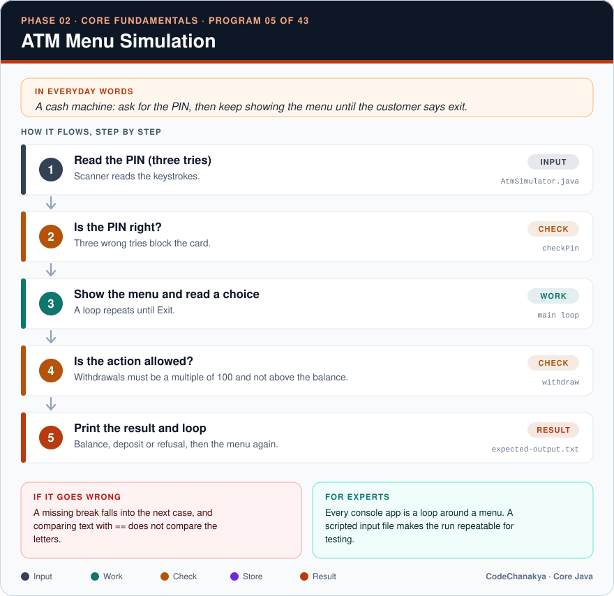

# 05 · ATM Menu Simulation

**Phase 02 · Core Fundamentals** &nbsp;|&nbsp; **Level:** Beginner to intermediate &nbsp;|&nbsp; **Java:** 21 or newer

Concepts: reading input with `Scanner`, `while` and `for` loops, `switch`, methods that return values, validating input, the remainder operator `%`.

---

## The problem

A customer inserts a card. The ATM asks for the PIN (three tries), then shows a menu again and again until the customer chooses Exit. The menu offers: check balance, deposit, withdraw. Withdrawals must be a multiple of 100 (the machine only holds 100-rupee notes) and cannot exceed the balance.

Every ATM program is a loop around a menu. Learn the shape once and you will recognise it in most console applications.

<!--flow-->
## The flow at a glance

<p align="center"><a href="../../docs/flows/program-05.svg"></a></p>

| If you are | Read it like this |
|---|---|
| New to coding | A cash machine: ask for the PIN, then keep showing the menu until the customer says exit. |
| Learning | Follow the numbered cards from top to bottom. Open the file named on each card, run the program, and match its output to the last card. |
| Experienced | Every console app is a loop around a menu. A scripted input file makes the run repeatable for testing. |

<details>
<summary>Text version of the flow</summary>

1. **Read the PIN (three tries)** (input): Scanner reads the keystrokes. (`AtmSimulator.java`)
2. **Is the PIN right?** (check): Three wrong tries block the card. (`checkPin`)
3. **Show the menu and read a choice** (work): A loop repeats until Exit. (`main loop`)
4. **Is the action allowed?** (check): Withdrawals must be a multiple of 100 and not above the balance. (`withdraw`)
5. **Print the result and loop** (result): Balance, deposit or refusal, then the menu again. (`expected-output.txt`)

</details>
<!--/flow-->

## Read in this order

| Step | File | What to look for |
|---|---|---|
| 1 | [`src/main/java/AtmSimulator.java`](src/main/java/AtmSimulator.java) | `main` first: it is only the menu loop. Then the small methods it calls. |
| 2 | [`sample-input.txt`](sample-input.txt) | The keystrokes used for the check run. |
| 3 | [`expected-output.txt`](expected-output.txt) | What those keystrokes produce. |

## Run it

```bash
./run.sh            # type the answers yourself
./run.sh --check    # feed sample-input.txt, then compare with expected-output.txt
```

When you run it yourself, type each answer and press Enter. The `--check` run does the same job automatically by feeding `sample-input.txt` to the program as if someone had typed it. Prompts are printed on their own line, so the interactive session and the check run read the same.

## What the sample input does

| Line typed | Where it goes | Result |
|---|---|---|
| `1111` | PIN, attempt 1 | Wrong PIN. 2 attempts left. |
| `1234` | PIN, attempt 2 | PIN accepted. |
| `1` | Menu | Balance: 10000 |
| `2`, `500` | Deposit | New balance 10500 |
| `3`, `250` | Withdraw | Rejected: not a multiple of 100 |
| `3`, `20000` | Withdraw | Rejected: insufficient funds |
| `3`, `2300` | Withdraw | Collect 2300, balance 8200 |
| `5` | Menu | Invalid choice |
| `abc` | Menu | Invalid choice, and the bad word is thrown away |
| `1` | Menu | Balance: 8200 |
| `4` | Menu | Exit |

## Expected output

```text
Enter PIN:
Wrong PIN. Attempts left: 2
Enter PIN:
PIN accepted.

1. Check balance
2. Deposit
3. Withdraw
4. Exit
Choose an option:
Balance: 10000

1. Check balance
2. Deposit
3. Withdraw
4. Exit
Choose an option:
Amount to deposit:
Deposited 500. New balance: 10500

1. Check balance
2. Deposit
3. Withdraw
4. Exit
Choose an option:
Amount to withdraw:
Amount must be a multiple of 100.

1. Check balance
2. Deposit
3. Withdraw
4. Exit
Choose an option:
Amount to withdraw:
Insufficient funds. Balance: 10500

1. Check balance
2. Deposit
3. Withdraw
4. Exit
Choose an option:
Amount to withdraw:
Please collect 2300. New balance: 8200

1. Check balance
2. Deposit
3. Withdraw
4. Exit
Choose an option:
Invalid choice. Enter a number from 1 to 4.

1. Check balance
2. Deposit
3. Withdraw
4. Exit
Choose an option:
Invalid choice. Enter a number from 1 to 4.

1. Check balance
2. Deposit
3. Withdraw
4. Exit
Choose an option:
Balance: 8200

1. Check balance
2. Deposit
3. Withdraw
4. Exit
Choose an option:
Thank you. Please take your card.
```

## The shape of the program

```text
main
 |-- pinAccepted()          for loop: up to 3 attempts
 `-- while (running)
      |-- printMenu()
      |-- readInt()
      `-- switch (choice)
           |-- 1  print the balance
           |-- 2  deposit()    returns the new balance
           |-- 3  withdraw()   returns the new balance
           |-- 4  running = false
           `-- default  "Invalid choice"
```

## New ideas

**`Scanner`** reads what the user types. `new Scanner(System.in)` connects it to the keyboard.

| Method | Meaning |
|---|---|
| `hasNext()` | Is there another word to read? |
| `hasNextInt()` | Is the next word a whole number? Look without consuming it. |
| `nextInt()` | Read that whole number. |
| `next()` | Read and discard the next word, whatever it is. |

**Loops.** Use `for` when you know how many times (three PIN attempts). Use `while` when you loop until something happens (until the customer exits).

**`switch`.** One value, many cases. The arrow form (`case 1 -> ...`) runs only the matching case. The older form (`case 1: ... break;`) falls through into the next case if you forget `break`. See `broken/FallThrough.java`.

**`%` (remainder).** `amount % 100` is what is left after dividing by 100. If it is not 0, the amount is not a multiple of 100.

**Methods that return the new balance.** `deposit` and `withdraw` do not change a shared variable. They receive the balance, and hand back the new one: `balance = deposit(scanner, balance);`. Then you can see every place the balance changes just by reading `main`. A shared `static` variable would hide that.

## Design decisions worth knowing

- **Why `readInt` returns -1 for bad input.** The program must survive someone typing `abc`. `-1` can never be a valid PIN, menu choice or amount, so it works as a signal. Phase 4 replaces this trick with exceptions.
- **Why `scanner.next()` throws the bad word away.** If it stayed in the input, `hasNextInt()` would be false forever and the program would repeat the same error without end. See `broken/ForgottenNext.java`.
- **Why the PIN is a constant.** A real ATM never stores a PIN in code. It is here so the program can run on its own. Whole-rupee `int` balances are also a teaching shortcut. Program 3 explains real money handling.

## Common mistakes

| Mistake | What you see |
|---|---|
| Forgetting `break` in an old-style `switch` | Several cases run, one after the other |
| Not reading the bad word with `next()` | The loop repeats the same error forever |
| Comparing text with `==` | No error, but the comparison is usually `false` |
| Reading a number when the next word is text | `InputMismatchException` (so check with `hasNextInt` first) |

Try three of these in [`broken/`](broken/README.md).

## Practice

- [`exercises/`](exercises/README.md) has six tasks: three beginner, two intermediate, one challenge.
- [`solutions/MyAtm.java`](solutions/MyAtm.java) is one answer to the exercises. Try them first.

## Verification

Compiled and run with OpenJDK 21.0.13 on Linux. `./run.sh --check` passes. The solution file also compiles and runs. Not yet run on Java 25, Windows or macOS.

## Next

Program 6 stores many values at once in arrays and reports on a whole class of students.
