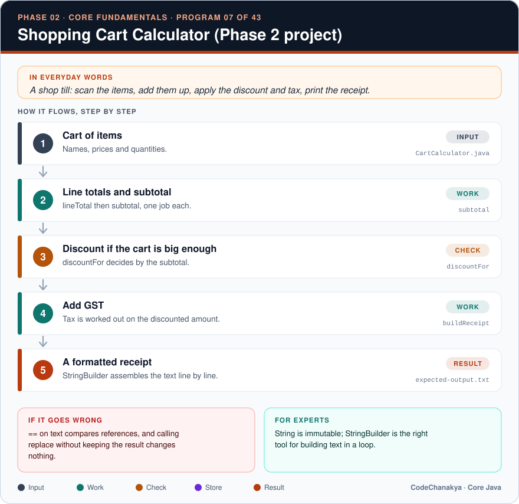

# 07 · Shopping Cart Calculator (Phase 2 project)

**Phase 02 · Core Fundamentals** &nbsp;|&nbsp; **Level:** Intermediate &nbsp;|&nbsp; **Java:** 21 or newer

Concepts: Strings, `StringBuilder`, `String.format`, methods, arrays, `BigDecimal`, decisions, loops, all together.

---

## The business problem

A small stationery shop wants a receipt. Each cart has several items with a quantity and a unit price. The customer may type a coupon code. The receipt must show every line, a subtotal, the discount, 18% GST and the final total, with the columns lined up.

<!--flow-->
## The flow at a glance

<p align="center"><a href="../../docs/flows/program-07.svg"></a></p>

| If you are | Read it like this |
|---|---|
| New to coding | A shop till: scan the items, add them up, apply the discount and tax, print the receipt. |
| Learning | Follow the numbered cards from top to bottom. Open the file named on each card, run the program, and match its output to the last card. |
| Experienced | String is immutable; StringBuilder is the right tool for building text in a loop. |

<details>
<summary>Text version of the flow</summary>

1. **Cart of items** (input): Names, prices and quantities. (`CartCalculator.java`)
2. **Line totals and subtotal** (work): lineTotal then subtotal, one job each. (`subtotal`)
3. **Discount if the cart is big enough** (check): discountFor decides by the subtotal. (`discountFor`)
4. **Add GST** (work): Tax is worked out on the discounted amount. (`buildReceipt`)
5. **A formatted receipt** (result): StringBuilder assembles the text line by line. (`expected-output.txt`)

</details>
<!--/flow-->

## Requirements

**Functional**
1. Price each line (quantity times unit price).
2. Add up the subtotal.
3. Apply the coupon `SAVE10` for 10% off, whatever the capitalisation and spaces the customer typed.
4. Charge 18% GST on the amount after the discount.
5. Print an aligned receipt.

**Non-functional**
- All money is `BigDecimal`, rounded to 2 places once per charge, with `HALF_UP`.
- Output is identical on every computer (no locale surprises).
- Each method does one job, so each rule can be changed in one place.

## Read in this order

| Step | File | What to look for |
|---|---|---|
| 1 | [`src/main/java/CartCalculator.java`](src/main/java/CartCalculator.java) | `main` sets up the cart. Then `buildReceipt`, which calls everything else. |
| 2 | the helper methods | `lineTotal`, `subtotal`, `discountFor`: small, with one job each. |
| 3 | [`expected-output.txt`](expected-output.txt) | Check the discount and GST by hand. |

## Run it

```bash
./run.sh            # compile and run
./run.sh --check    # run, then compare with expected-output.txt
```

Expected output:

```text
LAKEVIEW STATIONERS
==============================================
USB-C Cable        2 x    349.00 =    698.00
Wireless Mouse     1 x    799.50 =    799.50
Notebook A5        5 x     85.00 =    425.00
Desk Lamp          1 x   1249.00 =   1249.00
----------------------------------------------
Subtotal                               3171.50
Discount (SAVE10)                      -317.15
GST 18%                                 513.78
==============================================
TOTAL                                  3368.13
```

## How the pieces fit

```text
main
 `-- buildReceipt(names, quantities, prices, coupon)
      |-- subtotal()       loops over the arrays, calls lineTotal() for each row
      |     `-- lineTotal()
      |-- discountFor()    cleans the coupon text, then decides
      |-- GST              rounded to 2 places
      `-- StringBuilder    collects every line, then toString() once
```

The arrays are matched by position, as in Program 6. It works for now, and Phase 3 replaces them with a `CartItem` class.

## Strings: what you need to know

| Idea | Example | Notes |
|---|---|---|
| Strings never change | `coupon.trim();` on its own does nothing | Every String method returns a **new** String. Keep it: `coupon = coupon.trim();` |
| Clean before comparing | `coupon.trim().toUpperCase()` | Removes stray spaces and capitals before the check |
| Compare with `equals` | `cleaned.equals("SAVE10")` | `==` asks whether two names point to the same object, not whether the text matches |
| Repeat | `"=".repeat(46)` | A neat way to draw a line |
| Format | `String.format("%-16s %3d", name, qty)` | `%-16s` is text padded on the right to 16 characters, `%3d` is a number padded to 3 |

## Why `StringBuilder`

Joining Strings with `+` inside a loop makes a new String every time. A `StringBuilder` is a buffer you append to, then convert with `toString()` once at the end. For a receipt of four lines it makes no visible difference. For a report of ten thousand lines it does.

## Design decisions

- **`discountFor` returns a zero with two decimal places** for an unknown coupon, so the receipt prints `0.00` and not `0`.
- **The coupon is cleaned in one place.** The caller does not need to know about spaces or capitals.
- **The rates are constants** (`GST_RATE`, `COUPON_RATE`), so a rule change is a one-line edit.
- **`buildReceipt` returns text instead of printing it.** The caller decides what to do with it: print it, save it, or test it. That makes it easy to test, which Program 9 starts doing.

## Common mistakes

| Mistake | What you see |
|---|---|
| `stored == typed` for two Strings | `false`, even when the text matches |
| `coupon.trim();` and ignoring the result | The coupon is unchanged |
| `String s = someStringBuilder;` | `error: incompatible types: StringBuilder cannot be converted to String` |
| Rounding the GST early, then again | A total that is a paisa out |

Try three of these in [`broken/`](broken/README.md).

## Practice

- [`exercises/`](exercises/README.md) has six tasks: three beginner, two intermediate, one challenge.
- [`solutions/MyCart.java`](solutions/MyCart.java) is one answer to the exercises. Try them first.

## Test cases to run by hand

| Cart | Coupon | Expected |
|---|---|---|
| the cart in `main` | `"  save10 "` | the receipt above |
| the same cart | `"SAVE20"` | discount line shows `0.00` |
| an empty cart | `"SAVE10"` | everything `0.00` |

## Verification

Compiled and run with OpenJDK 21.0.13 on Linux. `./run.sh --check` passes. The solution file also compiles and runs. Not yet run on Java 25, Windows or macOS.

## Git commit suggestions

```text
Add Program 7: shopping cart calculator
Add receipt formatting with StringBuilder
Add coupon cleaning and discount rule
```

## Ideas to extend it

Read the cart from the keyboard with `Scanner`. Add a second coupon. Print the date. In Phase 3 you will turn the three arrays into a `CartItem` class, and in Phase 6 you will save the receipt to a file.

## Next

Phase 3 starts object-oriented programming. The first program, the Banking Application, gives each account its own data and behaviour instead of loose arrays.
