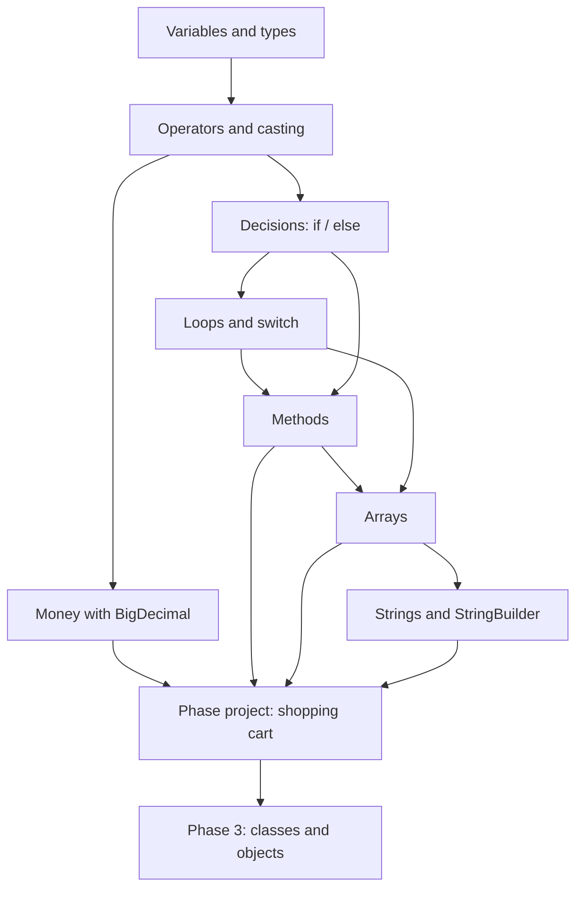

# Phase 02 · Core Fundamentals

Six programs that take you from "a program that prints" to "a program that decides, repeats and stores many values".

| No. | Program | New ideas |
|---|---|---|
| 02 | [Employee Salary Calculator](02-employee-salary-calculator) | variables, `int` and `double`, operators, casting |
| 03 | [Money Handling Mini-Lab](03-money-handling-mini-lab) | `BigDecimal`, rounding, `equals` versus `compareTo` |
| 04 | [Electricity Bill Generator](04-electricity-bill-generator) | `if` / `else`, constants, methods, two classes |
| 05 | [ATM Menu Simulation](05-atm-menu-simulation) | `Scanner`, loops, `switch`, validation |
| 06 | [Student Marks Analyzer](06-student-marks-analyzer) | arrays, two-dimensional arrays, overloading |
| 07 | [Shopping Cart Calculator](07-shopping-cart-calculator) | Strings, `StringBuilder`, everything combined (phase project) |

## How the concepts build on each other

Real programs use these ideas together, not one at a time. The shopping cart in Program 7 uses every box in the diagram.

## Mastery checkpoint

Before you move to Phase 3, build this without looking at the solutions.

**Fuel Station Receipt.** A fuel station sells petrol at 104.50 per litre and diesel at 92.30 per litre.

1. Keep three fills in arrays: fuel type, litres and customer name.
2. Price each fill with `BigDecimal`, and give a 2% discount on fills of 40 litres or more.
3. Print an aligned receipt with a total, built with a `StringBuilder`.
4. Put each rule in its own method. No method longer than about 15 lines.
5. Run it with an empty list of fills and with a fill of exactly 40 litres.

You are ready for Phase 3 when you can explain each decision you made and every number matches a hand calculation.

## Levels

| Level | You can... |
|---|---|
| 1 Understood | explain a concept in your own words |
| 2 Applied | write a program that uses it |
| 3 Connected | combine it with earlier concepts, as in Program 7 |
| 4 Mastered | solve the checkpoint above alone and test it |
