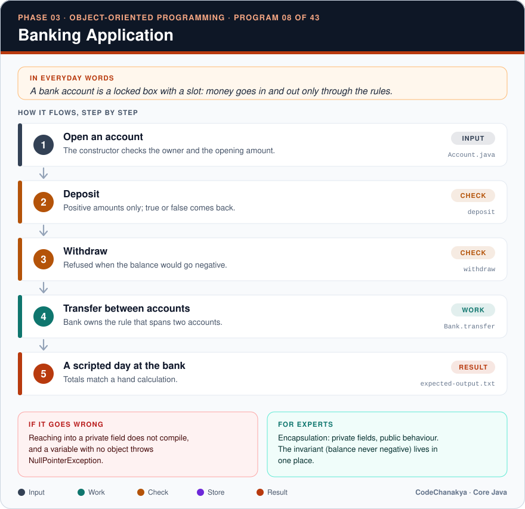
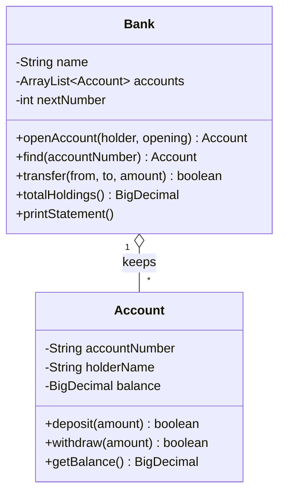

# 08 · Banking Application

**Phase 03 · Object-Oriented Programming** &nbsp;|&nbsp; **Level:** Intermediate &nbsp;|&nbsp; **Java:** 21 or newer

Concepts: classes and objects, fields, constructors, `this`, encapsulation (`private` fields and public methods), `toString`, `ArrayList` as a preview, packages.

---

## The problem

A small bank needs to keep accounts: who owns each one, how much is in it, and the rules for putting money in, taking money out and moving it between accounts.

In Phase 2 every value lived in its own variable or array. That breaks down when a thing has several facts that belong together (a number, an owner, a balance) and rules about how they may change. A **class** bundles the facts and the rules into one unit; an **object** is one real account made from it.

<!--flow-->
## The flow at a glance

<p align="center"><a href="../../docs/flows/program-08.svg"></a></p>

| If you are | Read it like this |
|---|---|
| New to coding | A bank account is a locked box with a slot: money goes in and out only through the rules. |
| Learning | Follow the numbered cards from top to bottom. Open the file named on each card, run the program, and match its output to the last card. |
| Experienced | Encapsulation: private fields, public behaviour. The invariant (balance never negative) lives in one place. |

<details>
<summary>Text version of the flow</summary>

1. **Open an account** (input): The constructor checks the owner and the opening amount. (`Account.java`)
2. **Deposit** (check): Positive amounts only; true or false comes back. (`deposit`)
3. **Withdraw** (check): Refused when the balance would go negative. (`withdraw`)
4. **Transfer between accounts** (work): Bank owns the rule that spans two accounts. (`Bank.transfer`)
5. **A scripted day at the bank** (result): Totals match a hand calculation. (`expected-output.txt`)

</details>
<!--/flow-->

## Requirements

**Functional**
1. Open an account with a holder name and an opening balance. Each gets a number such as `ACC-1001`.
2. Deposit and withdraw. Refuse zero or negative amounts. Refuse a withdrawal larger than the balance.
3. Transfer between two accounts, so that no money is lost or created if it fails.
4. Print a statement and the bank's total holdings.

**Non-functional**
- Money is `BigDecimal` with two decimal places.
- Nobody outside `Account` can change a balance directly.
- A refused operation changes nothing.

## Read in this order

| Step | File | What to look for |
|---|---|---|
| 1 | [`Account.java`](src/main/java/com/codechanakya/bank/Account.java) | Three private fields, a constructor that checks its input, `deposit` and `withdraw` that return `true` or `false`. |
| 2 | [`Bank.java`](src/main/java/com/codechanakya/bank/Bank.java) | Holds many accounts, hands out numbers, and owns the rule that spans two accounts: `transfer`. |
| 3 | [`Main.java`](src/main/java/com/codechanakya/bank/Main.java) | A scripted day at the bank. Read it as a user of the other two classes. |
| 4 | [`expected-output.txt`](expected-output.txt) | Check the totals by hand. |

## Run it

```bash
./run.sh            # compile and run
./run.sh --check    # run, then compare with expected-output.txt
```

Expected output:

```text
Opened 3 accounts
--- Chanakya Savings Bank ---
ACC-1001  Asha Menon          5000.00
ACC-1002  Rahul Verma         1200.50
ACC-1003  Meera Iyer             0.00
Total holdings: 6200.50

Deposit 750.25 to Asha: done
Deposit -20 to Rahul: refused
Withdraw 300 from Rahul: done
Withdraw 5000 from Meera: refused

Transfer 1000 Asha to Meera: done
Transfer 9999 Rahul to Asha: refused
Transfer to unknown ACC-9999: refused

--- Chanakya Savings Bank ---
ACC-1001  Asha Menon          4750.25
ACC-1002  Rahul Verma          900.50
ACC-1003  Meera Iyer          1000.00
Total holdings: 6650.75

Rejected: Account holder name is required
```

## How the classes fit



A minus sign means `private`, a plus sign means `public`. The diamond means a bank *has* accounts.

## Classes, objects and `new`

A class is the blueprint; an object is one thing built from it.

```java
Account asha  = bank.openAccount("Asha Menon", money("5000.00"));
Account rahul = bank.openAccount("Rahul Verma", money("1200.50"));
```

`asha` and `rahul` are two objects of the same class. Each has its own `balance`. Depositing into one does not touch the other.

## Encapsulation: why the fields are private

```java
private BigDecimal balance;          // nobody outside Account can touch this
public boolean deposit(BigDecimal amount) { ... }   // the only way in
```

If `balance` were public, any line anywhere could write `account.balance = 1000000`. With it private, the only way in is a method that checks the amount first. When a rule changes (say, a daily limit), you change one method and every caller follows it. That is the practical value of encapsulation: the rule has one home.

## Constructors and `this`

```java
public Account(String accountNumber, String holderName, BigDecimal openingBalance) {
    ...
    this.accountNumber = accountNumber;
}
```

The constructor runs once, when you write `new Account(...)`. Its job is to leave the object in a valid state or refuse to create it. `this.accountNumber` is the field; `accountNumber` is the parameter. Without `this`, Java would assign the parameter to itself and the field would stay empty. Try it in [`broken/ForgottenThis.java`](broken/README.md).

## Why `deposit` returns a boolean

Refusal is a normal event for a bank, not a disaster. The method says "done" or "refused" and the caller decides what to do. The constructor is different: an account that cannot exist at all (blank name) stops with an exception. Phase 4 covers exceptions in depth.

## The transfer rule

```java
if (!from.withdraw(amount)) { return false; }   // stop before anything changed
return to.deposit(amount);                      // cannot fail after the line above
```

Take the money out first. If that works, put it in. If the withdrawal fails, nothing has moved. Doing it in the other order could create money out of nothing.

## Packages and folders

The first line of each file says `package com.codechanakya.bank;`. The file must then sit in the matching folder, `com/codechanakya/bank/`. Packages group related classes and keep names from clashing; the reverse-domain style (`com.yourcompany.project`) is the convention. Replace `codechanakya` with your own name when you build your own project.

Running a packaged class needs its full name:

```bash
java -cp out com.codechanakya.bank.Main
```

`run.sh` does this for you. Phases 1 and 2 used the default package; from here on every program uses a real one.

## Common mistakes

| Mistake | What you see |
|---|---|
| Reading `account.balance` from another class | `error: balance has private access in Account` |
| Forgetting `this.` in a constructor | No error. The fields stay `null`. |
| Using a variable that was never given an object | `NullPointerException` |
| Putting a file in the wrong folder for its package | Compiles, then `Could not find or load main class` |

Try the first three in [`broken/`](broken/README.md).

## Practice

- [`exercises/`](exercises/README.md): six tasks, three beginner, two intermediate, one challenge.
- [`solutions/`](solutions/README.md): one answer to each. Try them first.

## Verification

Compiled and run with OpenJDK 21.0.13 on Linux. `./run.sh --check` passes. The solution file also compiles and runs. Not yet run on Java 25, Windows or macOS.

## Next

Program 9 tests this `Account` class with JUnit, so you stop checking results by eye.
