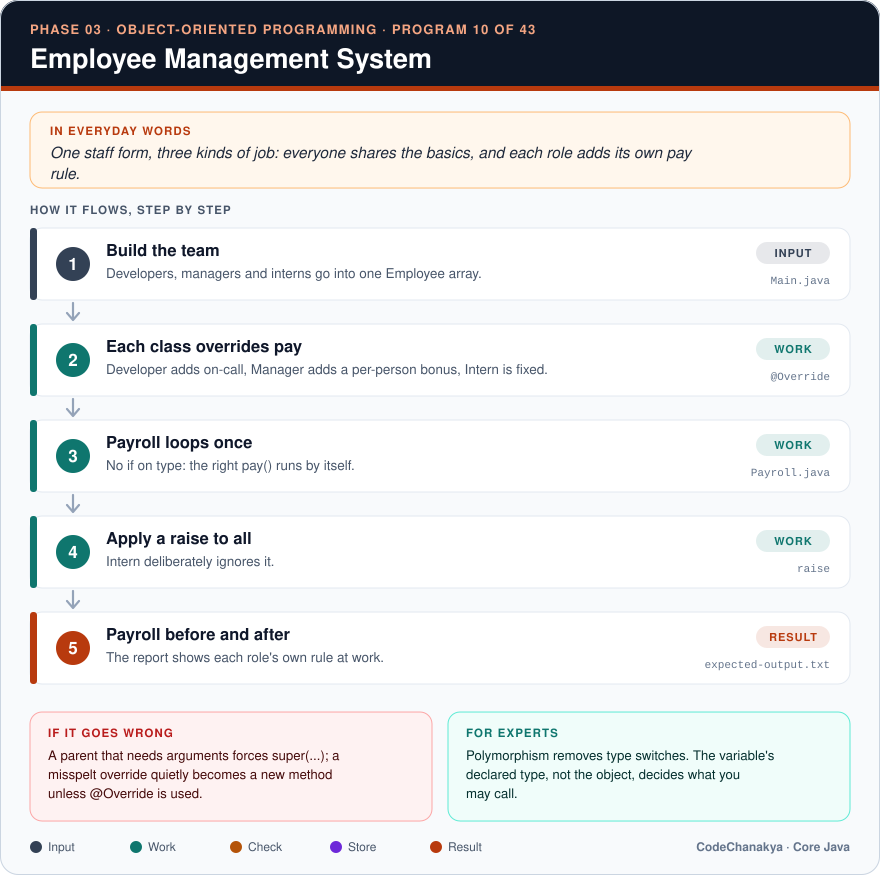
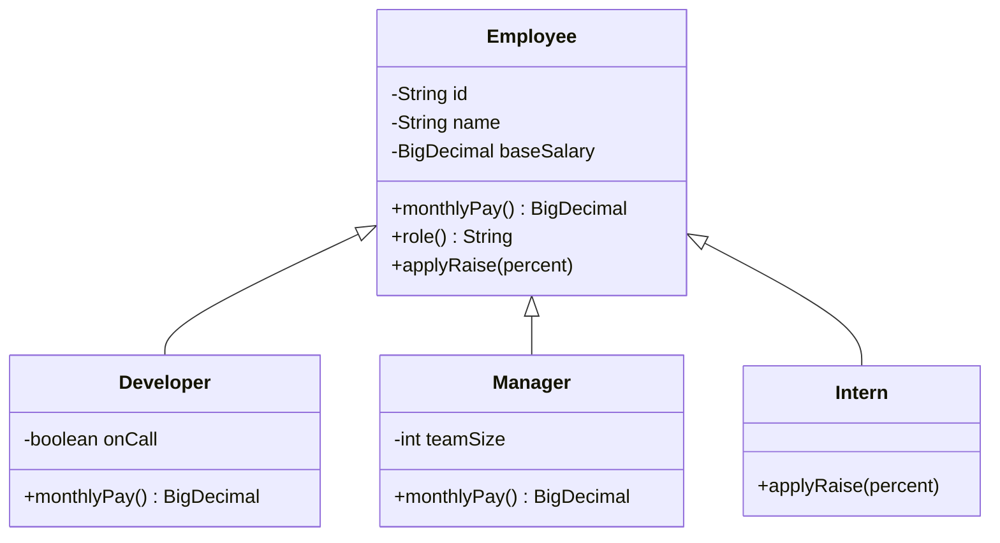

# 10 · Employee Management System

**Phase 03 · Object-Oriented Programming** &nbsp;|&nbsp; **Level:** Intermediate &nbsp;|&nbsp; **Java:** 21 or newer

Concepts: inheritance (`extends`), `super`, method overriding, `@Override`, polymorphism, `instanceof` with a pattern variable.

---

## The problem

A company pays developers, managers and interns, and each is paid by a different rule. A developer gets an on-call allowance, a manager gets a bonus for every person in the team, an intern gets a fixed stipend. HR wants one payroll report that covers all of them, and a raise that applies to everyone, except where the rule says otherwise.

The naive answer is one `Employee` class with a `type` field and a chain of `if (type.equals("MANAGER"))` in every method. Every new kind of employee means editing every one of those chains. Inheritance gives each kind its own class instead.

<!--flow-->
## The flow at a glance

<p align="center"><a href="../../docs/flows/program-10.svg"></a></p>

| If you are | Read it like this |
|---|---|
| New to coding | One staff form, three kinds of job: everyone shares the basics, and each role adds its own pay rule. |
| Learning | Follow the numbered cards from top to bottom. Open the file named on each card, run the program, and match its output to the last card. |
| Experienced | Polymorphism removes type switches. The variable's declared type, not the object, decides what you may call. |

<details>
<summary>Text version of the flow</summary>

1. **Build the team** (input): Developers, managers and interns go into one Employee array. (`Main.java`)
2. **Each class overrides pay** (work): Developer adds on-call, Manager adds a per-person bonus, Intern is fixed. (`@Override`)
3. **Payroll loops once** (work): No if on type: the right pay() runs by itself. (`Payroll.java`)
4. **Apply a raise to all** (work): Intern deliberately ignores it. (`raise`)
5. **Payroll before and after** (result): The report shows each role's own rule at work. (`expected-output.txt`)

</details>
<!--/flow-->

## Requirements

**Functional**
1. Every employee has an id, a name and a base salary.
2. Monthly pay: developer = base + 4000 when on call; manager = base + 1500 per report; intern = stipend.
3. A percentage raise applies to the base salary of everyone except interns.
4. One report lists everyone, the total, and the highest paid.

**Non-functional**
- `Payroll` must not need to change when a new kind of employee is added.
- Money is `BigDecimal`.

## Read in this order

| Step | File | What to look for |
|---|---|---|
| 1 | [`Employee.java`](src/main/java/com/codechanakya/employees/Employee.java) | The general case: pay is the base salary, role is "Employee". |
| 2 | [`Developer.java`](src/main/java/com/codechanakya/employees/Developer.java) and [`Manager.java`](src/main/java/com/codechanakya/employees/Manager.java) | `extends`, `super(...)`, and `@Override`. |
| 3 | [`Intern.java`](src/main/java/com/codechanakya/employees/Intern.java) | An override that deliberately does nothing. |
| 4 | [`Payroll.java`](src/main/java/com/codechanakya/employees/Payroll.java) | An `Employee[]` that holds all the kinds. No `if` on type anywhere. |
| 5 | [`Main.java`](src/main/java/com/codechanakya/employees/Main.java) | The scenario, plus one `instanceof`. |

## Run it

```bash
./run.sh            # compile and run
./run.sh --check    # run, then compare with expected-output.txt
```

Expected output:

```text
=== Payroll before the raise ===
ID     Name          Role       Monthly pay
E101   Asha Menon    Developer     74000.00
E102   Dev Patel     Developer     65000.00
E201   Rahul Verma   Manager       99000.00
E301   Kiran Rao     Intern        15000.00
Total payroll: 253000.00
Highest paid : Rahul Verma

Applying a 10 percent raise to everyone...

=== Payroll after the raise ===
ID     Name          Role       Monthly pay
E101   Asha Menon    Developer     81000.00
E102   Dev Patel     Developer     71500.00
E201   Rahul Verma   Manager      108000.00
E301   Kiran Rao     Intern        15000.00
Total payroll: 275500.00
Highest paid : Rahul Verma

Rahul Verma manages a team of 6
```

## The class tree



The open arrow reads "is a": a `Developer` **is an** `Employee`. Use inheritance only when that sentence is true.

## What a subclass inherits

`Developer extends Employee` means a `Developer` already has the id, the name, the base salary, `getName()`, `applyRaise()` and everything else in `Employee`. It writes only what is different. `Intern` is a handful of lines because almost everything is inherited.

## `super`: two uses

```java
super(id, name, baseSalary);          // in a constructor: build the parent part first
BigDecimal pay = super.monthlyPay();  // in a method: reuse the parent's version
```

The first is required: a child object contains a parent object, and the parent's constructor must run first. The second avoids repeating the base rule. If the base rule changes, every subclass follows.

## Overriding

A subclass replaces a parent method by declaring one with the same name and parameters. `@Override` asks the compiler to check that such a method exists. Without it, a typo such as `monthlypay()` quietly creates a new unrelated method, and the parent's version keeps running. See [`broken/OverrideTypo.java`](broken/README.md).

## Polymorphism, in one example

```java
Employee[] staff = { new Developer(...), new Manager(...), new Intern(...) };
for (Employee employee : staff) {
    employee.monthlyPay();    // which version runs?
}
```

The variable's type is `Employee`. The objects' real types differ. Java chooses the version of `monthlyPay()` from the **real** type, at run time. `Payroll` therefore works unchanged for a new kind of employee. This is what "program to the parent type" buys you. The solutions add a `SalesExecutive` and a `Contractor` without touching `Payroll`'s logic.

Look at `Employee.toString()`: it calls `role()` and `monthlyPay()`, so it prints the right role and pay for every subclass without being overridden.

## The variable's type limits what you can call

```java
Employee boss = new Manager(...);
boss.getTeamSize();      // does not compile
```

The compiler only knows `boss` is an `Employee`. To use a manager-only method, check first:

```java
if (employee instanceof Manager manager) {
    manager.getTeamSize();
}
```

This also declares `manager` in the same step, with no cast. If you find yourself writing many of these, the behaviour probably belongs in an overridden method instead.

## Common mistakes

| Mistake | What you see |
|---|---|
| A child constructor without `super(...)` when the parent needs arguments | `constructor Employee in class Employee cannot be applied to given types` |
| A typo in an overridden method name | With `@Override`: a compile error. Without it: no error and the wrong rule runs. |
| Calling a subclass-only method through a parent variable | `cannot find symbol` |
| Using `extends` for "has a" instead of "is a" | Compiles, but the design fights you. Program 12 shows the alternative. |

Try three of these in [`broken/`](broken/README.md).

## Practice

- [`exercises/`](exercises/README.md): six tasks, three beginner, two intermediate, one challenge.
- [`solutions/`](solutions/README.md): one answer to each.

## Verification

Compiled and run with OpenJDK 21.0.13 on Linux. `./run.sh --check` passes. The solution file also compiles and runs. Not yet run on Java 25, Windows or macOS.

## Next

Program 11 goes one step further: types that are so general they cannot exist on their own (abstract classes), and abilities shared across unrelated classes (interfaces).
