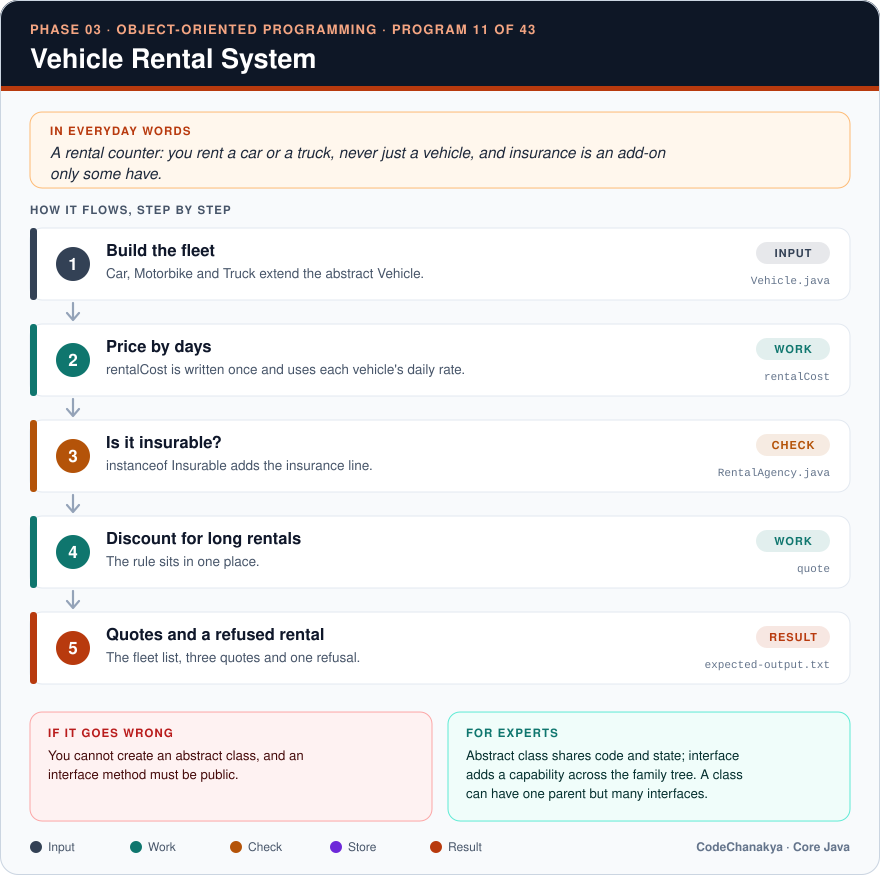
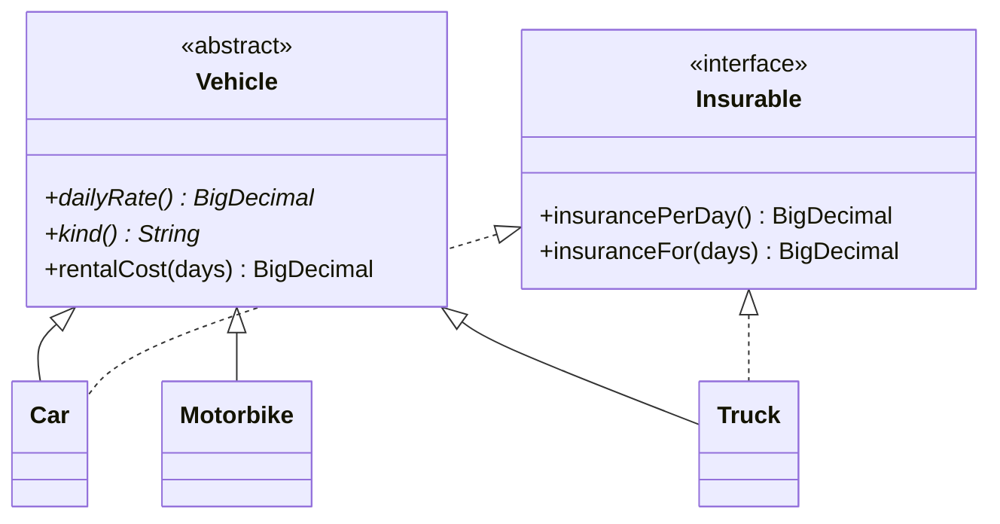

# 11 · Vehicle Rental System

**Phase 03 · Object-Oriented Programming** &nbsp;|&nbsp; **Level:** Intermediate &nbsp;|&nbsp; **Java:** 21 or newer

Concepts: abstract classes and methods, interfaces, default methods, `implements`, programming to an interface, `protected`.

---

## The problem

A rental agency has cars, motorbikes and trucks. Each is priced differently, and each customer wants a quote: rent for N days, plus insurance where it is offered, with a discount for long rentals.

Two ideas from Program 10 are not enough here:

- There is no such thing as "just a vehicle". You rent a *car* or a *truck*. The parent class should exist to share code, not to be created.
- Insurance is not a property of every vehicle, and it is not tied to one family of vehicles. A car and a truck both have it; a bike does not. A class can have only one parent, so this needs something else.

<!--flow-->
## The flow at a glance

<p align="center"><a href="../../docs/flows/program-11.svg"></a></p>

| If you are | Read it like this |
|---|---|
| New to coding | A rental counter: you rent a car or a truck, never just a vehicle, and insurance is an add-on only some have. |
| Learning | Follow the numbered cards from top to bottom. Open the file named on each card, run the program, and match its output to the last card. |
| Experienced | Abstract class shares code and state; interface adds a capability across the family tree. A class can have one parent but many interfaces. |

<details>
<summary>Text version of the flow</summary>

1. **Build the fleet** (input): Car, Motorbike and Truck extend the abstract Vehicle. (`Vehicle.java`)
2. **Price by days** (work): rentalCost is written once and uses each vehicle's daily rate. (`rentalCost`)
3. **Is it insurable?** (check): instanceof Insurable adds the insurance line. (`RentalAgency.java`)
4. **Discount for long rentals** (work): The rule sits in one place. (`quote`)
5. **Quotes and a refused rental** (result): The fleet list, three quotes and one refusal. (`expected-output.txt`)

</details>
<!--/flow-->

## Requirements

**Functional**
1. Daily rates: car 2500 (3000 for seven-seaters), bike 800, truck 3000 plus 500 per tonne.
2. Rentals of 7 days or more get 10 percent off the rent. Insurance is not discounted.
3. Insurance per day: car 300, truck 700, bikes none.
4. A quote lists rent, insurance and the total for any vehicle.

**Non-functional**
- Adding a new kind of vehicle must not change `RentalAgency`.
- A rental of less than one day is refused.

## Read in this order

| Step | File | What to look for |
|---|---|---|
| 1 | [`Vehicle.java`](src/main/java/com/codechanakya/rental/Vehicle.java) | `abstract class`, two abstract methods, and `rentalCost`, which is written once for all. |
| 2 | [`Insurable.java`](src/main/java/com/codechanakya/rental/Insurable.java) | An interface with one abstract method and one `default` method. |
| 3 | [`Car.java`](src/main/java/com/codechanakya/rental/Car.java), [`Motorbike.java`](src/main/java/com/codechanakya/rental/Motorbike.java), [`Truck.java`](src/main/java/com/codechanakya/rental/Truck.java) | `extends Vehicle`, and `implements Insurable` for two of them. |
| 4 | [`RentalAgency.java`](src/main/java/com/codechanakya/rental/RentalAgency.java) | A `List<Vehicle>` and one `instanceof Insurable`. |
| 5 | [`Main.java`](src/main/java/com/codechanakya/rental/Main.java) | Fleet, quotes and a refused rental. |

## Run it

```bash
./run.sh            # compile and run
./run.sh --check    # run, then compare with expected-output.txt
```

Expected output:

```text
--- Fleet ---
MH12AB1001 Car      Hyundai i20                  2500.00 per day
MH12AB1002 Car      Toyota Innova                3000.00 per day
MH12CD2001 Bike     Royal Enfield Classic 350     800.00 per day
MH12EF3001 Truck    Tata 407                     4500.00 per day

--- Quotes ---
Car      Hyundai i20                 3 days  rent   7500.00  insurance   900.00  total    8400.00
Car      Toyota Innova               7 days  rent  18900.00  insurance  2100.00  total   21000.00
Bike     Royal Enfield Classic 350   2 days  rent   1600.00  insurance        -  total    1600.00
Bike     Royal Enfield Classic 350  10 days  rent   7200.00  insurance        -  total    7200.00
Truck    Tata 407                    2 days  rent   9000.00  insurance  1400.00  total   10400.00

Rejected: A rental must be at least 1 day
```

## The class tree



A solid arrow is `extends`; a dotted arrow is `implements`. An asterisk marks an abstract method.

## Abstract class: a template with holes

```java
public abstract class Vehicle {
    public abstract BigDecimal dailyRate();        // a hole: each subclass fills it
    public BigDecimal rentalCost(int days) { ... } // finished code, shared by all
}
```

- You cannot write `new Vehicle()`. The compiler stops you, because it is incomplete by design.
- A subclass must implement every abstract method, or be abstract itself.
- `rentalCost` calls `dailyRate()`, which is not defined here. When you call it on a `Truck`, the truck's version runs. The shared rule (minimum one day, long-rental discount) is written once and applies to every vehicle.

## Interface: an ability, not a family

```java
public interface Insurable {
    BigDecimal insurancePerDay();
    default BigDecimal insuranceFor(int days) { ... }
}
```

An interface lists what a class can do, without saying how. A class can implement any number of interfaces but extend only one class, which is why abilities (`Insurable`, later `Comparable`, `Runnable`) are interfaces. A `default` method gives implementers some behaviour for free.

Interface methods are always `public`, so the implementing method must say `public` too. Forgetting it is a classic error, shown in [`broken/WeakerAccess.java`](broken/README.md).

## Abstract class or interface?

| | Abstract class | Interface |
|---|---|---|
| Relationship | "is a" (a Car is a Vehicle) | "can do" (a Car can be insured) |
| Fields and constructors | Yes | No instance fields |
| How many can a class use | One | Any number |
| Use it for | Sharing code between close relatives | Sharing a promise between unrelated classes |

## Asking about an ability

```java
if (vehicle instanceof Insurable insurable) {
    total = total.add(insurable.insuranceFor(days));
}
```

`RentalAgency` does not ask "are you a Truck?", which would break the day a new truck-like class appears. It asks "can you be insured?" and uses the answer. The bike is left out of it without any special code.

## `protected`

The `Vehicle` constructor is `protected`: only subclasses can call it. Since the class is abstract, nobody else could anyway; it states the intent. `protected` fields exist too, but prefer `private` fields with getters, as in Program 8.

## Common mistakes

| Mistake | What you see |
|---|---|
| `new Vehicle()` | `Vehicle is abstract; cannot be instantiated` |
| Forgetting to implement an abstract method | `... is not abstract and does not override abstract method ...` |
| Implementing an interface method without `public` | `attempting to assign weaker access privileges; was public` |
| Putting insurance in `Vehicle` and returning zero for bikes | Compiles, but every vehicle now lies about something |

Try the first three in [`broken/`](broken/README.md).

## Practice

- [`exercises/`](exercises/README.md): six tasks, three beginner, two intermediate, one challenge.
- [`solutions/`](solutions/README.md): one answer to each.

## Verification

Compiled and run with OpenJDK 21.0.13 on Linux. `./run.sh --check` passes. The solution file also compiles and runs. Not yet run on Java 25, Windows or macOS.

## Next

Program 12 uses interfaces for the other big idea of object-oriented design: building behaviour by plugging parts together instead of inheriting it.
