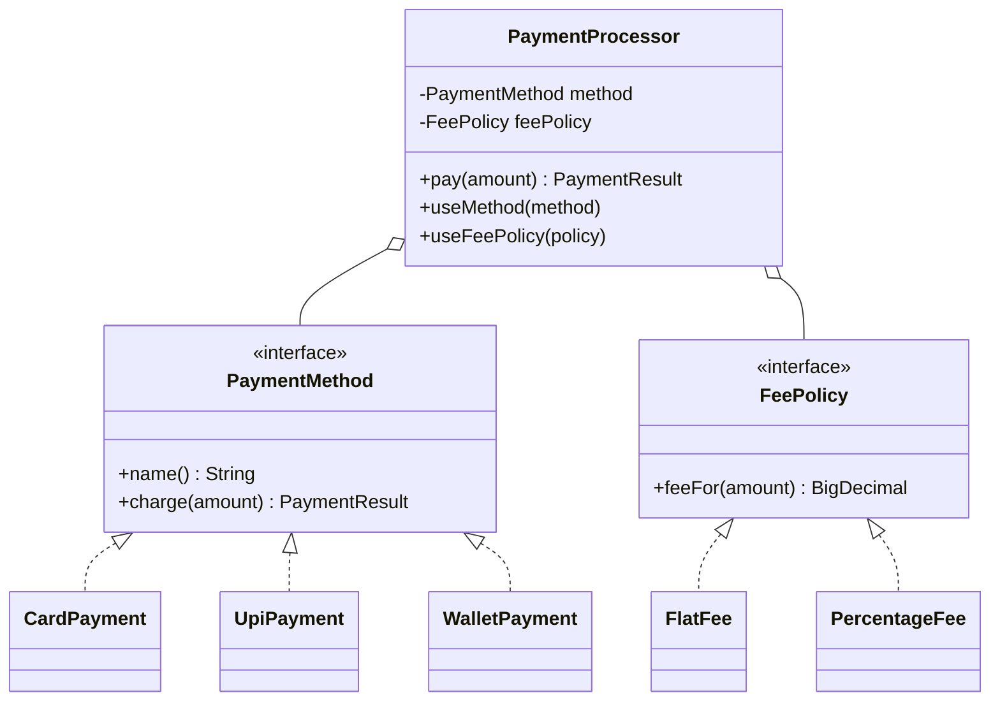

# 12 · Payment Processing System

**Phase 03 · Object-Oriented Programming** &nbsp;|&nbsp; **Level:** Intermediate to advanced &nbsp;|&nbsp; **Java:** 21 or newer

Concepts: interfaces as contracts, polymorphism through an interface, composition over inheritance, swapping behaviour at run time, immutable result objects, static factory methods.

---

## The problem

A shop wants to accept payments by card, UPI and wallet. Each has its own rules: a card has a limit, UPI has a per-payment cap, a wallet can only spend what it holds. On top of that the shop charges a fee, and the fee rule differs too: a percentage on cards, nothing on UPI, a flat amount on wallets.

With inheritance you would write `CardProcessor`, `UpiProcessor`, `WalletProcessor`, and then ask what happens when the fee rule changes independently of the payment method. Three methods times three fee rules is nine classes, and every new method or rule multiplies the count.

## Requirements

**Functional**
1. Three ways to pay: card (limit), UPI (per-payment cap), wallet (balance).
2. A fee on every payment: a percentage, or a flat amount.
3. A refused payment is a normal result, with a reason, not a crash.
4. A ledger records every attempt, approved or declined.

**Non-functional**
- Adding a new way to pay must not change `PaymentProcessor`.
- Changing the fee rule must not change any payment method.
- A `PaymentResult` cannot be altered after it is created.

## Read in this order

| Step | File | What to look for |
|---|---|---|
| 1 | [`PaymentMethod.java`](src/main/java/com/codechanakya/payments/PaymentMethod.java) and [`FeePolicy.java`](src/main/java/com/codechanakya/payments/FeePolicy.java) | The two contracts the processor depends on. |
| 2 | [`CardPayment.java`](src/main/java/com/codechanakya/payments/CardPayment.java), `UpiPayment.java`, `WalletPayment.java` | Three classes, one interface, three sets of rules. |
| 3 | [`FlatFee.java`](src/main/java/com/codechanakya/payments/FlatFee.java), `PercentageFee.java` | The same idea for fees. |
| 4 | [`PaymentProcessor.java`](src/main/java/com/codechanakya/payments/PaymentProcessor.java) | Two fields typed as interfaces, and `useMethod` / `useFeePolicy`. |
| 5 | [`PaymentResult.java`](src/main/java/com/codechanakya/payments/PaymentResult.java) | Final fields, a private constructor and two named factories. |
| 6 | [`Main.java`](src/main/java/com/codechanakya/payments/Main.java) | One processor, reused with different parts. |

## Run it

```bash
./run.sh            # compile and run
./run.sh --check    # run, then compare with expected-output.txt
```

Expected output:

```text
Card, 12000 -> approved CARD-0001 | Approved
Card, 45000 -> declined - | Over the card limit (37760.00 left)
Card, -50 -> declined - | Amount must be positive
UPI, 2500 -> approved UPI-0001 | Approved
UPI, 150000 -> declined - | Above the per-payment limit of 100000.00
Wallet, 250 -> approved WAL-0001 | Approved
Wallet, 100 -> declined - | Wallet balance is only 45.00

--- Ledger ---
APPROVED CARD-0001 charged 12240.00 (amount 12000.00 + 2% fee) via Card ****4242
DECLINED  Card ****4242: Over the card limit (37760.00 left)
DECLINED  Card ****4242: Amount must be positive
APPROVED UPI-0001 charged 2500.00 (amount 2500.00 + flat 0.00) via UPI asha@examplebank
DECLINED  UPI asha@examplebank: Above the per-payment limit of 100000.00
APPROVED WAL-0001 charged 255.00 (amount 250.00 + flat 5.00) via Wallet of Rahul
DECLINED  Wallet of Rahul: Wallet balance is only 45.00

Card limit left : 37760.00
Wallet balance  : 45.00
```

## The shape of the design



## Composition over inheritance

Program 10 reused behaviour by **being** something: a `Manager` is an `Employee`. This program reuses behaviour by **having** something: a processor has a payment method and has a fee policy.

| | Inheritance | Composition |
|---|---|---|
| Relationship | "is a" | "has a" |
| Chosen | when the class is written | when the object is built, and changeable later |
| Combining two variations | one class per combination | any method with any fee, no new class |
| Coupling | tight: a child depends on its parent's internals | loose: only on the interface |

Neither is wrong. Use inheritance for a true "is a" relationship with shared code (Program 10). Reach for composition when the thing varies in more than one way, or must change while the program runs.

## Programming to an interface

```java
private PaymentMethod method;       // not CardPayment
private FeePolicy feePolicy;        // not PercentageFee
```

The processor knows only the contract. In `Main`, one processor starts with a card and ends up taking wallet payments, and not a line of `PaymentProcessor` changes. The same idea, with databases instead of cards, is how real applications avoid being married to one vendor.

## An immutable result

```java
public class PaymentResult {
    private final boolean approved;       // final: set once
    private PaymentResult(...) { ... }   // private: only this class can build one
    public static PaymentResult approved(String reference) { ... }
    public static PaymentResult declined(String reason) { ... }
}
```

Nothing can alter a result once it exists, so passing it around is safe. The factories read as `PaymentResult.declined("Wallet balance is only 45.00")`, which says far more than `new PaymentResult(false, "-", "...")`. Phase 7 shows records, which give you this shape in one line.

## Declined is not an error

A card over its limit is business as usual. `charge` returns a declined result with a reason, the processor logs it, and the program carries on. Throwing exceptions is for things that should never happen, like a negative balance in a constructor. Phase 4 draws that line carefully.

## Common mistakes

| Mistake | What you see |
|---|---|
| Calling a class-only method through an interface variable | `cannot find symbol` |
| Creating the processor but never giving it a method | `NullPointerException` the first time it pays |
| Assigning to a `final` field after construction | `cannot assign a value to final variable` |
| Making the processor `instanceof`-check each payment type | Compiles, and quietly defeats the whole design |

Try the first three in [`broken/`](broken/README.md).

## Practice

- [`exercises/`](exercises/README.md): six tasks, three beginner, two intermediate, one challenge.
- [`solutions/`](solutions/README.md): one answer to each.

## Verification

Compiled and run with OpenJDK 21.0.13 on Linux. `./run.sh --check` passes. The solution file also compiles and runs. Not yet run on Java 25, Windows or macOS.

## Next

Program 13 is the Phase 3 project. It uses everything so far (encapsulation, inheritance, abstract classes, composition) to model a small online shop.
