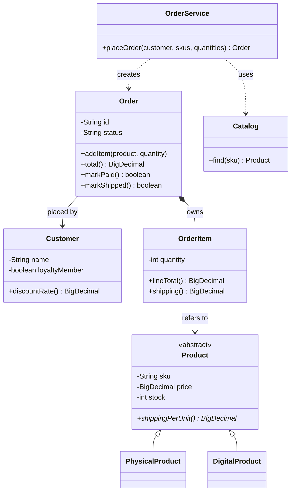

# 13 · E-commerce Order Management (Phase 3 project)

**Phase 03 · Object-Oriented Programming** &nbsp;|&nbsp; **Level:** Intermediate to advanced &nbsp;|&nbsp; **Java:** 21 or newer

Concepts: object relationships (association, composition), a service class, all-or-nothing operations, state transitions, abstract classes with subclasses, everything from Programs 8 to 12 together.

---

## The business problem

A small online shop sells physical goods and downloads. A customer places an order of several items. The shop must check stock, work out a total with a loyalty discount, shipping and GST, and then move the order through payment and dispatch, never skipping a step.

## Requirements

**Functional**
1. A catalog of products, each with a SKU, a price and a stock count. Physical products ship (30.00 plus 10.00 per kg, per unit); digital products do not.
2. An order has a customer and one or more items.
3. Totals: subtotal, loyalty discount (5 percent for members), shipping, GST at 18 percent on the goods after discount.
4. Placing an order is **all or nothing**: if any line cannot be filled, nothing is taken from stock.
5. An order moves `NEW` to `PAID` to `SHIPPED`, in that order only.

**Non-functional**
- Money is `BigDecimal`, rounded to two places once per charge.
- Each class has one clear job; no class reaches into another's fields.

## Read in this order

| Step | File | What to look for |
|---|---|---|
| 1 | [`Product.java`](src/main/java/com/codechanakya/shop/Product.java), `PhysicalProduct.java`, `DigitalProduct.java` | Abstract parent, two kinds, different shipping. |
| 2 | [`Customer.java`](src/main/java/com/codechanakya/shop/Customer.java) | The loyalty rule lives with the customer. |
| 3 | [`OrderItem.java`](src/main/java/com/codechanakya/shop/OrderItem.java) and [`Order.java`](src/main/java/com/codechanakya/shop/Order.java) | An order owns its items; status changes go through two guarded methods. |
| 4 | [`Catalog.java`](src/main/java/com/codechanakya/shop/Catalog.java) | A lookup by SKU that may return `null`. |
| 5 | [`OrderService.java`](src/main/java/com/codechanakya/shop/OrderService.java) | The two-pass rule that makes ordering all or nothing. |
| 6 | [`Main.java`](src/main/java/com/codechanakya/shop/Main.java) | A complete scenario, including a refused order. |

## Run it

```bash
./run.sh            # compile and run
./run.sh --check    # run, then compare with expected-output.txt
```

Expected output:

```text
--- Stock ---
STAND-01 Laptop Stand           Physical    10 left
KEYB-01  Mechanical Keyboard    Physical     3 left
BOOK-01  Java Ebook             Digital    999 left

Order ORD-5001 for Asha Menon (loyalty member)
  Laptop Stand           Physical  1 x   1299.00 =    1299.00
  Java Ebook             Digital   2 x    499.00 =     998.00
  Subtotal                                         2297.00
  Loyalty discount                                 -114.85
  Shipping                                           50.00
  GST 18%                                           392.79
  TOTAL                                            2624.94
  Status: NEW

Order refused: Only 3 left of Mechanical Keyboard (you asked for 5)

Order ORD-5002 for Rahul Verma
  Mechanical Keyboard    Physical  2 x   3499.00 =    6998.00
  Java Ebook             Digital   1 x    499.00 =     499.00
  Subtotal                                         7497.00
  Loyalty discount                                    0.00
  Shipping                                           80.00
  GST 18%                                          1349.46
  TOTAL                                            8926.46
  Status: NEW

Ship ORD-5001 before paying: refused
Pay  ORD-5001: done
Pay  ORD-5001 again: refused
Ship ORD-5001: done
ORD-5001 is now SHIPPED

--- Stock ---
STAND-01 Laptop Stand           Physical     9 left
KEYB-01  Mechanical Keyboard    Physical     1 left
BOOK-01  Java Ebook             Digital    996 left
```

## The model



## Three kinds of relationship

| Arrow | Name | Meaning here |
|---|---|---|
| `Order --> Customer` | association | The order knows its customer, but the customer exists without it. |
| `Order *-- OrderItem` | composition | The items belong to this order alone. Delete the order and the items go with it. |
| `OrderService ..> Catalog` | dependency | The service uses a catalog to do a job, and does not keep it as part of itself. |

Drawing the arrows before writing the code is the quickest way to find a design problem. A class with too many arrows pointing out of it is doing too much.

## All or nothing

```java
// pass 1: only check, change nothing
for (...) { if (!product.hasStock(quantity)) throw ...; }
// pass 2: now it is safe to take stock and build the order
for (...) { product.removeStock(quantity); order.addItem(product, quantity); }
```

In `Main`, Rahul asks for 1 ebook and 5 keyboards with 3 in stock. The check fails on the second line, before the ebook was touched, so the ebook stock is unchanged. Compare it with doing both in one loop: by the time the keyboard line failed, the ebook would already be gone from the shelf. Look at the stock list after the refused order and check the ebook count.

## Guarded state changes

```java
public boolean markShipped() {
    if (!status.equals(PAID)) { return false; }
    status = SHIPPED;
    return true;
}
```

The status field is private, so the only way to ship an order is through a method that checks it is paid. No caller can skip a step by accident. The statuses are plain Strings here, and a typo would be invisible: see [`broken/StatusTypo.java`](broken/README.md). Program 14 fixes it with enums.

## Where each rule lives

| Rule | Class | Why there |
|---|---|---|
| Loyalty discount rate | `Customer` | It is a fact about the customer. |
| Shipping per unit | `Product` subclasses | Physical and digital differ; polymorphism picks the right one. |
| Line total and line shipping | `OrderItem` | It has the product and the quantity. |
| Subtotal, GST, total, status moves | `Order` | It has all its items. |
| Stock checks across several lines | `OrderService` | The rule spans several objects and the catalog. |

When you are unsure where code belongs, ask which class already holds the data it needs.

## Common mistakes

| Mistake | What you see |
|---|---|
| Two orders handed the same list | Both orders list each other's items. |
| Removing stock without checking | Stock goes below zero. |
| Statuses as free text | A typo makes a rule silently never apply. |
| Checking and updating in one loop | A failed order leaves stock half taken. |

Try three of these in [`broken/`](broken/README.md).

## Practice

- [`exercises/`](exercises/README.md): six tasks, three beginner, two intermediate, one challenge.
- [`solutions/`](solutions/README.md): one answer to each.

## Test cases to run by hand

| Scenario | Expected |
|---|---|
| 1 stand, 2 ebooks, loyalty member | subtotal 2297.00, discount 114.85, total 2624.94 |
| 2 keyboards and 1 ebook, not a member | discount 0.00, shipping 80.00, total 8926.46 |
| 5 keyboards, 3 in stock | refused, and no stock changes |
| Ship before paying | refused |

## Verification

Compiled and run with OpenJDK 21.0.13 on Linux. `./run.sh --check` passes. The solution file also compiles and runs. Not yet run on Java 25, Windows or macOS.

## Git commit suggestions

```text
Add Program 13: model products, orders and customers
Add all-or-nothing order placement
Add guarded order status changes
```

## Next

Phase 4 (Programs 14 to 17) tightens what this program left loose: enums for the statuses, custom exceptions for the refusals, generics for the catalog, and annotations.
