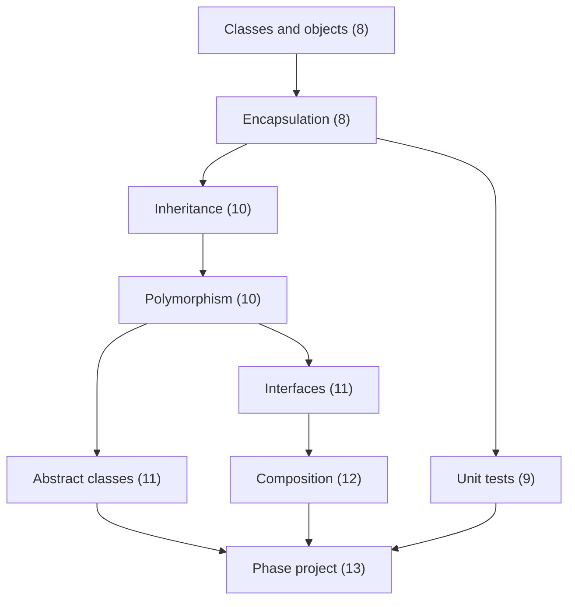

# Phase 03 · Object-Oriented Programming

Six programs that move you from loose variables and methods to a program built out of objects that protect their own rules.

| No. | Program | New ideas |
|---|---|---|
| 08 | [Banking Application](08-banking-application) | classes, objects, constructors, `this`, encapsulation, packages |
| 09 | [JUnit Starter Lab](09-junit-starter-lab) | unit tests, assertions, `@BeforeEach`, `assertThrows` |
| 10 | [Employee Management System](10-employee-management-system) | inheritance, `super`, overriding, polymorphism |
| 11 | [Vehicle Rental System](11-vehicle-rental-system) | abstract classes, interfaces, default methods |
| 12 | [Payment Processing System](12-payment-processing-system) | interfaces as contracts, composition over inheritance |
| 13 | [E-commerce Order Management](13-ecommerce-order-management) | object relationships, services, all-or-nothing rules (phase project) |

## How the ideas build



## A new way to run things

Phases 1 and 2 used the default package and one file. From here every program uses a real package, such as `com.codechanakya.bank`, and its files sit in matching folders. `run.sh` hides the details, but the command underneath is worth knowing:

```bash
javac --release 21 -d out @out/sources.txt         # compile every file listed
java -cp out com.codechanakya.bank.Main            # run the class by its full name
```

Program 9 is the first to need something from outside the JDK: the JUnit launcher, downloaded once by `run.sh`.

## Mastery checkpoint

Before you move to Phase 4, build this without looking at the solutions.

**Library Lending Desk.** A small library lends books and DVDs to members.

1. `Member` (id, name) and an abstract `Item` (id, title) with two subclasses, `Book` and `Dvd`. Loan periods differ: 14 days for a book, 7 for a DVD, set by an overridden method.
2. A `Loan` that links one member to one item and a due date count. A member may hold at most 3 items.
3. A `Library` class with `lend(member, item)` and `giveBack(item)` that return `true` or `false` and never leave the data half-updated.
4. Late fees through an interface `Chargeable` implemented only by `Dvd`.
5. Write at least six tests in JUnit, including one for the three-item limit.

You are ready for Phase 4 when each class has one clear job, no field is public, no `instanceof` chain decides behaviour that an overridden method could, and your tests fail when you break a rule on purpose.

## Levels

| Level | You can... |
|---|---|
| 1 Understood | explain a concept in your own words |
| 2 Applied | write a class that uses it |
| 3 Connected | combine it with earlier concepts, as in Program 13 |
| 4 Mastered | design the checkpoint alone and test it |
