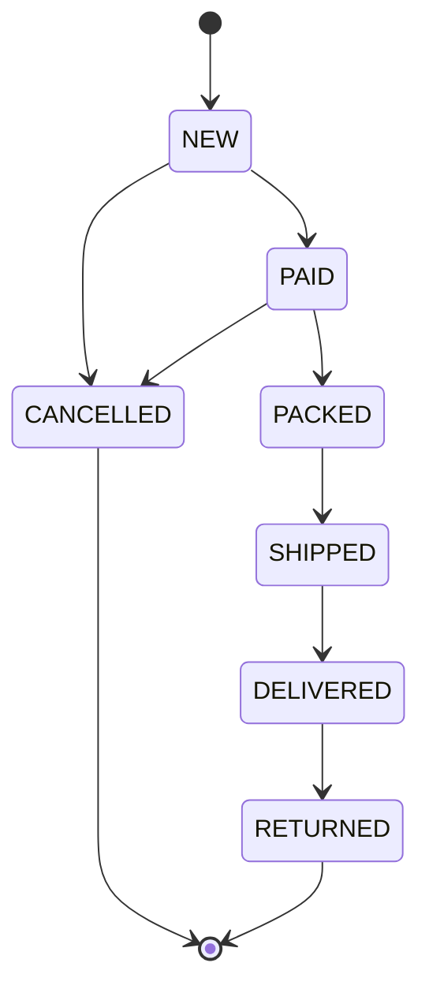

# 14 · Order Status Management

**Phase 04 · Java Essentials** &nbsp;|&nbsp; **Level:** Intermediate &nbsp;|&nbsp; **Java:** 21 or newer

Concepts: `enum` (with fields, constructors and methods), `switch` expressions over enums, `EnumSet` and `EnumMap` as a preview, `static` fields and methods, `final` fields, constants, `final` classes.

---

## The problem

Program 13 kept an order's status as a `String`: `"NEW"`, `"PAID"`, `"SHIPPED"`. It worked, until one letter went wrong. `"PAYED"` compiled, ran, and quietly never matched anything. Nothing stopped a caller from passing `"BANANA"` either.

This program replaces the strings with a proper type that lists every legal status, and moves the rules about which status may follow which into that type, where they cannot be forgotten.

## Requirements

**Functional**
1. Statuses: New, Paid, Packed, Shipped, Delivered, Cancelled, Returned.
2. Allowed moves: New to Paid or Cancelled; Paid to Packed or Cancelled; Packed to Shipped; Shipped to Delivered; Delivered to Returned.
3. Cancelled and Returned are final: nothing may follow.
4. An order remembers the whole path it has taken.
5. A report counts orders in every status, including statuses with none.

**Non-functional**
- A misspelt status must fail to compile.
- Adding a new status must force the rules to be updated.

## Read in this order

| Step | File | What to look for |
|---|---|---|
| 1 | [`OrderStatus.java`](src/main/java/com/codechanakya/orders/OrderStatus.java) | The constants, the constructor that gives each one a label, and `nextStates()`. |
| 2 | [`Order.java`](src/main/java/com/codechanakya/orders/Order.java) | `static` and `final` doing different jobs, and `moveTo`. |
| 3 | [`OrderBoard.java`](src/main/java/com/codechanakya/orders/OrderBoard.java) | A `final` class of static helpers, and an `EnumMap`. |
| 4 | [`Main.java`](src/main/java/com/codechanakya/orders/Main.java) | Five orders taking different journeys. |

## Run it

```bash
./run.sh            # compile and run
./run.sh --check    # run, then compare with expected-output.txt
```

Expected output:

```text
Ship a NEW order straight away: refused
Pay it first instead: done
Pay a RETURNED order: refused

--- Journeys ---
ORD-7001  Asha Menon  New > Paid > Packed > Shipped > Delivered
ORD-7002  Rahul Verma New > Paid > Cancelled
ORD-7003  Meera Iyer  New > Paid
ORD-7004  Kiran Rao   New > Paid > Packed > Shipped > Delivered > Returned
ORD-7005  Dev Patel   New
Orders created: 5

--- Orders by status ---
New        1
Paid       1
Packed     0
Shipped    0
Delivered  1
Cancelled  1
Returned   1

--- What can SHIPPED become? ---
[DELIVERED]
Finished states:
  CANCELLED (position 5)
  RETURNED (position 6)

Parsing text from outside the program:
  "SHIPPED" -> SHIPPED
  "PAYED" is not a status: No enum constant com.codechanakya.orders.OrderStatus.PAYED
```

## The state machine



Drawing the allowed moves first turns "what should happen?" into a picture you can check with the business before you write any code. Each arrow becomes one entry in `nextStates()`.

## Enum: a fixed list of names

```java
public enum OrderStatus { NEW, PAID, PACKED, SHIPPED, DELIVERED, CANCELLED, RETURNED }
```

- Write `OrderStatus.PAID`, never text. A typo is an error at the line you wrote it.
- `OrderStatus.values()` returns all of them, in declaration order. `ordinal()` is a constant's position, starting at 0.
- `valueOf("PAID")` converts text from outside the program (a file, a form). An unknown name throws `IllegalArgumentException`. See the last lines of `Main`.
- Compare with `==`: there is only ever one `PAID`.

## An enum is a class

```java
NEW("New", false),            // a constant, with arguments for the constructor
...
OrderStatus(String label, boolean finished) { ... }   // private, run once per constant
public Set<OrderStatus> nextStates() { ... }           // methods like any class
```

The label and the "finished" flag belong to the status, so they live with it. A caller asks `status.getLabel()`; it never keeps a parallel table of labels somewhere else that can fall out of date.

## A switch with no `default`

```java
return switch (this) {
    case NEW -> EnumSet.of(PAID, CANCELLED);
    ...
    case CANCELLED, RETURNED -> EnumSet.noneOf(OrderStatus.class);
};
```

A switch expression must produce a value for every possible input. Over an enum, the compiler knows every constant, so it can check you covered them all. Add a new status and forget the switch: the program stops compiling. Adding `default` would silence that safety net, so leave it out. Try [`broken/MissingSwitchCase.java`](broken/README.md).

## `final` and `static`: two different ideas

| Keyword | Means | Example here |
|---|---|---|
| `final` on a field | Set once, never reassigned. | `private final String id;` |
| `final` on a class | Cannot be extended. | `public final class OrderBoard` |
| `static` on a field | One copy shared by the whole class. | `private static int nextNumber` |
| `static` on a method | Belongs to the class, called without an object. | `Order.totalCreated()` |
| `static final` | A constant. | `Order.ID_PREFIX` |

Each `Order` has its own `id` and `status`. All orders share `nextNumber`, which is how each new order gets the next number. A static method has no "this", so it cannot touch instance fields. [`broken/StaticFromInstance.java`](broken/README.md) shows the error.

## Where the rules live

`Order.moveTo` does not know the rules. It asks the status: `status.canMoveTo(next)`. If the business adds a rule, exactly one method changes, and every order follows.

## Common mistakes

| Mistake | What you see |
|---|---|
| Misspelling a constant | `cannot find symbol` |
| A switch over an enum that misses a case | `the switch expression does not cover all possible input values` |
| Using an instance field from a static method | `non-static variable ... cannot be referenced from a static context` |
| Comparing enums with `equals` and a String | Compiles, but is always false. Compare enum to enum with `==`. |

Try the first three in [`broken/`](broken/README.md).

## Practice

- [`exercises/`](exercises/README.md): six tasks, three beginner, two intermediate, one challenge.
- [`solutions/`](solutions/README.md): one answer to each.

## Verification

Compiled and run with OpenJDK 21.0.13 on Linux. `./run.sh --check` passes. The solution file also compiles and runs. Not yet run on Java 25, Windows or macOS.

## Next

Program 15 deals with the other half of "refused": how to report that something went wrong, with exceptions that carry the reason.
