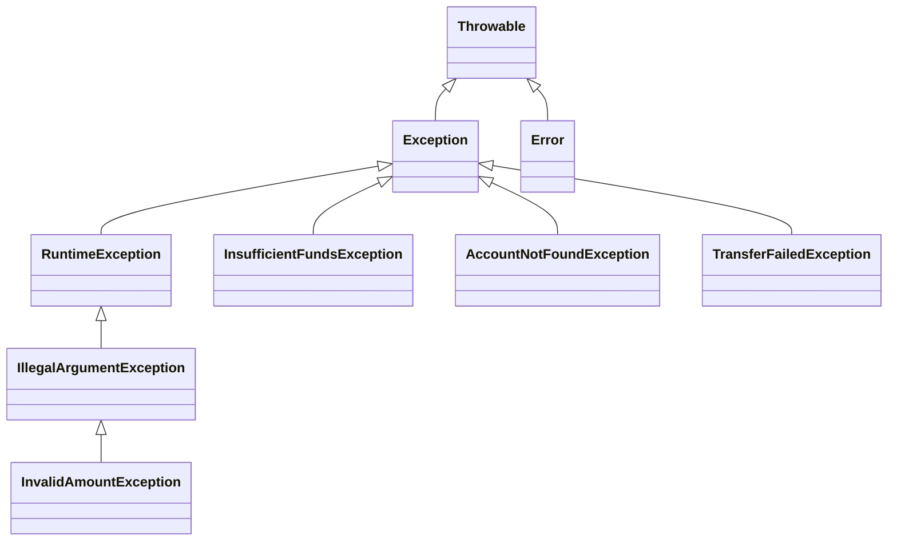

# 15 · Banking Exception Management

**Phase 04 · Java Essentials** &nbsp;|&nbsp; **Level:** Intermediate &nbsp;|&nbsp; **Java:** 21 or newer

Concepts: `try` / `catch` / `finally`, checked and unchecked exceptions, `throw` and `throws`, custom exception classes, exception chaining, multi-catch, try-with-resources and `AutoCloseable`.

---

## The problem

Program 8 handled trouble by returning `false`. That says "no" but not why, and a caller can forget to look at it. In a bank that is a bad habit: an ignored `false` from `withdraw` is money that went somewhere nobody noticed.

Exceptions fix both problems. An exception **carries the reason**, and unless someone deals with it, the program **stops** instead of carrying on with bad data.

## Requirements

**Functional**
1. A withdrawal larger than the balance is refused and says how much is missing.
2. A deposit or withdrawal of zero or less is refused.
3. Looking up a missing account is reported, never returned as `null`.
4. A transfer that fails reports one clear error and keeps the real cause.
5. An audit log is always closed, even when something goes wrong.

**Non-functional**
- Callers cannot ignore the "not enough money" case by accident.
- Error messages are written for people, not for programmers.

## Read in this order

| Step | File | What to look for |
|---|---|---|
| 1 | [`InsufficientFundsException.java`](src/main/java/com/codechanakya/bank/InsufficientFundsException.java) | A custom checked exception that carries numbers. |
| 2 | [`InvalidAmountException.java`](src/main/java/com/codechanakya/bank/InvalidAmountException.java) | The unchecked kind, and why it is unchecked. |
| 3 | [`Account.java`](src/main/java/com/codechanakya/bank/Account.java) | `throws` in a signature, `throw` in a body. |
| 4 | [`Bank.java`](src/main/java/com/codechanakya/bank/Bank.java) | A multi-catch, and wrapping one exception in another. |
| 5 | [`AuditLog.java`](src/main/java/com/codechanakya/bank/AuditLog.java) | `AutoCloseable`. |
| 6 | [`Main.java`](src/main/java/com/codechanakya/bank/Main.java) | Five short scenarios. |

## Run it

```bash
./run.sh            # compile and run
./run.sh --check    # run, then compare with expected-output.txt
```

Expected output:

```text
1. Catching a checked exception
   Withdrew 250, balance 750.00
   Refused: Cannot withdraw 5000.00, balance is 750.00
   Short by 4250.00

2. An unchecked exception from bad input
   Refused: Amount must be greater than zero, but was -5

3. Looking up an account that does not exist
   No account with number ACC-9999

4. A chained exception: the wrapper and its cause
   Transfer of 100 done
   Transfer of 9000 failed
   Cause: Cannot withdraw 9000.00, balance is 300.00
   Transfer of 10 failed
   Cause: No account with number ACC-7777

5. try-with-resources and finally
[audit] end-of-day opened
[audit] Asha balance 650.00
[audit] Rahul balance 300.00
[audit] end-of-day closed with 2 entries
   Stopped part-way: Cannot withdraw 1000.00, balance is 300.00
   finally runs every time, with or without an error
```

## The exception family



An exception is an object, and all of them are in one inheritance tree (Program 10 again). That is why `catch (Exception e)` catches nearly everything and why order matters in a list of `catch` blocks.

## How it flows

```java
try {
    asha.withdraw(250);         // fine
    asha.withdraw(5000);        // throws here
    System.out.println("...");  // skipped
} catch (InsufficientFundsException e) {
    // runs next
} finally {
    // runs always
}
```

When `throw` executes, Java stops the current method, leaves the `try`, and jumps to the first matching `catch`. Lines after the throw in that `try` do not run. The `finally` block runs whether or not anything was thrown.

## Checked and unchecked

| | Checked | Unchecked |
|---|---|---|
| Extends | `Exception` | `RuntimeException` |
| The compiler | forces every caller to catch it or declare it with `throws` | does not |
| Use for | things that can go wrong in a correct program: no money, no such account, file missing | caller mistakes: a negative amount, a `null` that should not be there |
| Here | `InsufficientFundsException`, `AccountNotFoundException` | `InvalidAmountException` |

A sensible rule: if a careful caller could reasonably be expected to recover, make it checked. If it means the caller's code is wrong, make it unchecked.

## Write your own exception

```java
public class InsufficientFundsException extends Exception {
    private final BigDecimal requested;
    private final BigDecimal available;
    ...
    public BigDecimal getShortfall() { ... }
}
```

A custom exception is a class that extends one of the standard ones. Give it a clear name (what went wrong, not where) and the data a handler needs, such as the shortfall, so nobody has to parse the message to get it back out.

## Chaining

```java
catch (AccountNotFoundException | InsufficientFundsException e) {
    throw new TransferFailedException("Transfer of ... failed", e);
}
```

The caller of `transfer` has one thing to handle, `TransferFailedException`, and can still ask `e.getCause()` for the original reason. Always pass the cause along when you wrap. Throwing a new exception without it throws away the evidence. The `|` in the catch is a multi-catch: one handler for several types.

## Cleaning up: `finally` and try-with-resources

```java
try (AuditLog log = new AuditLog("end-of-day")) {
    ...
}   // log.close() is called here automatically, even if something threw
```

Look at the last scenario in the output: the log reports closed **before** the `catch` block prints. Resources are closed as the `try` is left, then the handler runs. Use try-with-resources for anything that must be closed (files, connections); use `finally` for other clean-up.

## Common mistakes

| Mistake | What you see |
|---|---|
| Calling a method that `throws` a checked exception without handling it | `unreported exception ...; must be caught or declared to be thrown` |
| A general `catch (Exception e)` above a specific one | `exception ... has already been caught` |
| An empty `catch` block | No error at all, and the problem disappears silently. |
| Catching an exception just to print it and carry on | The program continues with bad data. |

Try three of these in [`broken/`](broken/README.md).

## Practice

- [`exercises/`](exercises/README.md): six tasks, three beginner, two intermediate, one challenge.
- [`solutions/`](solutions/README.md): one answer to each.

## Verification

Compiled and run with OpenJDK 21.0.13 on Linux. `./run.sh --check` passes. The solution file also compiles and runs. Not yet run on Java 25, Windows or macOS.

## Next

Program 16 shows how to write one repository that stores customers, products or anything else, using generics.
