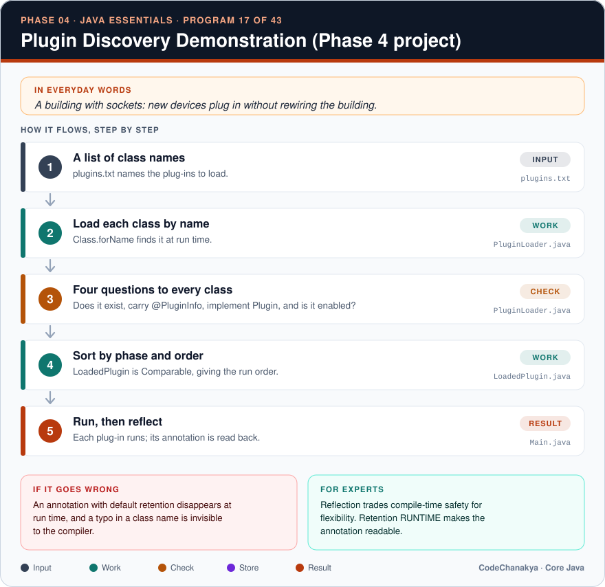
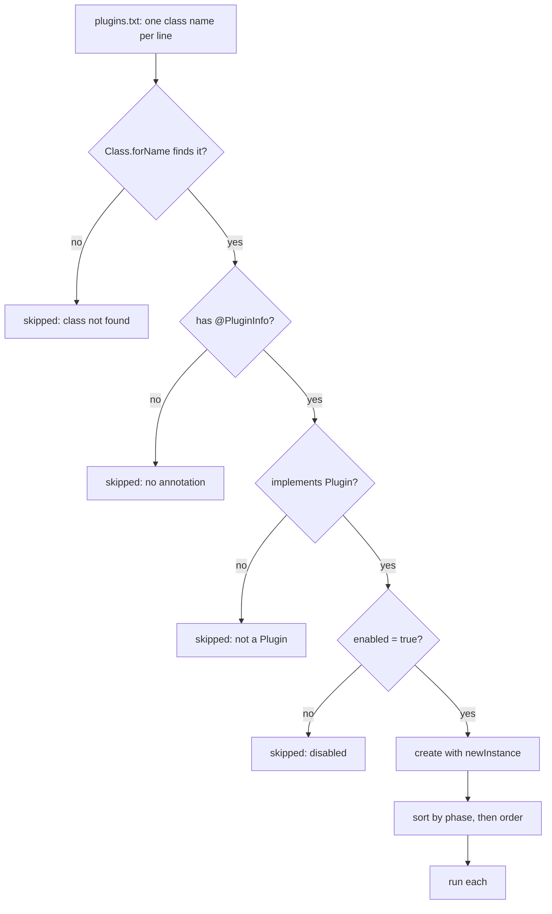

# 17 · Plugin Discovery Demonstration (Phase 4 project)

**Phase 04 · Java Essentials** &nbsp;|&nbsp; **Level:** Advanced &nbsp;|&nbsp; **Java:** 21 or newer

Concepts: custom annotations, retention and target, reflection (`Class.forName`, `getAnnotation`, `newInstance`, `getDeclaredMethods`), plus enums, exceptions, `Comparable` and interfaces from earlier programs.

---

## The problem

An application wants to be extended without being edited. A new report, a new check, a new start-up step should arrive as **one new class**, and the application should find it and run it, in the right order, without anyone changing the main code.

That needs the program to look at classes it never saw at compile time. Reflection does the looking. Annotations do the labelling: a class says "I am a plugin, my name is Audit, run me in the MAIN phase" in a way a program can read.

<!--flow-->
## The flow at a glance

<p align="center"><a href="../../docs/flows/program-17.svg"></a></p>

| If you are | Read it like this |
|---|---|
| New to coding | A building with sockets: new devices plug in without rewiring the building. |
| Learning | Follow the numbered cards from top to bottom. Open the file named on each card, run the program, and match its output to the last card. |
| Experienced | Reflection trades compile-time safety for flexibility. Retention RUNTIME makes the annotation readable. |

<details>
<summary>Text version of the flow</summary>

1. **A list of class names** (input): plugins.txt names the plug-ins to load. (`plugins.txt`)
2. **Load each class by name** (work): Class.forName finds it at run time. (`PluginLoader.java`)
3. **Four questions to every class** (check): Does it exist, carry @PluginInfo, implement Plugin, and is it enabled? (`PluginLoader.java`)
4. **Sort by phase and order** (work): LoadedPlugin is Comparable, giving the run order. (`LoadedPlugin.java`)
5. **Run, then reflect** (result): Each plug-in runs; its annotation is read back. (`Main.java`)

</details>
<!--/flow-->

## Requirements

**Functional**
1. A text file lists candidate class names.
2. For each: skip it, with a reason, if the class does not exist, has no `@PluginInfo`, is switched off, or does not implement `Plugin`.
3. Run the rest in order: first by phase (STARTUP, MAIN, CLEANUP), then by their order number.
4. Describe a class with reflection: its name, interfaces, annotation and methods.

**Non-functional**
- Adding a plugin must not need any change to the loader or `Main`.
- One bad entry must never stop the others loading.
- Output is identical on every machine.

## Read in this order

| Step | File | What to look for |
|---|---|---|
| 1 | [`PluginInfo.java`](src/main/java/com/codechanakya/plugins/PluginInfo.java) | An annotation declared with `@interface`, with defaults. |
| 2 | [`Plugin.java`](src/main/java/com/codechanakya/plugins/Plugin.java) and [`PluginPhase.java`](src/main/java/com/codechanakya/plugins/PluginPhase.java) | The interface and an enum. |
| 3 | [`builtin/`](src/main/java/com/codechanakya/plugins/builtin) | Six small classes, labelled in different ways. |
| 4 | [`plugins.txt`](src/main/resources/plugins.txt) | The list of names the loader reads. |
| 5 | [`PluginLoader.java`](src/main/java/com/codechanakya/plugins/PluginLoader.java) | The four questions asked of every class. |
| 6 | [`LoadedPlugin.java`](src/main/java/com/codechanakya/plugins/LoadedPlugin.java) | `Comparable`, giving the run order. |
| 7 | [`Main.java`](src/main/java/com/codechanakya/plugins/Main.java) | Loading, running, and reflecting. |

## Run it

```bash
./run.sh            # compile and run
./run.sh --check    # run, then compare with expected-output.txt
```

Expected output:

```text
--- Skipped ---
  ExperimentalPlugin: disabled
  NotAPlugin: no @PluginInfo annotation
  DoesNotExist: class not found

--- Running order ---
  STARTUP   10  Welcome
  MAIN      50  Audit
  MAIN     100  Report
  CLEANUP   10  Cleanup

--- Running ---
Welcome to the plugin demo
Audit: nothing suspicious found
Report: runs last among the MAIN plugins, just before Cleanup
Cleanup: temporary files removed

--- Reflection on WelcomePlugin ---
Full name : com.codechanakya.plugins.builtin.WelcomePlugin
Package   : com.codechanakya.plugins.builtin
Implements: [Plugin]
Annotation: name=Welcome, order=10, phase=STARTUP, enabled=true
Methods   : [run]
```

## How a plugin is found



## Annotations

```java
@Retention(RetentionPolicy.RUNTIME)
@Target(ElementType.TYPE)
public @interface PluginInfo {
    String name();                      // required
    int order() default 100;            // optional
    PluginPhase phase() default PluginPhase.MAIN;
    boolean enabled() default true;
}
```

An annotation changes nothing by itself. It is a note attached to a class, a method or a field, and something has to read it. Usage looks like this:

```java
@PluginInfo(name = "Audit", order = 50)
public class AuditPlugin implements Plugin { ... }
```

- **`@Retention(RUNTIME)`** keeps the note in the compiled class so a running program can see it. Without it, the note is dropped and reflection finds nothing: [`broken/DefaultRetention.java`](broken/README.md).
- **`@Target(TYPE)`** says where it may be placed. Putting `@PluginInfo` on a method would not compile.
- Elements with **no default** must always be given: `name` here.
- You have met annotations already: `@Override` (checked by the compiler) and `@Test` in Program 9 (read by JUnit by reflection, just as here).

## Reflection

Normal Java code names the classes it uses, so the compiler knows them. Reflection lets a program work with classes known only by name at run time.

| Call | What it does |
|---|---|
| `Class.forName("a.b.C")` | Loads a class from its name. Throws `ClassNotFoundException` if there is none. |
| `type.getAnnotation(PluginInfo.class)` | The annotation instance, or `null` when absent. |
| `Plugin.class.isAssignableFrom(type)` | Does `type` implement `Plugin`? |
| `type.getDeclaredConstructor().newInstance()` | Creates an object without writing `new`. |
| `type.getDeclaredMethods()` | The methods the class declares. Order is **not** guaranteed, so sort before printing. |

Look at what is missing from `PluginLoader`: no `new WelcomePlugin()`, and no import of any plugin. That is the whole point, and the whole cost. The compiler can no longer check a name written in a text file, so a typo is a run-time `ClassNotFoundException`, which is why the loader handles it and carries on. See [`broken/ClassNameTypo.java`](broken/README.md).

## Design decisions

- **Every skip has a reason.** A plugin that silently does not run is a very hard bug to find. The loader records why.
- **`PluginLoadException` is checked and wraps the cause.** Creating a plugin is the one step that can fail in many ways (no constructor, constructor throws, class is abstract). Program 15's chaining applies directly.
- **Sorting uses `Comparable`.** `LoadedPlugin.compareTo` says phase first, order second. `Collections.sort` does the rest. Program 16's idea of a type that knows how to compare itself.
- **Text file, not scanning.** Finding every class in a folder needs more machinery (and is what frameworks like Spring hide from you). Reading names from a file keeps the idea visible.

## When to use reflection

Frameworks use it everywhere: JUnit finds `@Test` methods, Spring finds beans, JSON libraries fill fields. Use it for **tools and frameworks**. In ordinary application code prefer plain interfaces, which the compiler can check; reflection is slower and moves errors from compile time to run time.

## Common mistakes

| Mistake | What you see |
|---|---|
| No `@Retention(RUNTIME)` | `getAnnotation` returns `null`. No error. |
| An annotation element with no default left out | `annotation ... is missing a default value for the element` |
| A typo in a class name string | `ClassNotFoundException` at run time |
| Relying on the order of `getDeclaredMethods` | Output that differs between machines |

Try three of these in [`broken/`](broken/README.md).

## Practice

- [`exercises/`](exercises/README.md): six tasks, three beginner, two intermediate, one challenge.
- [`solutions/`](solutions/README.md): one answer to each.

## Verification

Compiled and run with OpenJDK 21.0.13 on Linux. `./run.sh --check` passes. The solution file also compiles and runs. Not yet run on Java 25, Windows or macOS.

## Git commit suggestions

```text
Add Program 17: define @PluginInfo and the Plugin interface
Add plugin loader that reads class names and inspects them
Add built-in plugins and run them in phase order
```

## Next

Phase 5 (Programs 18 to 22) takes the collections that have been peeking through in this phase, `ArrayList`, `Map`, `Set`, and teaches them properly: when to pick which.
