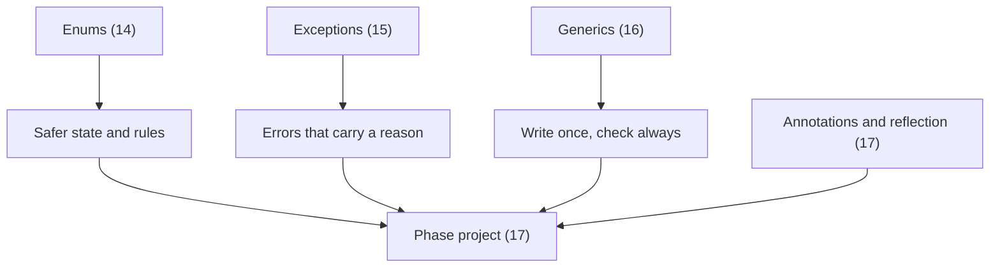

# Phase 04 · Java Essentials

Four programs for the parts of the language that separate a program that works from one that is safe to change: values the compiler can check, errors that carry their reason, code written once for many types, and classes that describe themselves.

| No. | Program | New ideas |
|---|---|---|
| 14 | [Order Status Management](14-order-status-management) | `enum`, `static`, `final`, switch over an enum |
| 15 | [Banking Exception Management](15-banking-exception-management) | exceptions, custom exceptions, `try-with-resources` |
| 16 | [Generic Repository](16-generic-repository) | generics, bounded types, wildcards |
| 17 | [Plugin Discovery Demonstration](17-plugin-discovery-demonstration) | annotations, reflection (phase project) |

## How the ideas build

The theme is moving mistakes from run time to compile time, and when that is not possible, making them loud and informative:

| Program 13 / earlier | This phase |
|---|---|
| A status is a `String`; a typo does nothing | an `enum`; a typo does not compile |
| A refusal is `false` or `null` | an exception with a reason that cannot be ignored |
| A store of `Object`, with casts | a generic store the compiler checks |
| Behaviour wired in by name | behaviour found by annotation |

## Mastery checkpoint

Before you move to Phase 5, build this without looking at the solutions.

**Event Ticket Desk.** A small hall sells seats.

1. An enum `SeatType` (STANDARD, PREMIUM, VIP) where each constant carries its own price, and a method `refundable()` that differs by constant.
2. A `Booking` class with an id, a name and a seat type, and a generic `Repository<Booking, String>` that stores it (write your own, or reuse the pattern from Program 16).
3. A checked `SoldOutException` and an unchecked `InvalidSeatCountException`. A `Desk.book(...)` method throws them with clear messages.
4. A report that counts bookings per seat type using an `EnumMap`.
5. Mark `Desk.book` with an annotation `@Audited` and use reflection to print every `@Audited` method of the class.

You are ready for Phase 5 when a wrong seat type cannot compile, every failure explains itself, no cast appears in your code, and you can explain why you chose a checked or unchecked exception for each case.

## Levels

| Level | You can... |
|---|---|
| 1 Understood | explain a concept in your own words |
| 2 Applied | write code that uses it |
| 3 Connected | combine it with earlier concepts, as in Program 17 |
| 4 Mastered | design the checkpoint alone and defend your choices |
