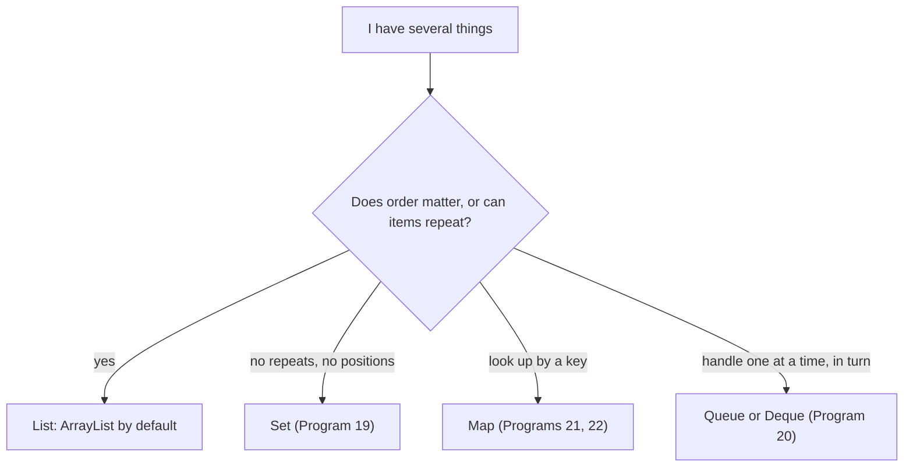

# 18 · Online Shopping Cart

**Phase 05 · Collections** &nbsp;|&nbsp; **Level:** Intermediate &nbsp;|&nbsp; **Java:** 21 or newer

Concepts: `List`, `ArrayList`, `Iterator`, `Comparator`, read-only views, immutable lists.

---

## The problem

A shopper adds products, adds the same one again, removes one, and wants to see the cart sorted by name, by price or by how much each line costs. Up to now the only container you have used for several things is an array, and an array cannot grow, cannot remove an item, and cannot be sorted by more than one rule without writing the loops yourself.

A `List` is the collection for "several things, in order, repeats allowed, and the size changes".

<!--flow-->
## The flow at a glance

<p align="center"><a href="../../docs/flows/program-18.svg"></a></p>

| If you are | Read it like this |
|---|---|
| New to coding | A shopping basket you can add to, remove from and sort every way you like. |
| Learning | Follow the numbered cards from top to bottom. Open the file named on each card, run the program, and match its output to the last card. |
| Experienced | A List keeps order and allows duplicates. Comparators separate how to sort from what is sorted. |

<details>
<summary>Text version of the flow</summary>

1. **Add products** (input): ArrayList grows as items are added, including duplicates. (`ShoppingCart.java`)
2. **Sort by name, price or line cost** (work): Three Comparators give three orders without changing the items. (`Comparator`)
3. **Remove safely** (work): An Iterator removes while walking the list. (`iterator.remove`)
4. **Guard the wrong turns** (check): Four common failures are shown on purpose. (`Main.java`)
5. **Cart views** (result): The same list, shown in different orders. (`expected-output.txt`)

</details>
<!--/flow-->

## Requirements

**Functional**
1. Add a product. Adding a SKU that is already there tops up its quantity.
2. Remove a line by SKU, and remove every line worth less than a given amount.
3. Total the cart.
4. Show the cart sorted three ways without disturbing the order the shopper added things in.
5. Give other code a way to look at the cart without changing it.

**Non-functional**
- Money is `BigDecimal`, shown with two decimals.
- Deleting while looping must not crash.

## Read in this order

| Step | File | What to look for |
|---|---|---|
| 1 | [`CartItem.java`](src/main/java/com/codechanakya/cart/CartItem.java) | One line of the cart. Nothing new; read it quickly. |
| 2 | [`ShoppingCart.java`](src/main/java/com/codechanakya/cart/ShoppingCart.java) | The `ArrayList`, the three comparators, the iterator removal. |
| 3 | [`Main.java`](src/main/java/com/codechanakya/cart/Main.java) | Sorting, removing, and four things that go wrong. |

## Run it

```bash
./run.sh            # compile and run
./run.sh --check    # run, then compare with expected-output.txt
```

Expected output:

```text
--- The cart, in the order things were added ---
  P-101  USB-C Cable       3 x   299.00 =    897.00
  P-205  Notebook          6 x    85.50 =    513.00
  P-310  Desk Lamp         1 x  1250.00 =   1250.00
  P-412  Pen Pack          3 x    40.00 =    120.00
  P-520  Headphones        1 x  1999.00 =   1999.00
  Lines: 5, total 4779.00

--- Sorted copies (the cart itself is not reordered) ---
By name:
  P-310  Desk Lamp         1 x  1250.00 =   1250.00
  P-520  Headphones        1 x  1999.00 =   1999.00
  P-205  Notebook          6 x    85.50 =    513.00
  P-412  Pen Pack          3 x    40.00 =    120.00
  P-101  USB-C Cable       3 x   299.00 =    897.00
By line total, biggest first:
  P-520  Headphones        1 x  1999.00 =   1999.00
  P-310  Desk Lamp         1 x  1250.00 =   1250.00
  P-101  USB-C Cable       3 x   299.00 =    897.00
  P-205  Notebook          6 x    85.50 =    513.00
  P-412  Pen Pack          3 x    40.00 =    120.00
By quantity, then name:
  P-205  Notebook          6 x    85.50 =    513.00
  P-412  Pen Pack          3 x    40.00 =    120.00
  P-101  USB-C Cable       3 x   299.00 =    897.00
  P-310  Desk Lamp         1 x  1250.00 =   1250.00
  P-520  Headphones        1 x  1999.00 =   1999.00
Still first in the cart: USB-C Cable

--- Removing with an Iterator ---
Remove P-310: true
Remove P-999: false
Lines worth less than 150.00 removed: 1
After clean-up
  P-101  USB-C Cable       3 x   299.00 =    897.00
  P-205  Notebook          6 x    85.50 =    513.00
  P-520  Headphones        1 x  1999.00 =   1999.00
  Lines: 3, total 3409.00

--- What goes wrong ---
Removing inside a for-each: ConcurrentModificationException
Adding to the read-only view: UnsupportedOperationException
Adding to List.of(...): UnsupportedOperationException
get(10) on a short list: Index 10 out of bounds for length 3
```

## Choosing a collection



Start with `ArrayList`. It is fast to read by position, fast to add at the end, and right for almost every list you will write. `LinkedList` exists, but its advantages show up rarely and its disadvantages (slow `get(i)`, more memory) show up often.

## What you are looking at

```java
List<CartItem> items = new ArrayList<>();
```

- The variable has the **interface** type, `List`, and the object is an `ArrayList`. Other code only needs to know "it is a list", so you can change the class later without touching callers.
- Common calls: `add(x)`, `add(i, x)`, `get(i)`, `set(i, x)`, `remove(i)`, `remove(object)`, `size()`, `isEmpty()`, `contains(x)`, `indexOf(x)`, `subList(from, to)`.
- A list is zero-based, like an array. `get(10)` on a list of 4 throws `IndexOutOfBoundsException`; the output ends with exactly that.

## Sorting with a Comparator

`Comparable` (Program 19) gives a class **one** natural order. A `Comparator` is a separate object that says "compare two of these by this rule", so you can have as many rules as you like.

```java
Comparator.comparing(CartItem::getName)                       // by name
Comparator.comparing(CartItem::lineTotal).reversed()          // biggest first
Comparator.comparingInt(CartItem::getQuantity).reversed()
          .thenComparing(CartItem::getName)                   // quantity, then name
```

`CartItem::getName` is a short way to say "the getName method of a CartItem". It is called a method reference, and Phase 7 covers it properly; for now read it as "by this getter". `thenComparing` is the tie-break: it only applies when the first rule says two items are equal.

`sortedBy` sorts a **copy**. The cart keeps the shopper's order, which the last line of the sorting section checks.

## Deleting safely with an Iterator

```java
Iterator<CartItem> it = items.iterator();
while (it.hasNext()) {
    if (it.next().lineTotal().compareTo(minimum) < 0) {
        it.remove();                 // the iterator removes, so it stays in step
    }
}
```

Removing with `items.remove(...)` inside a for-each loop breaks the loop's bookkeeping, and Java stops it with `ConcurrentModificationException` rather than let it skip items silently. The output shows this. The iterator's own `remove()` is the safe way. See [`broken/ConcurrentRemove.java`](broken/README.md).

## Handing out a safe view

```java
public List<CartItem> view() {
    return Collections.unmodifiableList(items);
}
```

If `getItems()` returned the real list, any caller could empty the cart or add rubbish. The unmodifiable wrapper still shows the live contents, but `add` and `remove` throw `UnsupportedOperationException`. `List.of(...)` builds a list that is read-only from the start.

## Common mistakes

| Mistake | What you see |
|---|---|
| Removing inside a for-each | `ConcurrentModificationException` |
| Adding to `List.of(...)` | `UnsupportedOperationException` |
| `Collections.sort` on items that cannot be compared | a compile error, shown in [`broken/`](broken/README.md) |
| `get(i)` past the end | `IndexOutOfBoundsException` |
| Using `==` to compare strings in `contains` or `indexOf` logic | works by luck, then stops; use `equals` |

## Practice

- [`exercises/`](exercises/README.md): six tasks.
- [`solutions/`](solutions/README.md): one answer to each.

## Verification

Compiled and run with OpenJDK 21.0.13 on Linux. `./run.sh --check` passes. The solution file also compiles and runs. Not yet run on Java 25, Windows or macOS.

## Next

Program 19 swaps the list for a `Set` when duplicates should not exist, and meets `Comparable` properly.
