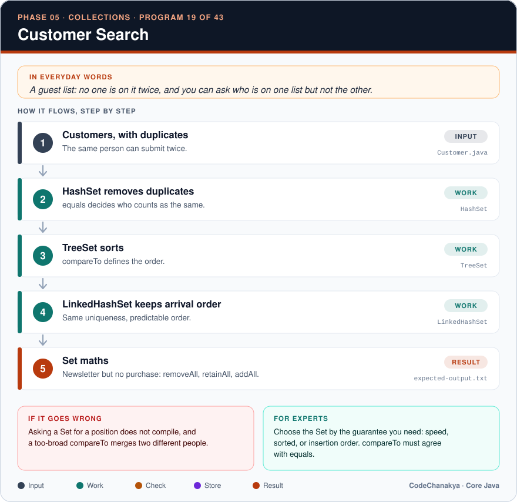

# 19 · Customer Search

**Phase 05 · Collections** &nbsp;|&nbsp; **Level:** Intermediate &nbsp;|&nbsp; **Java:** 21 or newer

Concepts: `Set`, `HashSet`, `LinkedHashSet`, `TreeSet`, `Comparable`, set operations.

---

## The problem

The sign-up form lets people submit twice. The marketing team wants a list of unique customers, a sorted list of cities, a way to search by name, and a quick answer to "who is on the newsletter but has not bought anything?"

Each of those questions has the same shape: a collection where **nothing appears twice** and where position does not matter. That is a `Set`.

<!--flow-->
## The flow at a glance

<p align="center"><a href="../../docs/flows/program-19.svg"></a></p>

| If you are | Read it like this |
|---|---|
| New to coding | A guest list: no one is on it twice, and you can ask who is on one list but not the other. |
| Learning | Follow the numbered cards from top to bottom. Open the file named on each card, run the program, and match its output to the last card. |
| Experienced | Choose the Set by the guarantee you need: speed, sorted, or insertion order. compareTo must agree with equals. |

<details>
<summary>Text version of the flow</summary>

1. **Customers, with duplicates** (input): The same person can submit twice. (`Customer.java`)
2. **HashSet removes duplicates** (work): equals decides who counts as the same. (`HashSet`)
3. **TreeSet sorts** (work): compareTo defines the order. (`TreeSet`)
4. **LinkedHashSet keeps arrival order** (work): Same uniqueness, predictable order. (`LinkedHashSet`)
5. **Set maths** (result): Newsletter but no purchase: removeAll, retainAll, addAll. (`expected-output.txt`)

</details>
<!--/flow-->

## Requirements

**Functional**
1. Keep the first sign-up for each email and ignore repeats, in arrival order.
2. List the cities served, alphabetically, with no repeats.
3. Search customers by the start of a name, results in alphabetical order.
4. Combine two groups of names: in both, in either, in one but not the other.

**Non-functional**
- "The same customer" must be defined in one place.
- Output order is predictable on every machine.

## Read in this order

| Step | File | What to look for |
|---|---|---|
| 1 | [`Customer.java`](src/main/java/com/codechanakya/customers/Customer.java) | `Comparable<Customer>` and `compareTo`. |
| 2 | [`CustomerDirectory.java`](src/main/java/com/codechanakya/customers/CustomerDirectory.java) | Three kinds of `Set`, each picked for a reason. |
| 3 | [`Main.java`](src/main/java/com/codechanakya/customers/Main.java) | The same data in all three, and the set maths. |

## Run it

```bash
./run.sh            # compile and run
./run.sh --check    # run, then compare with expected-output.txt
```

Expected output:

```text
Sign-ups received: 7

--- First sign-up per email (LinkedHashSet keeps arrival order) ---
  Asha Menon <asha@example.com> Kochi
  Rahul Verma <rahul@example.com> Pune
  Meera Iyer <meera@example.com> Chennai
  Kiran Rao <kiran@example.com> Pune
  Anil Kumar <anil@example.com> Kochi
  Asha Menon <asha.m@example.com> Chennai

--- Cities served (TreeSet keeps them sorted) ---
  [Chennai, Kochi, Pune]

--- Search: names starting with "as" ---
  Asha Menon <asha.m@example.com> Chennai
  Asha Menon <asha@example.com> Kochi
Two sign-ups from asha@example.com collapsed into one result,
because compareTo() said they are the same customer.

--- Same data, three kinds of Set ---
  LinkedHashSet (insertion order): [vip, new, pune, kochi]
  TreeSet (sorted order)         : [kochi, new, pune, vip]
  HashSet size                   : 4 (its order is not promised)

--- Set maths: newsletter list against buyers ---
  Newsletter : [Asha Menon, Kiran Rao, Meera Iyer, Rahul Verma]
  Buyers     : [Anil Kumar, Asha Menon, Meera Iyer]
  Both       : [Asha Menon, Meera Iyer]
  Either     : [Anil Kumar, Asha Menon, Kiran Rao, Meera Iyer, Rahul Verma]
  Newsletter only: [Kiran Rao, Rahul Verma]

--- Set facts ---
  First add("a") returns : true
  Second add("a") returns: false (already there, nothing changes)
  Is Asha a buyer? true
```

## The three Sets

| | `HashSet` | `LinkedHashSet` | `TreeSet` |
|---|---|---|---|
| Order | none promised | order of insertion | sorted |
| Speed | fastest | nearly as fast | slower, grows with log of size |
| Needs | `equals` and `hashCode` (Program 21) | the same | `Comparable`, or a `Comparator` |
| Reach for it when | you only ask "is it in there?" | you want de-duplication **and** the original order | you want sorted output or ranges |

Look at the "Same data, three kinds of Set" section of the output: one input, three orders. The `HashSet` line prints only the size, because its order is not something to rely on, and it can differ between Java versions.

## Sets answer "was it new?"

```java
if (seenEmails.add(customer.getEmail())) {
    unique.add(customer);       // first time we have met this email
}
```

`add` returns `true` when the item was new and `false` when the set already had it. That one return value is the whole de-duplication loop, with no `contains` check needed first. The last lines of the output show it.

## Comparable: the natural order

```java
public class Customer implements Comparable<Customer> {
    public int compareTo(Customer other) { ... }
}
```

`compareTo` returns a negative number when this comes first, zero when they are equal, and a positive number when this comes later. `TreeSet` and `Collections.sort` use it when you give them nothing else.

Two points that surprise people:

1. A `TreeSet` decides "duplicate" with `compareTo`, not `equals`. If `compareTo` says zero, the second item is thrown away. In this program name plus email is the identity, so two sign-ups with the same email collapse and two different people called Asha stay apart. Compare with [`broken/CompareToTooBroad.java`](broken/README.md), which compares names only.
2. `compareTo` should agree with `equals` whenever you can manage it. The next program shows why.

`Comparable` is the one natural order a class carries. `Comparator` (Program 18) is an outside rule you pass in. Use `Comparable` for "this is obviously how these sort", and `Comparator` for every other ordering.

## Set maths

```java
both.retainAll(buyers);      // keep only what is also in buyers: intersection
either.addAll(buyers);       // everything from either: union
onlyNewsletter.removeAll(buyers);   // remove those: difference
```

Each of these changes the set it is called on, so the program makes a copy first (`new TreeSet<>(newsletter)`) and leaves the originals alone.

## Common mistakes

| Mistake | What you see |
|---|---|
| `set.get(0)` | compile error: sets have no positions |
| A `TreeSet` of a class that is not `Comparable` | `ClassCastException` when the first item is added |
| `compareTo` that looks at too little | different items silently disappear |
| Relying on `HashSet` order | output changes on another machine |

Try three of these in [`broken/`](broken/README.md).

## Practice

- [`exercises/`](exercises/README.md): six tasks.
- [`solutions/`](solutions/README.md): one answer to each.

## Verification

Compiled and run with OpenJDK 21.0.13 on Linux. `./run.sh --check` passes. The solution file also compiles and runs. Not yet run on Java 25, Windows or macOS.

## Next

Program 20 is about collections where **when** an item arrives matters: queues and deques.
