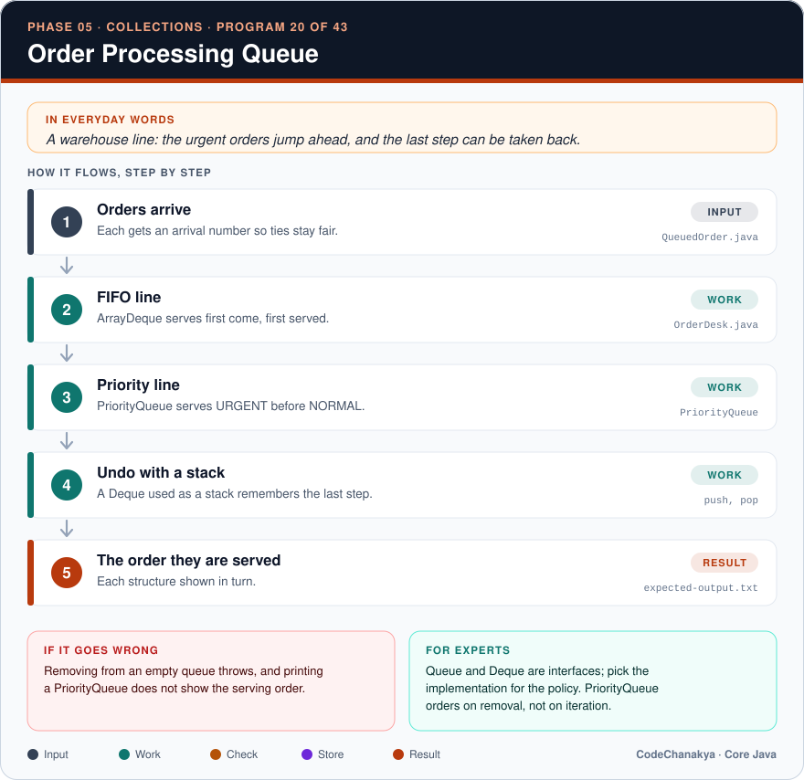
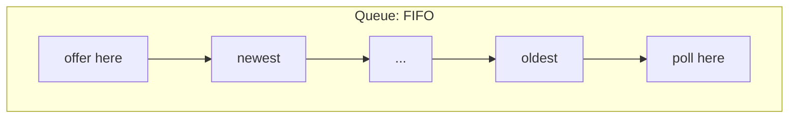

# 20 · Order Processing Queue

**Phase 05 · Collections** &nbsp;|&nbsp; **Level:** Intermediate &nbsp;|&nbsp; **Java:** 21 or newer

Concepts: `Queue`, `Deque`, `ArrayDeque`, `PriorityQueue`, `offer` / `poll` / `peek`, a stack with a `Deque`.

---

## The problem

Orders arrive all day. A warehouse handles them one at a time, and two questions decide the design: **who goes next**, and **can the last step be taken back**?

- First come, first served: a queue.
- Express orders jump the line, and ties keep arrival order: a priority queue.
- "Oops, undo that": a stack, which is a deque used from one end.

<!--flow-->
## The flow at a glance

<p align="center"><a href="../../docs/flows/program-20.svg"></a></p>

| If you are | Read it like this |
|---|---|
| New to coding | A warehouse line: the urgent orders jump ahead, and the last step can be taken back. |
| Learning | Follow the numbered cards from top to bottom. Open the file named on each card, run the program, and match its output to the last card. |
| Experienced | Queue and Deque are interfaces; pick the implementation for the policy. PriorityQueue orders on removal, not on iteration. |

<details>
<summary>Text version of the flow</summary>

1. **Orders arrive** (input): Each gets an arrival number so ties stay fair. (`QueuedOrder.java`)
2. **FIFO line** (work): ArrayDeque serves first come, first served. (`OrderDesk.java`)
3. **Priority line** (work): PriorityQueue serves URGENT before NORMAL. (`PriorityQueue`)
4. **Undo with a stack** (work): A Deque used as a stack remembers the last step. (`push, pop`)
5. **The order they are served** (result): Each structure shown in turn. (`expected-output.txt`)

</details>
<!--/flow-->

## Requirements

**Functional**
1. Orders go into a line; the next one out is the one that has waited longest.
2. A second line serves express orders first, fairly among themselves.
3. Finished orders can be undone, most recent first.
4. Asking an empty line for its next order must be handled safely.

**Non-functional**
- Two express orders are never swapped.
- The undo history is a collection of its own, separate from the lines.

## Read in this order

| Step | File | What to look for |
|---|---|---|
| 1 | [`Priority.java`](src/main/java/com/codechanakya/queue/Priority.java) | An enum whose order is the priority. |
| 2 | [`QueuedOrder.java`](src/main/java/com/codechanakya/queue/QueuedOrder.java) | The arrival number that makes ties fair. |
| 3 | [`OrderDesk.java`](src/main/java/com/codechanakya/queue/OrderDesk.java) | `ArrayDeque`, `PriorityQueue`, and a `Deque` used as a stack. |
| 4 | [`Main.java`](src/main/java/com/codechanakya/queue/Main.java) | Each structure in turn. |

## Run it

```bash
./run.sh            # compile and run
./run.sh --check    # run, then compare with expected-output.txt
```

Expected output:

```text
Orders received: 5

--- A plain queue: first in, first out ---
  Peek (look, do not take): ORD-1 (Asha, standard)
  Poll: ORD-1 (Asha, standard)
  Poll: ORD-2 (Rahul, express)
  Poll: ORD-3 (Meera, standard)

--- A priority queue: express first, then arrival ---
  Handle: ORD-2 (Rahul, express)
  Handle: ORD-4 (Kiran, express)
  Handle: ORD-1 (Asha, standard)
  Waiting: 2, finished: 3

--- A deque used as an undo stack ---
  Last finished: ORD-1 (Asha, standard)
  Undo it: ORD-1 (Asha, standard)
  Waiting again: 3, finished: 2
  Handle next: ORD-1 (Asha, standard)

--- Both ends of a Deque ---
  Tray: [front, middle, back]
  Take from front: front, from back: back
  Left: [middle]

--- Empty queue: null or exception? ---
  poll() on empty returns: null
  peek() on empty returns: null
  remove() on empty throws: NoSuchElementException
```

Note that the first two sections of the output work on **two independent lines holding the same five orders**, so ORD-1 appears in both. That is only so you can compare the two structures side by side; a real desk would use one.

## Queue and Deque



| Interface | Behaviour | Main calls |
|---|---|---|
| `Queue` | first in, first out | `offer`, `poll`, `peek` |
| `Deque` (double-ended queue, said "deck") | add and remove at **both** ends | `addFirst`, `addLast`, `pollFirst`, `pollLast`, and the stack calls `push`, `pop` |
| `PriorityQueue` | the next one out is the **smallest** by its order, not the oldest | `offer`, `poll`, `peek` |

`ArrayDeque` implements both `Queue` and `Deque`, is fast at both ends, and is the default choice for queues and stacks. (An old class called `Stack` exists; do not use it.)

## Two sets of calls: one throws, one returns null

| Action | Throws when it cannot | Returns a special value |
|---|---|---|
| add | `add(x)` | `offer(x)` |
| take | `remove()` | `poll()` returns `null` |
| look | `element()` | `peek()` returns `null` |

The last section of the output shows the pair. Prefer the `offer` / `poll` / `peek` family when "empty" is a normal state, which it is for a queue of work. Use `remove` when an empty queue means the program is wrong. Careful: if a queue can legitimately hold `null` you could not tell the difference, which is why `ArrayDeque` refuses `null` outright.

## PriorityQueue

```java
new PriorityQueue<>(
    Comparator.comparing(QueuedOrder::getPriority)       // enum order: EXPRESS first
              .thenComparingInt(QueuedOrder::getArrival)); // then who came first
```

- The comparator is the same tool from Program 18.
- Without the arrival tie-break, two express orders can come out in either order, which is unfair and untestable. A priority queue gives no promise about equal items, so you supply the promise.
- Printing a `PriorityQueue` does **not** show the sorted order, only `poll()` does. See [`broken/PriorityQueueOrder.java`](broken/README.md).

## A Deque as a stack

```java
history.push(order);        // add on top
history.pollFirst();        // take the top
history.peekFirst();        // look at the top
```

The last thing finished is the first thing undone: last in, first out. Undo and redo, a browser's back button, and nested brackets are all stacks.

## Common mistakes

| Mistake | What you see |
|---|---|
| `remove()` on an empty queue | `NoSuchElementException` |
| Printing a `PriorityQueue` to check its order | an order that looks wrong, and is fine |
| `push` on a variable typed `Queue` | compile error, `push` belongs to `Deque` |
| Adding `null` to an `ArrayDeque` | `NullPointerException` |
| A priority with no tie-break | equal items come out in an unspecified order |

## Practice

- [`exercises/`](exercises/README.md): six tasks.
- [`solutions/`](solutions/README.md): one answer to each.

## Verification

Compiled and run with OpenJDK 21.0.13 on Linux. `./run.sh --check` passes. The solution file also compiles and runs. Not yet run on Java 25, Windows or macOS.

## Next

Program 21 is about `Map`: finding something by a key instead of by position or by turn.
