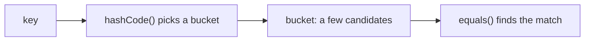

# 21 · Employee Directory

**Phase 05 · Collections** &nbsp;|&nbsp; **Level:** Intermediate to advanced &nbsp;|&nbsp; **Java:** 21 or newer

Concepts: `Map`, `HashMap`, `LinkedHashMap`, `TreeMap`, `equals` and `hashCode`, `getOrDefault`, `putIfAbsent`, `computeIfAbsent`, `merge`.

---

## The problem

HR needs to answer "who is E-211?" instantly, and "who is in Finance?", and "how many people does each department have?" With a list, the first question means scanning every employee, every time.

A `Map` stores **key to value** pairs and finds a value from its key without scanning. The price: the key type must have a correct `equals` and `hashCode`, which is the part of Java that most often goes wrong.

<!--flow-->
## The flow at a glance

<p align="center"><a href="../../docs/flows/program-21.svg"></a></p>

| If you are | Read it like this |
|---|---|
| New to coding | A phone book: look up by name in one step instead of reading every page. |
| Learning | Follow the numbered cards from top to bottom. Open the file named on each card, run the program, and match its output to the last card. |
| Experienced | A HashMap finds a bucket with hashCode, then compares with equals. TreeMap and LinkedHashMap trade speed for order. |

<details>
<summary>Text version of the flow</summary>

1. **Employees with an id** (input): equals and hashCode are written from the same field. (`Employee.java`)
2. **HashMap by id** (store): Lookup by id is effectively one step. (`Directory.java`)
3. **Group by department** (work): A Map from department to a list of people. (`Directory.java`)
4. **Replace and count** (work): put replaces; merge counts per department. (`merge`)
5. **Lookups and groups** (result): Why equals and hashCode must go together is shown. (`expected-output.txt`)

</details>
<!--/flow-->

## Requirements

**Functional**
1. Add, find, replace and remove an employee by id.
2. Add only when the id is free.
3. List everyone in the order they joined.
4. Group employees by department, with departments alphabetical, and count them.
5. Never hand the caller a `null` where a friendly default would do.

**Non-functional**
- Two `Employee` objects with the same id are the same person.
- Lookup does not slow down as the company grows.

## Read in this order

| Step | File | What to look for |
|---|---|---|
| 1 | [`Employee.java`](src/main/java/com/codechanakya/directory/Employee.java) | `equals` and `hashCode`, written together from one field. |
| 2 | [`Directory.java`](src/main/java/com/codechanakya/directory/Directory.java) | Three kinds of `Map`, and the helper methods. |
| 3 | [`Main.java`](src/main/java/com/codechanakya/directory/Main.java) | Lookups, replacement, grouping, and why the two methods matter. |

## Run it

```bash
./run.sh            # compile and run
./run.sh --check    # run, then compare with expected-output.txt
```

Expected output:

```text
--- Lookup by key ---
  find(E-007)       : E-007 Meera Iyer (Engineering)
  find(E-999)       : null
  nameOrUnknown(E-999): (unknown)
  has(E-350)        : true

--- put() replaces, putIfAbsent() does not ---
  put returned the old value: E-350 Kiran Rao (Support)
  addIfAbsent on a taken id : false
  E-350 is still            : E-350 Kiran Rao (Engineering)

--- Everyone, in joining order ---
  E-104 -> Asha Menon
  E-211 -> Rahul Verma
  E-007 -> Meera Iyer
  E-350 -> Kiran Rao
  E-412 -> Dev Patel

--- Grouped by department ---
  Engineering: Asha Menon, Meera Iyer, Kiran Rao
  Finance: Rahul Verma, Dev Patel
  Head count: {Engineering=3, Finance=2}

--- Why equals() and hashCode() matter ---
  Added the same id twice, set holds: 1
  first.equals(sameId): true
  Same hash code: true

--- Counting words with a HashMap ---
  to=2, be=2, or=1, not=1, missing=null
  (HashMap makes no promise about iteration order, so we look the keys up one by one.)
```

## The three Maps

| | `HashMap` | `LinkedHashMap` | `TreeMap` |
|---|---|---|---|
| Iteration order | none promised | order of insertion | sorted by key |
| Speed | fastest | nearly as fast | slower |
| Key needs | `equals` and `hashCode` | the same | `Comparable` or a `Comparator` |
| Used here for | word counts | the main table (joining order) | departments (alphabetical) |

The same Set-versus-Map pattern from Program 19 applies: pick `LinkedHashMap` when you want lookup **and** a stable order, and `TreeMap` when you want it sorted.

## The calls you will use every day

| Call | What it does |
|---|---|
| `put(k, v)` | stores a pair; returns the **old** value, or `null` if the key was new |
| `get(k)` | the value, or `null` if the key is missing |
| `getOrDefault(k, d)` | the value, or `d` when the key is missing |
| `putIfAbsent(k, v)` | stores only when the key is free; returns the existing value or `null` |
| `containsKey(k)` | does the key exist? |
| `remove(k)` | deletes the pair and returns its value |
| `computeIfAbsent(k, ...)` | creates a value the first time a key appears |
| `merge(k, v, ...)` | stores `v`, or combines it with what is already there |
| `keySet()`, `values()`, `entrySet()` | the keys, the values, or the pairs, for looping |

The department grouping and the head count use the last two, which replace the old "get it, check for null, create it, put it back" dance. The expressions `key -> new ArrayList<>()` and `Integer::sum` are short pieces of code passed as arguments. They are called lambdas and method references, and Phase 7 explains them. For now read them as "a recipe for when it is missing" and "add the two numbers".

## equals and hashCode

A `HashMap` finds a key in two steps:

1. `hashCode()` picks a **bucket**: a small box where the key might be.
2. `equals()` checks the keys in that bucket one by one.



Two rules, and they must hold together:

1. If `a.equals(b)` is true, `a.hashCode()` must equal `b.hashCode()`.
2. A key's `equals` and `hashCode` must not change while it sits in a map.

Break rule 1 and equal objects land in different buckets, so the map cannot find an object it contains: [`broken/EqualsWithoutHashCode.java`](broken/README.md). Break rule 2 by editing a key after storing it and the entry is lost in the wrong bucket: [`broken/MutableKey.java`](broken/README.md). That is why `Employee` has only `final` fields, and why `String`, `Integer` and enums (all immutable) make good keys.

`Objects.hash(id)` builds a hash from the same fields `equals` compares. Write the two methods together, every time. Your IDE can generate both.

## Common mistakes

| Mistake | What you see |
|---|---|
| `equals` without `hashCode` | a `HashSet` or `HashMap` that cannot find its own items |
| Changing a key after storing it | the entry is "lost" |
| `int n = map.get(k)` for a missing key | `NullPointerException` (the `null` cannot become an `int`) |
| Printing a `HashMap` and relying on the order | output that differs between machines |
| Removing from a map inside a for-each | `ConcurrentModificationException` |

Try three of these in [`broken/`](broken/README.md).

## Practice

- [`exercises/`](exercises/README.md): six tasks.
- [`solutions/`](solutions/README.md): one answer to each.

## Verification

Compiled and run with OpenJDK 21.0.13 on Linux. `./run.sh --check` passes. The solution file also compiles and runs. Not yet run on Java 25, Windows or macOS.

## Next

Program 22 is the Phase 5 project. It combines maps, lists, sets and a deque in one inventory.
