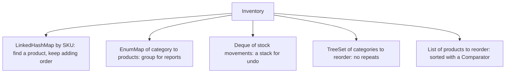

# 22 · Product Inventory (Phase 5 project)

**Phase 05 · Collections** &nbsp;|&nbsp; **Level:** Advanced &nbsp;|&nbsp; **Java:** 21 or newer

Concepts: `Map`, `List`, `Set`, `Deque` working together, `EnumMap`, a generic helper, custom exceptions.

---

## The problem

A shop needs stock control. Find a product by SKU, receive and sell stock, group products by category, list what needs reordering, and take back the last change when someone clicks the wrong button.

No single collection does all of it. This project uses each collection for the job it is good at, which is the real skill of this phase.

## Requirements

**Functional**
1. Add products; look one up by SKU.
2. Receive stock and sell stock. Selling more than is on the shelf is refused and says by how much.
3. An unknown SKU is reported clearly.
4. Report: products grouped by category; money tied up per category; products at or below their reorder level, emptiest first; and which categories are affected.
5. Undo the latest change.

**Non-functional**
- Every stock change is recorded; nothing can change stock without going through `Inventory`.
- Reports come out in a predictable order.

## Read in this order

| Step | File | What to look for |
|---|---|---|
| 1 | [`Category.java`](src/main/java/com/codechanakya/inventory/Category.java), [`Product.java`](src/main/java/com/codechanakya/inventory/Product.java) | An enum (Program 14) and a package-private `changeStock`. |
| 2 | [`UnknownProductException.java`](src/main/java/com/codechanakya/inventory/UnknownProductException.java), [`OutOfStockException.java`](src/main/java/com/codechanakya/inventory/OutOfStockException.java) | Checked exceptions (Program 15), one carrying numbers. |
| 3 | [`MapUtil.java`](src/main/java/com/codechanakya/inventory/MapUtil.java) | A generic method with two type parameters (Program 16). |
| 4 | [`StockMovement.java`](src/main/java/com/codechanakya/inventory/StockMovement.java) | One recorded change. |
| 5 | [`Inventory.java`](src/main/java/com/codechanakya/inventory/Inventory.java) | Four collections, four jobs. |
| 6 | [`Main.java`](src/main/java/com/codechanakya/inventory/Main.java) | A day at the shop. |

## Run it

```bash
./run.sh            # compile and run
./run.sh --check    # run, then compare with expected-output.txt
```

Expected output:

```text
--- Stock by category ---
ELECTRONICS:
  E-100  USB-C Cable      ELECTRONICS   299.00  stock  40
  E-110  Headphones       ELECTRONICS  1999.00  stock   6
STATIONERY:
  S-200  Notebook         STATIONERY     85.50  stock 120
  S-210  Pen Pack         STATIONERY     40.00  stock  25
HOME:
  H-300  Desk Lamp        HOME         1250.00  stock   3

--- Value of stock per category ---
  ELECTRONICS: 23954.00
  STATIONERY: 11260.00
  HOME: 3750.00

--- Reorder list, emptiest first ---
  Desk Lamp: 3 left, reorder at 5
  Headphones: 6 left, reorder at 8
  Pen Pack: 25 left, reorder at 25
  Categories affected: [ELECTRONICS, STATIONERY, HOME]

--- Selling and receiving ---
  Three movements recorded.
  Refused: Cannot sell 10 of Headphones, only 6 in stock
  Short by: 4
  Refused: No product with SKU X-999

--- Movement history, newest first ---
  +12 H-300 (received)
  -100 S-200 (sold)
  -15 E-100 (sold)

--- Undo the last two movements ---
  Undid: +12 H-300 (received)
  Undid: -100 S-200 (sold)
  Notebook stock is back to 120
  Lamp stock is back to     3

--- Reorder list now ---
  Desk Lamp: 3 left
  Headphones: 6 left
  Pen Pack: 25 left
```

## One collection per job



| Question | Collection | Why |
|---|---|---|
| "Which product has SKU H-300?" | `LinkedHashMap<String, Product>` | lookup by key, stable listing |
| "All products in a category?" | `EnumMap<Category, List<Product>>` | keys are an enum, so `EnumMap` is compact and ordered by declaration |
| "What was the last change?" | `ArrayDeque<StockMovement>` | last in, first out |
| "Which categories need action?" | `TreeSet<Category>` | no repeats, sorted |
| "What to reorder, emptiest first?" | `ArrayList` plus a `Comparator` | a sorted sequence |

## How the pieces fit

- **Enum from Program 14.** `Category` replaces a `String`, so `"Stationary"` cannot compile.
- **Exceptions from Program 15.** `OutOfStockException` carries the shortfall; callers handle a missing SKU with a multi-catch.
- **Generics from Program 16.** `MapUtil.addToGroup(Map<K, List<V>>, K, V)` is written once and works for any key and value types. It is used for the category grouping.
- **Comparator from Program 18.** `LOWEST_STOCK_FIRST` sorts the reorder list, with the name as tie-break.
- **Queue and Deque from Program 20.** The undo history is a `Deque` used as a stack.
- **Map from Program 21.** `merge` totals the money per category, and `BigDecimal::add` is the combining rule.

## Design decisions

- **`changeStock` is package-private.** Code outside the package cannot call it, so nobody can change stock without `Inventory` recording the movement. Undo only works because of that.
- **Undo reverses the stored change.** The movement holds the delta, so reversing it is `changeStock(-delta)`. No snapshots are needed.
- **`byCategory()` is rebuilt on each call.** It is simple, and always correct after a sale. For a very large inventory you would keep it up to date instead.
- **A sale is checked before anything changes.** An `OutOfStockException` leaves stock and history untouched.
- **A checked exception for an unknown SKU.** A mistyped SKU is a normal event the caller can recover from.

## Common mistakes

| Mistake | What you see |
|---|---|
| Putting a `Product` where the map wants a `List<Product>` | `incompatible types` at compile time |
| A `null` key in a `TreeMap` | `NullPointerException` |
| Removing from a map while looping over it | `ConcurrentModificationException` |
| Mutating a product's data from outside the class | stock with no history, so undo breaks |

Try three of these in [`broken/`](broken/README.md).

## Practice

- [`exercises/`](exercises/README.md): six tasks.
- [`solutions/`](solutions/README.md): one answer to each.

## Verification

Compiled and run with OpenJDK 21.0.13 on Linux. `./run.sh --check` passes. The solution file also compiles and runs. Not yet run on Java 25, Windows or macOS.

## Git commit suggestions

```text
Add Program 22: product and category model
Add inventory with lookup by SKU and grouping by category
Add stock movements with undo
Add reorder report
```

## Next

Phase 6 (Programs 23 to 26) leaves memory behind: reading and writing files, and working with dates.
