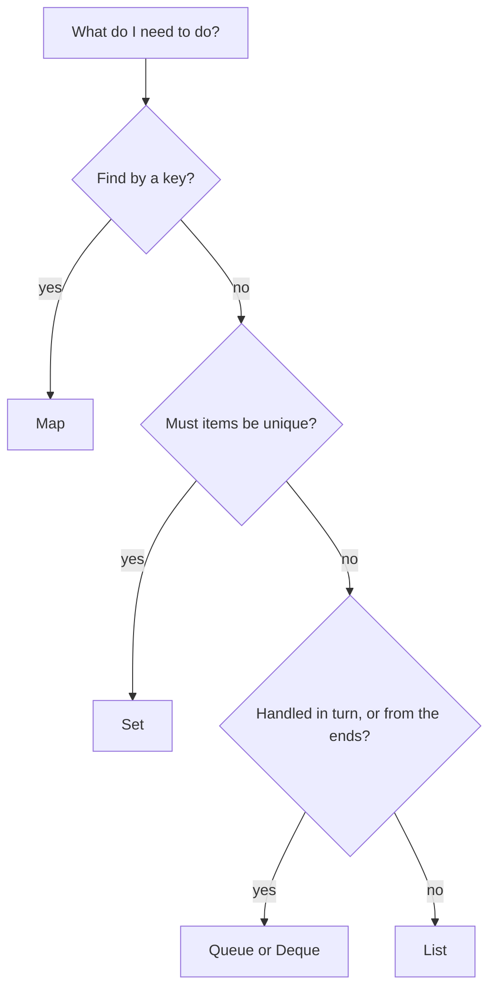

# Phase 05 · Collections

Five programs on the containers Java gives you, and above all on **choosing** between them. Writing code with a `List` is easy. Knowing when a `Set`, a `Map` or a `Deque` would have been the better answer is the skill.

| No. | Program | New ideas |
|---|---|---|
| 18 | [Online Shopping Cart](18-online-shopping-cart) | `List`, `Iterator`, `Comparator` |
| 19 | [Customer Search](19-customer-search) | `Set`, `Comparable` |
| 20 | [Order Processing Queue](20-order-processing-queue) | `Queue`, `Deque`, `PriorityQueue` |
| 21 | [Employee Directory](21-employee-directory) | `Map`, `equals` / `hashCode` |
| 22 | [Product Inventory](22-product-inventory) | all of them together (phase project) |

## Which collection?

| Need | Use | Typical class |
|---|---|---|
| Ordered sequence, repeats allowed | `List` | `ArrayList` |
| No repeats, any order | `Set` | `HashSet` |
| No repeats, keep arrival order | `Set` | `LinkedHashSet` |
| No repeats, sorted | `Set` | `TreeSet` |
| Key to value | `Map` | `HashMap` |
| Key to value, keep arrival order | `Map` | `LinkedHashMap` |
| Key to value, sorted by key | `Map` | `TreeMap` |
| Key is an enum | `Map` | `EnumMap` |
| First in, first out | `Queue` | `ArrayDeque` |
| Last in, first out | `Deque` | `ArrayDeque` |
| Smallest or most urgent first | `Queue` | `PriorityQueue` |

Two habits to build now: declare variables with the **interface** (`List`, `Map`) and create the class (`ArrayList`, `HashMap`) on the right of the `=`; and always give the collection its type (`List<String>`, never a raw `List`).

## Mastery checkpoint

Build this without looking at the solutions.

**Library Desk.** A small library lends books.

1. A `Book` with an ISBN (its identity, with correct `equals` and `hashCode`), a title and an author.
2. A `Map<String, Book>` catalogue found by ISBN, and a `Set<String>` of ISBNs currently on loan.
3. A `Queue` of members waiting for a book that is on loan, first come first served. When it is returned, the next member in the queue gets it.
4. A `Deque` that records loans so the last one can be undone.
5. A report of titles in alphabetical order using a `Comparator`, and of authors with how many books each has (`merge`).
6. Use the custom exceptions style from Phase 4: refuse an unknown ISBN and a book already on loan.

You are ready for Phase 6 when you can say, for each collection you picked, **why** it and not another, and when a repeated ISBN, an empty queue and a wrong key are all handled without a crash.

## Levels

| Level | You can... |
|---|---|
| 1 Understood | explain what each collection is for |
| 2 Applied | use each of them in a working program |
| 3 Connected | combine them as Program 22 does |
| 4 Mastered | choose, justify and defend the choice for a new problem |
