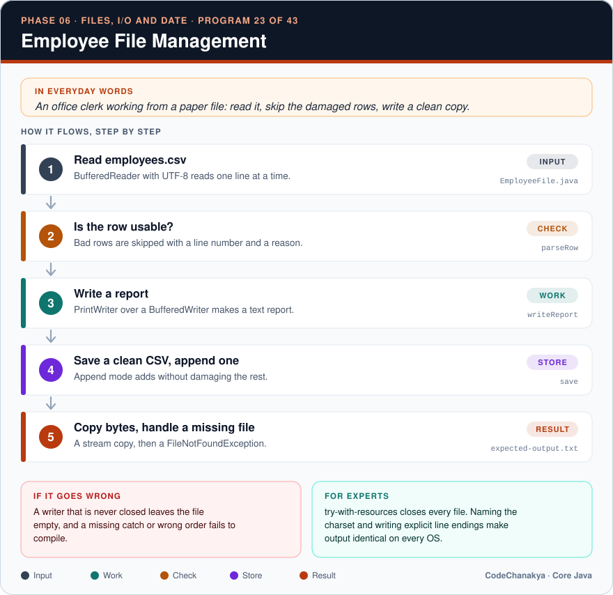

# 23 · Employee File Management

**Phase 06 · Files, I/O and Date** &nbsp;|&nbsp; **Level:** Intermediate &nbsp;|&nbsp; **Java:** 21 or newer

Concepts: `File`, `Reader` and `Writer`, `InputStream` and `OutputStream`, buffering, try-with-resources, CSV, `IOException`.

---

## The problem

Until now every program started with its data typed into `Main` and forgot it all when it ended. Real programs read data from files and write results back. HR keeps employees in a CSV file, and the program has to read it, cope with the bad rows every real file has, produce a report, and add a new employee without damaging the rest.

<!--flow-->
## The flow at a glance

<p align="center"><a href="../../docs/flows/program-23.svg"></a></p>

| If you are | Read it like this |
|---|---|
| New to coding | An office clerk working from a paper file: read it, skip the damaged rows, write a clean copy. |
| Learning | Follow the numbered cards from top to bottom. Open the file named on each card, run the program, and match its output to the last card. |
| Experienced | try-with-resources closes every file. Naming the charset and writing explicit line endings make output identical on every OS. |

<details>
<summary>Text version of the flow</summary>

1. **Read employees.csv** (input): BufferedReader with UTF-8 reads one line at a time. (`EmployeeFile.java`)
2. **Is the row usable?** (check): Bad rows are skipped with a line number and a reason. (`parseRow`)
3. **Write a report** (work): PrintWriter over a BufferedWriter makes a text report. (`writeReport`)
4. **Save a clean CSV, append one** (store): Append mode adds without damaging the rest. (`save`)
5. **Copy bytes, handle a missing file** (result): A stream copy, then a FileNotFoundException. (`expected-output.txt`)

</details>
<!--/flow-->

## Requirements

**Functional**
1. Read `data/employees.csv` into `Employee` objects.
2. Skip rows that cannot be used, and say which row and why.
3. Write a readable text report and read it back.
4. Save a clean CSV, then append one more employee to it.
5. Copy a file byte for byte.
6. Handle a file that does not exist.

**Non-functional**
- Every file is closed, even when something fails.
- The files the program writes are identical on every operating system.
- Nothing is written outside `out/`.

## Read in this order

| Step | File | What to look for |
|---|---|---|
| 1 | [`data/employees.csv`](data/employees.csv) | Real-looking data with a blank line and two bad rows. |
| 2 | [`Employee.java`](src/main/java/com/codechanakya/files/Employee.java), [`LoadResult.java`](src/main/java/com/codechanakya/files/LoadResult.java) | A row, and "good rows plus problems". |
| 3 | [`EmployeeFile.java`](src/main/java/com/codechanakya/files/EmployeeFile.java) | Every `java.io` class used here, and why. |
| 4 | [`Main.java`](src/main/java/com/codechanakya/files/Main.java) | Six short scenarios. |

## Run it

```bash
./run.sh            # compile and run
./run.sh --check    # run, then compare with expected-output.txt
```

Run it from this folder (`run.sh` does that for you). The program reads its sample data from the `data` folder next to it, and writes anything it creates under `out/work`, which `run.sh` clears on every run, so the repository stays clean.

Expected output:

```text
--- Reading data/employees.csv ---
Loaded 6 employees, skipped 2 lines
  Skipped line 8: expected 4 fields but found 3
  Skipped line 9: salary is not a number: "seventy thousand"

--- Payroll by department ---
  Engineering    285000.50
  Finance        140500.00
  Support         41000.00
  Total          466500.50

--- Writing a report, then reading it back ---
  | ID       Name           Department        Salary
  | ------------------------------------------------
  | E-101    Asha Menon     Engineering     92000.00
  | E-102    Rahul Verma    Finance         68000.00
  | E-103    Meera Iyer     Engineering    105000.50
  | E-104    Kiran Rao      Support         41000.00
  | E-205    Dev Patel      Finance         72500.00
  | E-208    Neha Joshi     Engineering     88000.00
  | 6 employees

--- Saving a clean copy, then appending ---
  Rows after save  : 6
  Rows after append: 7 (problems: 0)

--- Copying as raw bytes ---
  Copied 280 bytes; the original is 280 bytes, the copy is 280 bytes

--- When the file is not there ---
  exists(): false
  Caught FileNotFoundException
  FileNotFoundException is an IOException: true
```

## Two families: text and bytes

| | Reads | Writes | Knows about |
|---|---|---|---|
| **Reader / Writer** | `FileReader`, `BufferedReader` | `FileWriter`, `BufferedWriter`, `PrintWriter` | characters, so it needs a charset |
| **InputStream / OutputStream** | `FileInputStream` | `FileOutputStream` | raw bytes; images, PDFs, anything |

Use a Reader or Writer for text, and a stream for everything else. `copyBytes` uses streams because it must copy a file without caring what is in it.

## Layers: wrapping one class in another

```java
new BufferedReader(new FileReader(file, StandardCharsets.UTF_8))
```

`FileReader` knows how to get characters from a file. `BufferedReader` is wrapped around it and adds a memory buffer plus `readLine()`. Disk reads are slow, so reading a line from a buffer already in memory is far faster than asking the disk for each character. The same wrapping idea gives you `PrintWriter` (adds `printf`) around a `BufferedWriter` around a `FileWriter` in `writeReport`.

## Always close: try-with-resources

```java
try (BufferedReader reader = new BufferedReader(new FileReader(file, StandardCharsets.UTF_8))) {
    ...
}   // reader.close() runs here, even if an exception was thrown
```

Program 15 showed this with an audit log. A file you forget to close stays locked on some systems, and a writer you forget to close may never write its last lines, because buffered text is only sent to disk when the buffer is flushed or the writer is closed. Closing a writer flushes it first. See [`broken/UnclosedWriter.java`](broken/README.md): the file is still empty while the writer is open.

## Charsets and line endings

- **Charset.** Text is stored as bytes, and a charset says how. Always name it (`StandardCharsets.UTF_8`). Without it Java uses a default that differs between systems, and the same file reads differently on two machines.
- **Line endings.** Windows ends lines with two characters, Linux and macOS with one. `readLine()` copes with both. When writing, `newLine()` and `%n` use the **local** convention, so this program writes `"\n"` explicitly. The result: the files it creates are the same on every system, and `expected-output.txt` matches everywhere.

## Reading a messy file

```java
String[] parts = line.split(",", -1);
```

The `-1` stops Java from throwing away empty trailing fields, so `E-206,Zoya,Support,` is seen as four fields with the last one empty, instead of looking like three. Row validation lives in one place (`parseRow`), and it records a **reason** for every rejected line. A loader that silently drops rows is hard to trust; one that says "line 8: expected 4 fields but found 3" is easy to fix.

## Where is "here"?

`new File("data", "employees.csv")` is a **relative** path. It is relative to the folder the program was started from, not to the source file. `run.sh` begins with `cd` into the program's folder for exactly that reason. Start the program from somewhere else and the file will not be found: a `FileNotFoundException`, shown in the last scenario.

## Exceptions

`FileNotFoundException` is a **subclass** of `IOException`. If you catch both, the specific one must come first (Program 15's rule): see [`broken/CatchOrderIO.java`](broken/README.md). Most file methods throw the checked `IOException`, so the compiler forces you to decide what happens when the disk says no ([`broken/UnhandledIOException.java`](broken/README.md)).

## Common mistakes

| Mistake | What you see |
|---|---|
| Not closing a writer | missing or truncated output, with no error |
| No charset | text that changes between machines |
| Using `newLine()` and `%n` when the file must be identical everywhere | CRLF on Windows, LF elsewhere |
| Catching `IOException` before `FileNotFoundException` | compile error: already caught |
| Assuming the working directory | `FileNotFoundException` when run from another folder |

## Practice

- [`exercises/`](exercises/README.md): six tasks.
- [`solutions/`](solutions/README.md): one answer to each.

## Verification

Compiled and run with OpenJDK 21.0.13 on Linux. `./run.sh --check` passes. The solution file also compiles and runs. Not yet run on Java 25, Windows or macOS.

## Next

Program 24 does the same job with the newer `java.nio.file` classes, which are what you will meet in modern code.
