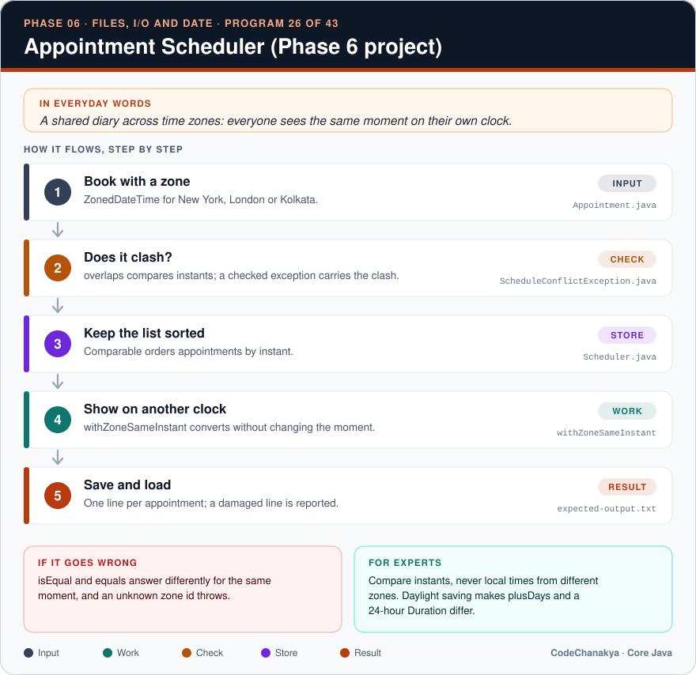
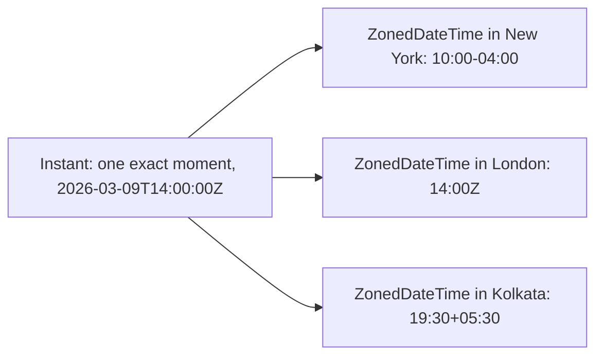

# 26 · Appointment Scheduler (Phase 6 project)

**Phase 06 · Files, I/O and Date** &nbsp;|&nbsp; **Level:** Advanced &nbsp;|&nbsp; **Java:** 21 or newer

Concepts: `ZonedDateTime`, `ZoneId`, `Instant`, `Duration`, daylight saving, saving and loading a text file, plus checked exceptions and `Comparable`.

---

## The problem

A team in New York, London and Kolkata books meetings. Everybody types a time on their own clock, the scheduler must not double-book anyone, each person wants the agenda on their own clock, and the bookings must survive the program being closed.

Three problems at once: time zones, daylight saving (clocks that skip and repeat an hour), and persistence. This project builds on everything from Phases 4 and 5 too: a checked exception, `Comparable`, sorted collections, and file reading with careful error handling.

<!--flow-->
## The flow at a glance

<p align="center"><a href="../../docs/flows/program-26.svg"></a></p>

| If you are | Read it like this |
|---|---|
| New to coding | A shared diary across time zones: everyone sees the same moment on their own clock. |
| Learning | Follow the numbered cards from top to bottom. Open the file named on each card, run the program, and match its output to the last card. |
| Experienced | Compare instants, never local times from different zones. Daylight saving makes plusDays and a 24-hour Duration differ. |

<details>
<summary>Text version of the flow</summary>

1. **Book with a zone** (input): ZonedDateTime for New York, London or Kolkata. (`Appointment.java`)
2. **Does it clash?** (check): overlaps compares instants; a checked exception carries the clash. (`ScheduleConflictException.java`)
3. **Keep the list sorted** (store): Comparable orders appointments by instant. (`Scheduler.java`)
4. **Show on another clock** (work): withZoneSameInstant converts without changing the moment. (`withZoneSameInstant`)
5. **Save and load** (result): One line per appointment; a damaged line is reported. (`expected-output.txt`)

</details>
<!--/flow-->

## Requirements

**Functional**
1. Book an appointment with a title, a start time **in a zone**, and a length.
2. Refuse an appointment that overlaps another, even when they were entered in different zones.
3. Show the agenda in any zone.
4. Save to a file and load it back, with every moment unchanged.
5. A damaged file must not stop the good lines loading, and every skipped line gets a reason.

**Non-functional**
- Comparing and ordering uses exact moments, never local clock readings.
- Behaviour around a clock change is deliberate, not accidental.

## Read in this order

| Step | File | What to look for |
|---|---|---|
| 1 | [`Appointment.java`](src/main/java/com/codechanakya/scheduler/Appointment.java) | `ZonedDateTime`, `Duration`, `overlaps`, `toLine` and `fromLine`. |
| 2 | [`ScheduleConflictException.java`](src/main/java/com/codechanakya/scheduler/ScheduleConflictException.java) | A checked exception that carries the clash. |
| 3 | [`Scheduler.java`](src/main/java/com/codechanakya/scheduler/Scheduler.java) | A sorted list, `withZoneSameInstant`, save and load. |
| 4 | [`Main.java`](src/main/java/com/codechanakya/scheduler/Main.java) | Five sections, from zones to a damaged file. |

## Run it

```bash
./run.sh            # compile and run
./run.sh --check    # run, then compare with expected-output.txt
```

Run it from this folder (`run.sh` does that for you). The program reads its sample data from the `data` folder next to it, and writes anything it creates under `out/work`, which `run.sh` clears on every run, so the repository stays clean.

Expected output:

```text
--- One moment, three clocks ---
  New York: 2026-03-09T10:00-04:00[America/New_York]
  London  : 2026-03-09T14:00Z[Europe/London]
  Kolkata : 2026-03-09T19:30+05:30[Asia/Kolkata]
  Same Instant in UTC: 2026-03-09T14:00:00Z

--- Booking across zones ---
  Booked  "Stand-up"
  Refused "Design review" overlaps "Stand-up"
  Booked  "Client call"
  Booked  "Retro"

--- The same agenda on two clocks ---
  New York:
    Mon 09 Mar 10:00 -04:00 [America/New_York]  Stand-up (30 min)
    Mon 09 Mar 11:00 -04:00 [America/New_York]  Client call (60 min)
    Tue 10 Mar 15:00 -04:00 [America/New_York]  Retro (60 min)
  Kolkata:
    Mon 09 Mar 19:30 +05:30 [Asia/Kolkata]  Stand-up (30 min)
    Mon 09 Mar 20:30 +05:30 [Asia/Kolkata]  Client call (60 min)
    Wed 11 Mar 00:30 +05:30 [Asia/Kolkata]  Retro (60 min)

--- Clock changes ---
  2:30 on 8 March does not exist in New York, so Java gives: 2026-03-08T03:30-04:00[America/New_York]
  1:30 on 1 November happens twice. Default (earlier): 2026-11-01T01:30-04:00[America/New_York]
  The later one: 2026-11-01T01:30-05:00[America/New_York]
  Saturday 09:00 plusDays(1)       : 2026-03-08T09:00-04:00[America/New_York]
  Saturday 09:00 plus 24 hours     : 2026-03-08T10:00-04:00[America/New_York]
  Hours in 8 March in New York     : 23

--- Saving and loading ---
  | Stand-up|2026-03-09T10:00-04:00[America/New_York]|30
  | Client call|2026-03-09T20:30+05:30[Asia/Kolkata]|60
  | Retro|2026-03-10T15:00-04:00[America/New_York]|60
  Loaded 3 appointments, 0 problems
  Every start time survived the round trip: true

--- A damaged file ---
  Loaded 4 appointments
  Skipped line 5: could not read (IllegalArgumentException)
  Skipped line 6: could not read (DateTimeParseException)
  Skipped line 7: "Overlap" overlaps "Stand-up"
  Skipped line 8: could not read (NumberFormatException)
```

## Three ways to say "when"



| Class | What it knows | Use for |
|---|---|---|
| `Instant` | one point on the timeline, no zone | logs, timestamps, comparing |
| `ZonedDateTime` | the moment **and** a zone's rules (`America/New_York`) | meetings, anything people attend |
| `LocalDateTime` | a clock reading with no zone | cannot compare across places (see `EqualsVsIsEqual`) |

The first section of the output prints one moment three ways. Look at the London line: `14:00Z`. The `Z` means "offset zero from UTC", and that is what London's clocks show in early March. In late March London moves to summer time and the same zone shows `+01:00`.

## Zone ids and offsets

- Use a **zone id**: `ZoneId.of("America/New_York")`. It names a place whose rules for daylight saving are known.
- An **offset** such as `-04:00` is only a number. It says nothing about what happens next autumn.
- Abbreviations like `IST` are ambiguous (India, Ireland and Israel all use it), so Java does not accept them as ids. A made-up id fails: [`broken/UnknownZone.java`](broken/README.md).

## Comparing two appointments

```java
start.toInstant().isBefore(other.getEnd().toInstant())
```

Ten o'clock in New York and 14:00 in London are the same moment, so `equals()` on the two `ZonedDateTime` values says **false** (different zones) while `isEqual()` says **true** (same instant). Comparing `LocalDateTime` values would call New York "earlier" when it is not. Everything that decides order or overlap in this program goes through `toInstant()`. See [`broken/EqualsVsIsEqual.java`](broken/README.md).

The overlap test treats appointments as half-open: one that ends at 10:30 does not clash with one that starts at 10:30.

## Clock changes

The "Clock changes" section prints what Java does, for New York in 2026:

| Situation | What Java does |
|---|---|
| 02:30 on 8 March does not exist (clocks jump from 02:00 to 03:00) | moves forward to 03:30 |
| 01:30 on 1 November happens twice (clocks fall back) | picks the **earlier** one by default; `withLaterOffsetAtOverlap()` picks the other |
| Saturday 09:00 `plusDays(1)` | Sunday 09:00 on the wall clock, though only 23 hours passed |
| Saturday 09:00 `plus(Duration.ofHours(24))` | exactly 24 hours later, which reads 10:00 on the wall clock |
| the day of 8 March | 23 hours long |

Choose on purpose. "Same time tomorrow" is `plusDays`. "Exactly one day of elapsed time" is a `Duration`. An appointment's **end** is `start.plus(length)`, because a one hour meeting lasts one hour even across a change.

## Saving and loading

A line looks like this:

```text
Stand-up|2026-03-09T10:00-04:00[America/New_York]|30
```

- `ZonedDateTime.toString()` produces the ISO form with both the offset and the zone id, and `ZonedDateTime.parse` reads it back. No formatter is needed, and the moment survives the round trip, which the program checks.
- Minutes are stored as a plain number, and `Duration.ofMinutes` rebuilds the length.
- `fromLine` is the reverse of `toLine`. Keep the two next to each other so they stay in step.
- The `|` separator is chosen because titles can contain commas. A title that contained a `|` would break the format; a real system would escape it or use JSON, which you meet later.

**A design note.** Storing the zone id alongside the offset lets the loader check that the offset is right for that zone. For a meeting years away, the rules for a zone can change (countries do abolish or move daylight saving), which is one reason calendars store the local time and the zone rather than a fixed instant.

## A damaged file

The last section appends five lines, four of them bad in different ways, and loads again. The loader:

- skips an unreadable line and records a reason with its line number;
- reports an overlap as a conflict, not as corruption;
- never lets one bad line stop the rest.

`catch (RuntimeException e)` is deliberately wide **here**: every kind of failure from a bad line means the same thing, "this line is not usable". It is not a pattern to copy into code where different errors need different handling.

## Common mistakes

| Mistake | What you see |
|---|---|
| Comparing local times from different zones | wrong order, missed clashes |
| `equals` where `isEqual` was meant | `false` for the same moment |
| Using offsets instead of zone ids | wrong answers after a clock change |
| `Duration.between` on dates | `UnsupportedTemporalTypeException` |
| `plusDays` where elapsed time was meant, or the opposite | an hour out around a clock change |
| Guessing a zone name | `ZoneRulesException` |

## Practice

- [`exercises/`](exercises/README.md): six tasks.
- [`solutions/`](solutions/README.md): one answer to each.

## Verification

Compiled and run with OpenJDK 21.0.13 on Linux. `./run.sh --check` passes. The solution file also compiles and runs. Not yet run on Java 25, Windows or macOS.

## Git commit suggestions

```text
Add Program 26: appointment model with zones and duration
Add scheduler with conflict detection
Add saving and loading with line-by-line error reports
```

## Next

Phase 7 (Programs 27 to 30) is Modern Java: lambdas, streams, records and `Optional`. You have already used small pieces of them (`CartItem::getName`, `Integer::sum`); the next phase explains them.
