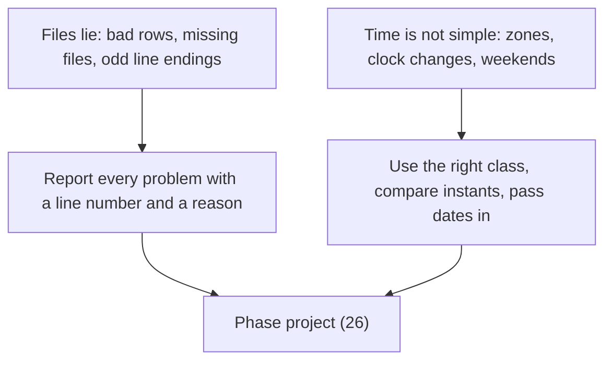

# Phase 06 · Files, I/O and Date

Programs so far lived and died in memory. This phase makes them useful in the real world: reading and writing files, and knowing what day and time it is, which is harder than it sounds.

| No. | Program | New ideas |
|---|---|---|
| 23 | [Employee File Management](23-employee-file-management) | `java.io`: readers, writers, streams, buffering |
| 24 | [Log File Analyzer](24-log-file-analyzer) | `java.nio.file`: `Path` and `Files` |
| 25 | [Daily Transaction Report](25-daily-transaction-report) | `LocalDate`, `LocalTime`, `Duration`, formatting |
| 26 | [Appointment Scheduler](26-appointment-scheduler) | `ZonedDateTime`, daylight saving, saving to a file (phase project) |

## How these programs run

Each reads sample data from a `data` folder next to it and writes anything it creates under `out/work`. Run each from its own folder; `run.sh` does that for you. If you start a program from somewhere else, its relative paths point at the wrong place and it reports a missing file, which is a good thing to see once on purpose.

## The themes

| Habit | Why |
|---|---|
| Name the charset: `StandardCharsets.UTF_8` | the default differs between machines |
| Close everything with try-with-resources | open files leak and unflushed text is lost |
| Skip a bad row, but say which and why | silent data loss is the worst outcome |
| Sort anything that came from a directory listing | the order is the system's, not yours |
| Pass a `Locale` when formatting text | names of days and months follow the machine |
| Pass the date in; avoid `now()` in logic | testable and repeatable |
| Compare instants, never local times from different zones | correctness across places |

## Mastery checkpoint

Build this without looking at the solutions.

**Shift Roster.** A shop records staff shifts in a CSV: `employee,date,start,end`.

1. Read the file with `Path` and `Files`. Skip bad rows (a wrong date, a missing field, an end before the start) and report each with its line number and reason.
2. Work out the hours each person worked, as a `Duration`, and the total for the week starting on Monday.
3. Flag any shift that crosses midnight and any shift that falls on a weekend.
4. Write a summary file and a second file with only the rejected rows.
5. Add an on-call rota: each on-call slot has a start in a named time zone. Show it on the clocks of two zones, and refuse overlaps.
6. Pass the report date in as a value; never call `now()`.

You are ready for Phase 7 when a messy file never crashes the program, every number can be explained, no result depends on the machine's language or clock, and you can say why `plusDays(1)` and `plus(Duration.ofHours(24))` can differ.

## Levels

| Level | You can... |
|---|---|
| 1 Understood | explain what each class is for |
| 2 Applied | read, write and format correctly |
| 3 Connected | combine files, dates, collections and exceptions as Program 26 does |
| 4 Mastered | design the roster alone and defend every choice |
