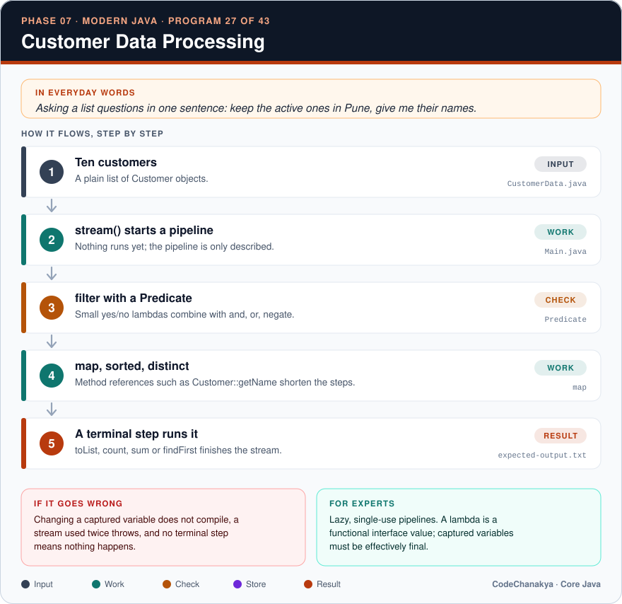

# 27 · Customer Data Processing

**Phase 07 · Modern Java** &nbsp;|&nbsp; **Level:** Intermediate &nbsp;|&nbsp; **Java:** 21 or newer

Concepts: lambdas, functional interfaces, method references, streams, `Comparator`.

---

## The problem

A marketing team keeps a list of customers and asks a new question every day: who is active in Pune, who are the top spenders, which email domains do we have. Each question used to mean another loop. This program answers them with small pieces of behaviour passed around as values: lambdas.

<!--flow-->
## The flow at a glance

<p align="center"><a href="../../docs/flows/program-27.svg"></a></p>

| If you are | Read it like this |
|---|---|
| New to coding | Asking a list questions in one sentence: keep the active ones in Pune, give me their names. |
| Learning | Follow the numbered cards from top to bottom. Open the file named on each card, run the program, and match its output to the last card. |
| Experienced | Lazy, single-use pipelines. A lambda is a functional interface value; captured variables must be effectively final. |

<details>
<summary>Text version of the flow</summary>

1. **Ten customers** (input): A plain list of Customer objects. (`CustomerData.java`)
2. **stream() starts a pipeline** (work): Nothing runs yet; the pipeline is only described. (`Main.java`)
3. **filter with a Predicate** (check): Small yes/no lambdas combine with and, or, negate. (`Predicate`)
4. **map, sorted, distinct** (work): Method references such as Customer::getName shorten the steps. (`map`)
5. **A terminal step runs it** (result): toList, count, sum or findFirst finishes the stream. (`expected-output.txt`)

</details>
<!--/flow-->

## Requirements

**Functional**
1. Answer filter, transform, sort, count and sum questions about a list of customers.
2. Build bigger questions out of smaller ones (`and`, `or`, `negate`).
3. Define one functional interface of your own (a `Discount`) and chain it.
4. Change a list in place with `replaceAll` and `removeIf`.
5. Show that a stream is lazy and can be used only once.

**Non-functional**
- Money is `BigDecimal`, never `double`.
- The output is the same on every run.

## Read in this order

| Step | File | What to look for |
|---|---|---|
| 1 | [`Customer.java`](src/main/java/com/codechanakya/customerdata/Customer.java) | An ordinary class. Nothing special is needed to use lambdas with it. |
| 2 | [`Discount.java`](src/main/java/com/codechanakya/customerdata/Discount.java) | `@FunctionalInterface` and a `default` method. |
| 3 | [`CustomerData.java`](src/main/java/com/codechanakya/customerdata/CustomerData.java) | Ten sample customers. |
| 4 | [`Main.java`](src/main/java/com/codechanakya/customerdata/Main.java) | Eleven short sections, in the order of the output. |

## Run it

```bash
./run.sh            # compile and run
./run.sh --check    # run, then compare with expected-output.txt
```

Run it from this folder (`run.sh` does that for you). Nothing here reads or writes files, so there is nothing to clean up.

Expected output:

```text
--- The same question, a loop and a stream ---
Names of active customers in Pune:
  loop  : [Rahul Verma, Zoya Khan]
  stream: [Rahul Verma, Zoya Khan]

--- Predicate: a yes/no question, as a value ---
  Active big spenders : [Asha Menon, Meera Iyer, Zoya Khan]
  Inactive or in Kochi: [Asha Menon, Kiran Rao, Imran Sheikh, Neha Joshi, Leela Nair]
  Test one customer   : true

--- Function: turn one thing into another ---
  Asha Menon <asha@example.com>
  RAHUL VERMA <RAHUL@MAIL.ORG>

--- Consumer and Supplier ---
  Hello, Dev!
  [empty list made on demand]

--- Sorting with a Comparator ---
  Top 3 spenders:
    Meera Iyer (Chennai, 41, 30500.00)
    Zoya Khan (Pune, 36, 19800.00)
    Asha Menon (Kochi, 34, 12500.00)
  Youngest first, then by name: [Dev Patel, Rahul Verma, Farah Siddiqui, Neha Joshi]

--- Pipelines: filter, map, distinct, sorted ---
  Cities, sorted, no repeats: [Chennai, Kochi, Mumbai, Pune]
  Email domains            : [corp.example.net, example.com, mail.org]
  How many are active      : 7

--- Questions with a yes or no answer ---
  Anyone over 55?           true
  Everyone spent something? false
  Nobody under 18?          true

--- Adding things up ---
  Total spent: 95051.25
  Average per customer: 9505.13
  Ages: min 23, max 60, average 37.9, count 10

--- Your own functional interface ---
  Basket 400.00: 10 percent -> 360.00, voucher -> 350.00, both -> 310.00

--- Changing a list in place ---
  [VIP, PUNE]

--- Streams are lazy, and used once ---
  Nothing has been checked yet. Asking for the first match:
    checking Asha Menon
  First over 30: Asha Menon
  Using the same stream again: IllegalStateException
```

## A lambda is a method without a name

```java
Predicate<Customer> active = c -> c.isActive();
```

A **lambda** is a short way to write the one method of an interface. `Predicate<T>` has one method, `boolean test(T)`. The lambda above is that method's body, so the variable `active` now holds a *question* that can be passed to other code, stored, combined and called later. An interface with exactly one abstract method is a **functional interface**. The ones you will meet most:

| Interface | Method | Shape | Example |
|---|---|---|---|
| `Predicate<T>` | `test` | T in, boolean out | `c -> c.getAge() > 40` |
| `Function<T,R>` | `apply` | T in, R out | `Customer::getName` |
| `Consumer<T>` | `accept` | T in, nothing out | `System.out::println` |
| `Supplier<T>` | `get` | nothing in, T out | `ArrayList::new` |
| `Comparator<T>` | `compare` | two T in, int out | `Comparator.comparing(Customer::getAge)` |

Your own is just an interface with one method. `Discount` is one, and `@FunctionalInterface` makes the compiler check that it keeps to one.

## Method references

`Customer::getName` is shorthand for `c -> c.getName()`. Use it when the lambda only calls one method and passes its argument straight through. If the shorthand is harder to read than the lambda, write the lambda.

## Loop versus stream

The first section answers the same question twice. The loop says *how* (create a list, walk, test, add). The stream says *what*: filter on this, map to that, collect.

```java
customers.stream()
         .filter(c -> c.isActive())
         .filter(c -> c.getCity().equals("Pune"))
         .map(Customer::getName)
         .toList();
```

A pipeline has three parts: a **source** (`stream()`), zero or more **intermediate** steps (`filter`, `map`, `sorted`, `distinct`), and one **terminal** step (`toList`, `count`, `forEach`, `anyMatch`, `sum`). Streams do not change the list they came from.

## Laziness and single use

Intermediate steps do nothing until a terminal step asks for a result. The last section proves it: nothing is checked until `findFirst()` runs, and then only as many customers are checked as it takes to find one. A stream can be consumed once. Asking again throws `IllegalStateException`; build a new stream from the list instead. See [`broken/`](broken/README.md).

## Captured variables

A lambda can read local variables from the method around it, but only ones that are **effectively final** (never changed after they are set). The reason is simple: the lambda may run later, or on another thread, and a variable that keeps changing would give it different answers at different times. Keep a running total in the stream (`reduce`, `sum`) or in an object, not in a captured `int`.

## Common mistakes

| Mistake | What you see |
|---|---|
| Changing a local variable inside a lambda | compile error: must be final or effectively final |
| Using a stream twice | `IllegalStateException: stream has already been operated upon or closed` |
| Building a pipeline with no terminal step | nothing happens, and no error |
| `double` for money | tiny errors that grow |
| A long lambda with several statements | unreadable; move it to a named method and use `Class::method` |

## Practice

- [`exercises/`](exercises/README.md): six tasks.
- [`solutions/`](solutions/README.md): one answer to each.

## Verification

Compiled and run with OpenJDK 21.0.13 on Linux. `./run.sh --check` passes. The solution file also compiles and runs. Not yet run on Java 25, Windows or macOS.

## Next

Program 28 stores data in records, so classes like `Customer` shrink to one line, and uses `Optional` for answers that may not exist.
