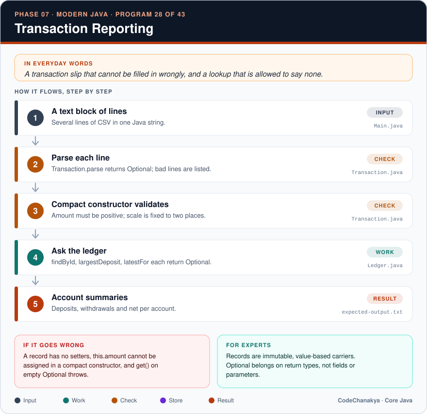

# 28 · Transaction Reporting

**Phase 07 · Modern Java** &nbsp;|&nbsp; **Level:** Intermediate &nbsp;|&nbsp; **Java:** 21 or newer

Concepts: `record`, compact constructors, `Optional`, text blocks, local records.

---

## The problem

The bank exports transactions as lines of text. The program turns each line into a value that is always valid, reports on them, and answers questions like "what is the largest deposit?" or "what is the latest transaction for ACC-3?", where the honest answer is sometimes "there is none". Records make the data short to write and safe to share, and `Optional` makes "maybe nothing" part of the method's signature.

<!--flow-->
## The flow at a glance

<p align="center"><a href="../../docs/flows/program-28.svg"></a></p>

| If you are | Read it like this |
|---|---|
| New to coding | A transaction slip that cannot be filled in wrongly, and a lookup that is allowed to say none. |
| Learning | Follow the numbered cards from top to bottom. Open the file named on each card, run the program, and match its output to the last card. |
| Experienced | Records are immutable, value-based carriers. Optional belongs on return types, not fields or parameters. |

<details>
<summary>Text version of the flow</summary>

1. **A text block of lines** (input): Several lines of CSV in one Java string. (`Main.java`)
2. **Parse each line** (check): Transaction.parse returns Optional; bad lines are listed. (`Transaction.java`)
3. **Compact constructor validates** (check): Amount must be positive; scale is fixed to two places. (`Transaction.java`)
4. **Ask the ledger** (work): findById, largestDeposit, latestFor each return Optional. (`Ledger.java`)
5. **Account summaries** (result): Deposits, withdrawals and net per account. (`expected-output.txt`)

</details>
<!--/flow-->

## Requirements

**Functional**
1. A `Transaction` that cannot exist with a zero or negative amount.
2. Load transactions from text, reject bad lines, and say which lines and why.
3. Find a transaction by id, the largest deposit and the latest for an account, each returning an `Optional`.
4. Report deposits, withdrawals and net per account.
5. Use a record declared inside a method for a temporary result.

**Non-functional**
- Amounts are `BigDecimal` with two decimal places.
- Records are immutable; "changing" one means making a new one.

## Read in this order

| Step | File | What to look for |
|---|---|---|
| 1 | [`Kind.java`](src/main/java/com/codechanakya/reporting/Kind.java) | A small enum. |
| 2 | [`Transaction.java`](src/main/java/com/codechanakya/reporting/Transaction.java) | A record with a compact constructor, a static `parse`, a `withAmount`. |
| 3 | [`AccountSummary.java`](src/main/java/com/codechanakya/reporting/AccountSummary.java) | A record with a computed method. |
| 4 | [`Ledger.java`](src/main/java/com/codechanakya/reporting/Ledger.java) | Methods that return `Optional`. |
| 5 | [`Main.java`](src/main/java/com/codechanakya/reporting/Main.java) | A text block as input, then six sections. |

## Run it

```bash
./run.sh            # compile and run
./run.sh --check    # run, then compare with expected-output.txt
```

Run it from this folder (`run.sh` does that for you). Nothing here reads or writes files, so there is nothing to clean up.

Expected output:

```text
--- What a record gives you for free ---
  toString : Transaction[id=T-1, account=ACC-1, kind=DEPOSIT, amount=100.00, date=2026-03-02]
  accessor : id() = T-1, amount() = 100.00
  equals   : true (same values, so equal; different objects: true)
  hashCode : true
  In a HashSet twice: 1 item
  withAmount made a new one: 250.00, the old one is still 100.00

--- Validation in the compact constructor ---
  Refused: Amount must be positive for T-2

--- Loading a text block ---
  Loaded 6 transactions, rejected 4
    line 7: T-1006,ACC-1,TRANSFER,100.00,2026-03-04
    line 8: T-1007,ACC-3,WITHDRAWAL,-50.00,2026-03-05
    line 9: T-1008,ACC-1,DEPOSIT,1000.00,not-a-date
    line 11: T-1010,ACC-1

--- Optional: an answer that may not exist ---
  isPresent        : true
  map the amount   : 800.00
  missing id, orElse: (none)
  ifPresent        : T-1004 belongs to ACC-3
  ifPresentOrElse  : T-9999 is not in the ledger
  Largest deposit  : T-1001
  Latest for ACC-3 : T-1004
  Latest for ACC-9 : (no transactions)

--- orElseThrow when "no" is a real error ---
  Transaction T-9999 does not exist

--- A report from records ---
  ACC-1  2 tx  in   5000.00  out    300.00  net   4700.00
  ACC-2  3 tx  in   4250.00  out   1200.50  net   3049.50
  ACC-3  1 tx  in    800.00  out      0.00  net    800.00
  AccountSummary[account=ACC-1, count=2, deposits=5000.00, withdrawals=300.00]

--- A record can live inside a method ---
  Range[low=250.00, high=5000.00]
```

## Records

```java
public record Transaction(String id, String account, Kind kind, BigDecimal amount, LocalDate date) { }
```

One line gives you the private final fields, a constructor, the accessors (`id()`, not `getId()`), and `equals`, `hashCode` and `toString` based on **all** the fields. A record is a *transparent carrier of data*: what you see in the header is what it is. The first section of the output shows each of these.

| | Ordinary class | Record |
|---|---|---|
| Fields | you write them | the header |
| Mutable | if you add setters | never; fields are final |
| `equals`/`hashCode` | you write them | free, by value |
| Extends another class | yes | no (it can implement interfaces) |
| Best for | things with behaviour and identity | plain data |

Records can have methods and static methods (`parse`, `net()`), and they can implement interfaces. They cannot have extra instance fields.

## The compact constructor

```java
public Transaction {
    if (amount.signum() <= 0) throw new IllegalArgumentException("...");
    amount = amount.setScale(2);
}
```

There is no parameter list: the compiler adds it. The code runs *before* the fields are set, so it is the place to validate and to tidy values. Assign to the **parameter** (`amount = ...`) to change what is stored; writing `this.amount = ...` is a compile error. Because every path to a `Transaction` goes through this constructor, an invalid one can never exist. That is the main safety record types give you.

## "With" methods

A record cannot be changed, so `withAmount(...)` returns a new record with one value different. The section "What a record gives you" shows the old one is untouched. Immutable values are safe to share and to use as keys.

## Optional

A method like `findById` cannot always return a transaction. Returning `null` hides that, and the caller finds out later with a `NullPointerException`. `Optional<Transaction>` states it in the type.

| Method | Use it to |
|---|---|
| `map(f)` | transform the value if there is one |
| `orElse(x)` | give a default |
| `ifPresent(c)` | do something if there is a value |
| `ifPresentOrElse(c, r)` | do one thing or the other |
| `orElseThrow(...)` | say "no" is a real error |
| `isPresent()` | rarely; prefer the others |

Avoid `get()`. It throws `NoSuchElementException` when empty, which is the same mistake as `null` with a different name ([`broken/`](broken/README.md)). Use `Optional` as a **return type**, not as a field or a parameter.

## Text blocks

The input is written in `"""` quotes across several lines, with no `\n` and no escaped quotes. Java removes the common indentation. `csv.lines()` then turns it into a stream of lines.

## A record inside a method

`Range` is declared inside `main` because nobody else needs it. A **local record** is an easy way to return two values together without creating a file.

## Common mistakes

| Mistake | What you see |
|---|---|
| A setter on a record | compile error: records have no setters; use a `withX` method |
| `this.amount = ...` in a compact constructor | compile error: cannot assign a value to a final variable |
| `optional.get()` on an empty one | `NoSuchElementException: No value present` |
| Returning `null` from a method that could return `Optional` | surprise `NullPointerException` in the caller |
| Comparing `BigDecimal` with `equals` | `100.0` and `100.00` are not equal; the compact constructor fixes the scale so records compare fairly |

## Practice

- [`exercises/`](exercises/README.md): six tasks.
- [`solutions/`](solutions/README.md): one answer to each.

## Verification

Compiled and run with OpenJDK 21.0.13 on Linux. `./run.sh --check` passes. The solution file also compiles and runs. Not yet run on Java 25, Windows or macOS.

## Next

Program 29 groups and totals thousands of rows with `Collectors`.
