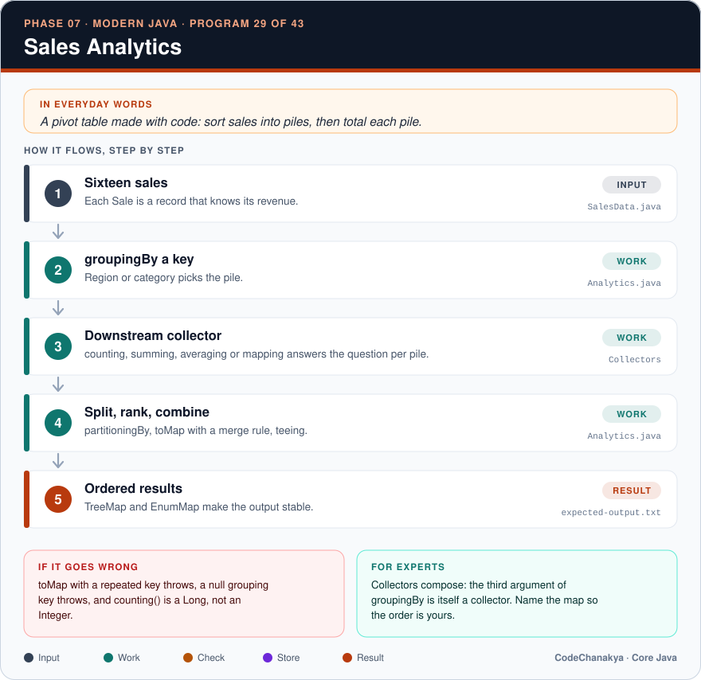

# 29 · Sales Analytics

**Phase 07 · Modern Java** &nbsp;|&nbsp; **Level:** Intermediate &nbsp;|&nbsp; **Java:** 21 or newer

Concepts: `Collectors`, `groupingBy`, `partitioningBy`, `toMap`, `teeing`, `flatMap`, summary statistics.

---

## The problem

Management wants numbers from sixteen sales: revenue per region, units sold, average units per order, who sells the most, how many big orders there were. In SQL this is `GROUP BY`. In Java it is `Collectors`, and this program shows the whole set.

<!--flow-->
## The flow at a glance

<p align="center"><a href="../../docs/flows/program-29.svg"></a></p>

| If you are | Read it like this |
|---|---|
| New to coding | A pivot table made with code: sort sales into piles, then total each pile. |
| Learning | Follow the numbered cards from top to bottom. Open the file named on each card, run the program, and match its output to the last card. |
| Experienced | Collectors compose: the third argument of groupingBy is itself a collector. Name the map so the order is yours. |

<details>
<summary>Text version of the flow</summary>

1. **Sixteen sales** (input): Each Sale is a record that knows its revenue. (`SalesData.java`)
2. **groupingBy a key** (work): Region or category picks the pile. (`Analytics.java`)
3. **Downstream collector** (work): counting, summing, averaging or mapping answers the question per pile. (`Collectors`)
4. **Split, rank, combine** (work): partitioningBy, toMap with a merge rule, teeing. (`Analytics.java`)
5. **Ordered results** (result): TreeMap and EnumMap make the output stable. (`expected-output.txt`)

</details>
<!--/flow-->

## Requirements

**Functional**
1. Total, count and average per region and per category.
2. Show what is inside each group (names, the biggest sale).
3. Rank the top three salespeople.
4. Split orders into big and small.
5. Compute two results in one pass over the data.
6. Always print in a fixed order.

**Non-functional**
- Money is `BigDecimal`. Percentages are formatted with `Locale.ROOT`.
- Results are sorted maps, so the output never depends on hash order.

## Read in this order

| Step | File | What to look for |
|---|---|---|
| 1 | [`Category.java`](src/main/java/com/codechanakya/analytics/Category.java), [`Sale.java`](src/main/java/com/codechanakya/analytics/Sale.java) | An enum and a record that knows its own revenue. |
| 2 | [`SalesData.java`](src/main/java/com/codechanakya/analytics/SalesData.java) | Sixteen sales. |
| 3 | [`Analytics.java`](src/main/java/com/codechanakya/analytics/Analytics.java) | One method per question. This is the file to study. |
| 4 | [`Main.java`](src/main/java/com/codechanakya/analytics/Main.java) | Calls each one and prints. |

## Run it

```bash
./run.sh            # compile and run
./run.sh --check    # run, then compare with expected-output.txt
```

Run it from this folder (`run.sh` does that for you). Nothing here reads or writes files, so there is nothing to clean up.

Expected output:

```text
--- Total per bucket ---
  Revenue by region    : {East=13542.00, North=13657.00, South=14384.50, West=17896.00}
  Units by region      : {East=111, North=54, South=33, West=70}
  Orders by category   : {ELECTRONICS=7, STATIONERY=4, HOME=5}

--- Averages and shares ---
  East averages 27.8 units per order
  North averages 13.5 units per order
  South averages 8.3 units per order
  West averages 17.5 units per order
  East is 22.8 percent of revenue
  North is 23.0 percent of revenue
  South is 24.2 percent of revenue
  West is 30.1 percent of revenue

--- What is inside each bucket ---
  Salespeople by region: {East=[Dev, Kiran], North=[Asha, Neha], South=[Meera, Rahul], West=[Farah, Zoya]}
  Biggest sale by region: {East=S-05, North=S-01, South=S-04, West=S-08}

--- Ranking salespeople ---
  Zoya: 10496.00
  Asha: 9417.00
  Meera: 8249.00
  Everyone (toMap with a merge rule): {Asha=9417.00, Dev=5544.00, Farah=7400.00, Kiran=7998.00, Meera=8249.00, Neha=4240.00, Rahul=6135.50, Zoya=10496.00}

--- Splitting in two ---
  Orders of 5000 or more: 4, smaller: 12

--- Several answers in one pass ---
  teeing: 268 units in 16 orders
  Units per order: min 1, max 100, sum 268, count 16

--- Group, then flatten ---
  [S-01, S-02, S-03, S-04, S-05, S-06, S-07, S-08, S-09, S-10, S-11, S-12, S-13, S-14, S-15, S-16]
  Regions: [East, North, South, West]
```

## groupingBy is GROUP BY

```java
sales.stream().collect(Collectors.groupingBy(Sale::region, TreeMap::new, Collectors.counting()));
```

The three arguments are: **how to group** (the key), **what map to build** (`TreeMap::new` so keys come out sorted), and **what to do with each group** (the *downstream* collector). Change the third argument and the same grouping gives a different answer.

| Downstream collector | Result per group | SQL cousin |
|---|---|---|
| `counting()` | a `Long` | `COUNT(*)` |
| `summingInt(f)` | an `Integer` | `SUM(col)` |
| `averagingInt(f)` | a `Double` | `AVG(col)` |
| `reducing(zero, f, add)` | any type, e.g. `BigDecimal` | `SUM` of decimals |
| `mapping(f, toList())` | a list of one field | `GROUP_CONCAT` |
| `maxBy(comparator)` | an `Optional` | `MAX` with its row |
| `collectingAndThen(c, f)` | the result of `c`, then `f` | wrap the answer |

`summingInt` has no `BigDecimal` version, which is why money uses `reducing(BigDecimal.ZERO, Sale::revenue, BigDecimal::add)`.

## Other collectors in the program

| Collector | Section | Purpose |
|---|---|---|
| `toMap(key, value, merge)` | Ranking | Build a map. The merge rule decides what happens when two rows share a key. |
| `partitioningBy(test)` | Splitting in two | Exactly two groups, `true` and `false`, and both are always present. |
| `teeing(a, b, combine)` | Several answers | Two collectors share one pass, and a function combines them. |
| `summarizingInt(f)` | Several answers | min, max, sum, count and average together. |
| `joining(", ", "[", "]")` | Regions | Join strings. |
| `flatMap` | Group, then flatten | Turn a stream of lists into one stream of items. |

## Choosing the map

`groupingBy` on its own returns a `HashMap`, whose order you cannot rely on. Passing `TreeMap::new` sorts by key. Passing `() -> new EnumMap<>(Category.class)` orders by the enum's declaration order. Every map in this program names its supplier so the printed output is the same each run.

## Types you must get right

The result type follows the collector. `counting()` gives `Long`, not `Integer`; `Map<String, Integer>` will not compile ([`broken/`](broken/README.md)). The message mentions "inference variable D", which is the compiler saying the downstream collector produced something other than what you declared. Use `var` while exploring and read the type from your IDE.

## Common mistakes

| Mistake | What you see |
|---|---|
| `toMap` without a merge function and a repeated key | `IllegalStateException: Duplicate key` |
| `groupingBy` on a field that can be `null` | `NullPointerException: element cannot be mapped to a null key` |
| Declaring `Map<String, Integer>` for `counting()` | compile error about inference variable D |
| Using `HashMap` and expecting sorted output | order that changes between machines |
| `double` for revenue | cents that do not add up |

## Practice

- [`exercises/`](exercises/README.md): six tasks.
- [`solutions/`](solutions/README.md): one answer to each.

## Verification

Every figure in the output was added up by hand from the sample data as well as by the program. Compiled and run with OpenJDK 21.0.13 on Linux. `./run.sh --check` passes. The solution file also compiles and runs. Not yet run on Java 25, Windows or macOS.

## Next

Program 30 is the phase project. It models a catalogue with sealed types and pattern matching, and uses lambdas, records and streams from the whole phase.
