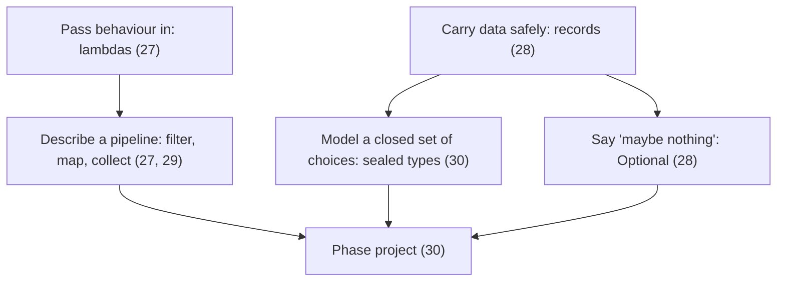

# Phase 07 · Modern Java

Programs 27 to 30 are the tools that make today's Java look different from Java ten years ago. Earlier programs promised them: lambdas for passing behaviour around, records for plain data, collectors for summaries, and sealed types with pattern matching for choices the compiler can check.

| No. | Program | New ideas |
|---|---|---|
| 27 | [Customer Data Processing](27-customer-data-processing) | lambdas, functional interfaces, method references, streams |
| 28 | [Transaction Reporting](28-transaction-reporting) | records, compact constructors, `Optional`, text blocks |
| 29 | [Sales Analytics](29-sales-analytics) | `Collectors`: `groupingBy`, `partitioningBy`, `toMap`, `teeing` |
| 30 | [Product Recommendation Filtering](30-product-recommendation-filtering) | sealed types, pattern-matching `switch`, record patterns (phase project) |

## How these programs run

None of these programs reads or writes files. Each has a `run.sh`; use `./run.sh --check` to compare with `expected-output.txt`. The code uses Java 21 features only (records, sealed types, pattern matching for `switch`, text blocks), with no preview flags.

## The themes

| Habit | Why |
|---|---|
| Prefer `Class::method` when a lambda just forwards | shorter and clearer |
| Keep lambdas to one short expression | long ones need a name |
| Do not change outside variables from a lambda | they must be effectively final |
| Use a record for plain data | free `equals`, `hashCode`, `toString`, and immutable |
| Validate in the compact constructor | an invalid record cannot exist |
| Return `Optional`, never `null`, for "maybe nothing" | the type tells the caller |
| Name the map in `groupingBy` | the output order is then yours |
| Seal a hierarchy that is a fixed list | the compiler checks every switch |
| Avoid `default` in a switch over a sealed type | it switches off the compiler's check |

## Mastery checkpoint

Build this without looking at the solutions.

**Library Loans.** A library has books, DVDs and magazines. Each loan records a member, an item, a start date and a due date.

1. Model items as a sealed interface with three records. Model a loan as a record whose compact constructor refuses a due date before the start.
2. A switch decides the loan period in days from the kind of item, with no `default`.
3. Using streams only: the overdue loans for a given date, the number of loans per member sorted by name, and the member with the most loans as an `Optional`.
4. Split loans into overdue and on time with `partitioningBy`.
5. Add a fourth kind of item and let the compiler show you what to update.
6. Pass the date in as a value; never call `now()`.

You are ready for Phase 8 when you can explain why a stream cannot be reused, why a record cannot have a setter, why `Optional.get()` is a smell, and why a `default` in a sealed switch costs you something.

## Levels

| Level | You can... |
|---|---|
| 1 Understood | read a pipeline and say what it returns |
| 2 Applied | write lambdas, records, collectors and a pattern switch correctly |
| 3 Connected | combine them as Program 30 does |
| 4 Mastered | design the library model alone and defend every choice |
