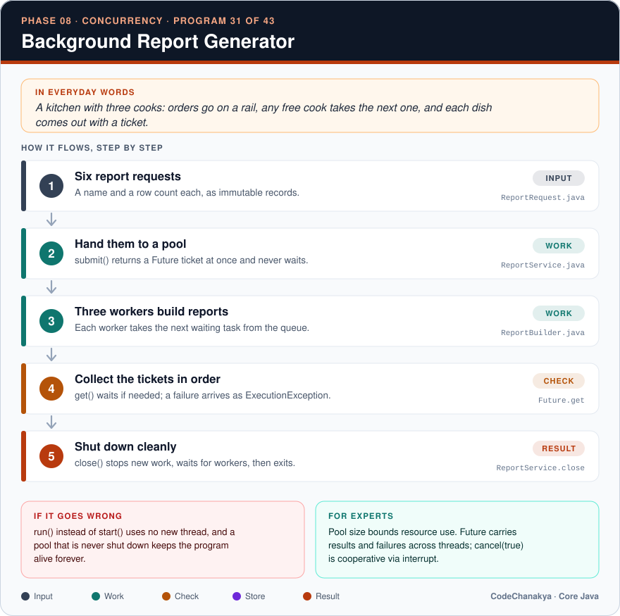
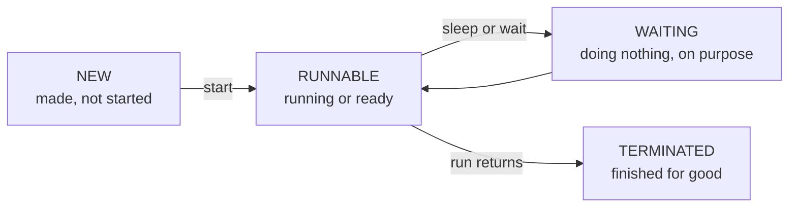
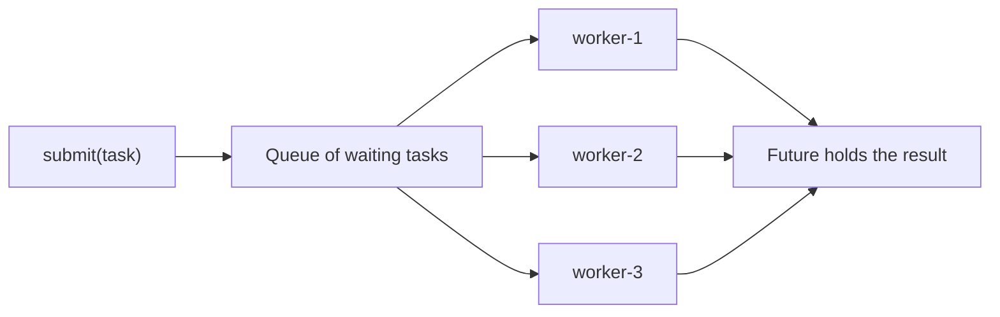

# 31 · Background Report Generator

**Phase 08 · Concurrency** &nbsp;|&nbsp; **Level:** Intermediate &nbsp;|&nbsp; **Java:** 21 or newer

Concepts: `Thread`, `Runnable`, `Callable`, `ExecutorService`, `Future`, `shutdown`, cancellation.

---

## The problem

A company needs six reports every morning. Each one waits on a slow database before it can be built. If one thread builds them one after another, the sixth report waits for the first five, and whoever pressed the button stares at a frozen screen. The work should happen in the background, several reports at a time, and the person who asked should be able to collect each report when it is ready.

This is the first program in which two things happen at the same time.

<!--flow-->
## The flow at a glance

<p align="center"><a href="../../docs/flows/program-31.svg"></a></p>

| If you are | Read it like this |
|---|---|
| New to coding | A kitchen with three cooks: orders go on a rail, any free cook takes the next one, and each dish comes out with a ticket. |
| Learning | Follow the numbered cards from top to bottom. Open the file named on each card, run the program, and match its output to the last card. |
| Experienced | Pool size bounds resource use. Future carries results and failures across threads; cancel(true) is cooperative via interrupt. |

<details>
<summary>Text version of the flow</summary>

1. **Six report requests** (input): A name and a row count each, as immutable records. (`ReportRequest.java`)
2. **Hand them to a pool** (work): submit() returns a Future ticket at once and never waits. (`ReportService.java`)
3. **Three workers build reports** (work): Each worker takes the next waiting task from the queue. (`ReportBuilder.java`)
4. **Collect the tickets in order** (check): get() waits if needed; a failure arrives as ExecutionException. (`Future.get`)
5. **Shut down cleanly** (result): close() stops new work, waits for workers, then exits. (`ReportService.close`)

</details>
<!--/flow-->

## Requirements

**Functional**
1. Build a report from a request (a name and a number of rows).
2. Build many reports on a small team of worker threads.
3. Collect the reports in the order they were asked for.
4. When one report fails, report it and carry on with the rest.
5. Stop a task that runs too long.
6. Shut the workers down so the program can end.

**Non-functional**
- The number of threads is fixed and small, however many reports are asked for.
- The output is identical on every run.

## Read in this order

| Step | File | What to look for |
|---|---|---|
| 1 | [`ReportRequest.java`](src/main/java/com/codechanakya/reports/ReportRequest.java), [`Report.java`](src/main/java/com/codechanakya/reports/Report.java) | Two records. Immutable values are the safest things to hand between threads. |
| 2 | [`ReportBuilder.java`](src/main/java/com/codechanakya/reports/ReportBuilder.java) | The slow work, with no shared state. |
| 3 | [`NamedThreads.java`](src/main/java/com/codechanakya/reports/NamedThreads.java) | Giving worker threads readable names. |
| 4 | [`ReportService.java`](src/main/java/com/codechanakya/reports/ReportService.java) | The pool, the tickets (`Future`) and a safe `close()`. |
| 5 | [`Main.java`](src/main/java/com/codechanakya/reports/Main.java) | Six short sections, in the order of the output. |

## Run it

```bash
./run.sh            # compile and run
./run.sh --check    # run, then compare with expected-output.txt
```

Run it from this folder (`run.sh` does that for you). Nothing here reads or writes files, so there is nothing to clean up.

Expected output:

```text
--- A thread by hand ---
  Main is running on thread main
  Before start(), the worker is NEW
  Hello from thread report-worker
  After join(), the worker is TERMINATED

--- One thread doing everything ---
  Sales: 1200 rows, checksum 199892
  Inventory: 800 rows, checksum 457531
  Payroll: 450 rows, checksum 351826
  Attendance: 2000 rows, checksum 769152
  Tax: 300 rows, checksum 677226
  Audit: 1500 rows, checksum 138478
  Each report waited for the one before it.

--- A pool of three workers ---
  Handed over 6 requests without waiting.
  Sales: 1200 rows, checksum 199892
  Inventory: 800 rows, checksum 457531
  Payroll: 450 rows, checksum 351826
  Attendance: 2000 rows, checksum 769152
  Tax: 300 rows, checksum 677226
  Audit: 1500 rows, checksum 138478
  Worker threads used: 3 (never more than 3: true)

--- When one report fails ---
  Sales: 1200 rows, checksum 199892
  Broken failed: Report Broken needs at least one row
  Tax: 300 rows, checksum 677226
  The other two reports were not affected.

--- Stopping a task that runs too long ---
  cancel(true) returned true, isCancelled() is true
  The task noticed the interrupt: true

--- Shutting down properly ---
  Before close(), isShutdown is false
  After close(),  isShutdown is true
  A new request is refused: RejectedExecutionException
```

## What a thread is

A **program** (a process) has its own memory. A **thread** is a path of execution inside it. Every Java program starts with one thread, called `main`. Extra threads share the program's memory with `main`, which is what makes them quick to start and also what makes them dangerous (Program 32 is about that danger).

| | Process | Thread |
|---|---|---|
| Memory | its own | shared with the other threads of the same process |
| Cost to start | high | low |
| Talking to each other | slow, through files or sockets | fast, through shared objects |
| A crash | stays inside it | can take down the whole program |

On a computer with several cores, threads really can run at the same moment. On one core they take turns so quickly that it looks the same. Either way, **you do not choose the order**.

## The life of a thread



The first section of the output prints `NEW` before `start()` and `TERMINATED` after `join()`. Two calls matter more than any others:

| Call | What it does |
|---|---|
| `start()` | Creates a new thread that runs the task. Call it once. |
| `join()` | Makes the calling thread wait until the other thread has finished. |

Calling `run()` instead of `start()` is a classic mistake: it is an ordinary method call on the current thread, and nothing runs in the background ([`broken/`](broken/README.md)).

## Runnable and Callable

A task is a small piece of work for a thread to do.

| | `Runnable` | `Callable<V>` |
|---|---|---|
| Method | `void run()` | `V call()` |
| Returns a value | no | yes |
| May throw a checked exception | no | yes |
| Used with | `Thread`, `execute`, `submit` | `submit` |

`ReportBuilder.build` throws `InterruptedException`, so the task that calls it must be a `Callable`. Put the same code in a `Runnable` and the compiler refuses ([`broken/SleepInRunnable.java`](broken/README.md)).

## A pool instead of a thread per task

Starting a thread for every request is wasteful, and ten thousand requests would start ten thousand threads. An **executor** owns a fixed team of worker threads and a queue.



`submit` returns at once with a **Future**, a ticket for a result that may not exist yet.

| Future method | Meaning |
|---|---|
| `get()` | Wait until the result is ready, then return it. Rethrows a task's failure. |
| `get(time, unit)` | Wait, but give up after a deadline (`TimeoutException`). |
| `isDone()` | Is it finished (successfully, with a failure, or cancelled)? |
| `cancel(true)` | Ask for it to stop. A sleeping task is interrupted. |

The program hands out six tickets and then reads them in order. `get()` on a report that is still being built simply waits for it.

## When a task fails

An exception thrown on a worker thread cannot travel back to the caller's stack, because the caller is somewhere else by then. The executor catches it, stores it in the Future, and `get()` throws it again wrapped in an `ExecutionException`. **The real problem is the cause**: `e.getCause()`. The section "When one report fails" shows the other two reports arriving normally. If nobody ever calls `get()`, the failure is never seen.

## Stopping a task

You cannot force a thread to stop. You can only ask. `cancel(true)` **interrupts** the thread, which makes a blocking call such as `Thread.sleep` throw `InterruptedException`. A well-written task catches that and finishes. Two habits go with it:

- Never swallow an `InterruptedException` silently. Either stop, or call `Thread.currentThread().interrupt()` to keep the signal alive. `ReportService.close()` does the second.
- A task that never blocks and never checks the flag cannot be stopped this way.

## Shutting down

Worker threads of an ordinary pool are not daemons: they keep the program alive. Forget to shut the pool down and the program never ends ([`broken/ForgotShutdown.java`](broken/README.md)).

| Call | Effect |
|---|---|
| `shutdown()` | Accept no new tasks; finish the queued ones. |
| `awaitTermination(time, unit)` | Wait for the workers to finish. |
| `shutdownNow()` | Interrupt the running tasks and drop the queued ones. |

`ReportService` wraps all three in `close()` and implements `AutoCloseable`, so `try-with-resources` cannot forget. (Since Java 19, `ExecutorService` itself is `AutoCloseable` too; writing it out once shows what `close()` is doing.)

## Why the output is the same every time

Threads run in an order nobody can promise. A program whose output depends on that order cannot be checked by comparing it with a file, and it cannot be trusted either. So this program follows two rules, and you should too when you write your own:

1. **Never print from a worker thread** (with the one marked exception). Workers hand back values; the main thread prints them.
2. **Collect results in the order the work was handed out**, not the order it finished.

The program also never prints how long anything took, because timings change from machine to machine. The exercises ask you to measure speed yourself.

## Common mistakes

| Mistake | What you see |
|---|---|
| `run()` instead of `start()` | the task runs on `main`; no concurrency |
| Forgetting `shutdown()` | the program never ends |
| Printing from workers and expecting an order | output that changes between runs |
| Ignoring a `Future` | a failure nobody ever sees |
| Swallowing `InterruptedException` | a task that cannot be cancelled |
| One thread per task | thousands of threads and an out-of-memory error |

## Practice

- [`exercises/`](exercises/README.md): six tasks.
- [`solutions/`](solutions/README.md): one answer to each.

## Verification

Compiled and run with OpenJDK 21.0.13 on Linux. `./run.sh --check` passes. The solution file also compiles and runs. Not yet run on Java 25, Windows or macOS. The checksums were also computed independently in Python. Output was compared across repeated runs, several at once, to be sure it does not depend on thread timing.

## Next

Program 32 shows what goes wrong when threads share data, and three ways to make it right.
