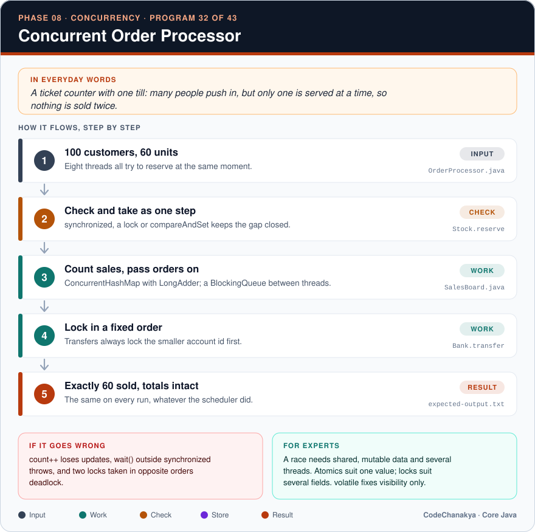
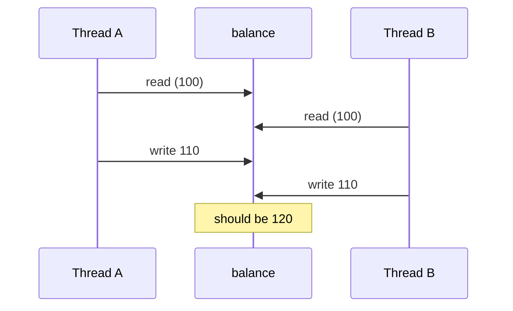
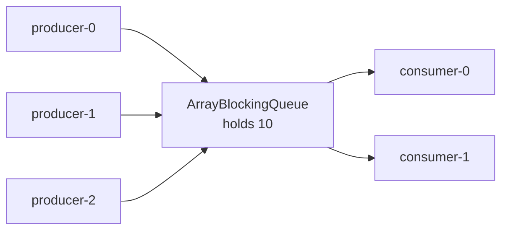
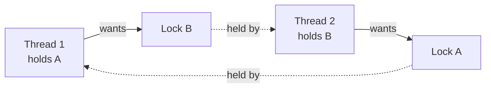

# 32 · Concurrent Order Processor

**Phase 08 · Concurrency** &nbsp;|&nbsp; **Level:** Advanced &nbsp;|&nbsp; **Java:** 21 or newer

Concepts: race conditions, `synchronized`, `ReentrantLock`, atomics, `volatile`, `BlockingQueue`, deadlock.

---

## The problem

A shop has 60 units of a product and 100 customers click "buy" at the same moment. Exactly 60 must succeed and 40 must be told "sold out". Sell 61 and the shop owes someone a refund; sell 59 and it has lost a sale for nothing.

In a single thread this is trivial. With many threads it is the hardest kind of bug in this course, because the wrong answer appears only *sometimes*. This program shows the cause, three correct fixes, and the ways a fix itself can go wrong.

<!--flow-->
## The flow at a glance

<p align="center"><a href="../../docs/flows/program-32.svg"></a></p>

| If you are | Read it like this |
|---|---|
| New to coding | A ticket counter with one till: many people push in, but only one is served at a time, so nothing is sold twice. |
| Learning | Follow the numbered cards from top to bottom. Open the file named on each card, run the program, and match its output to the last card. |
| Experienced | A race needs shared, mutable data and several threads. Atomics suit one value; locks suit several fields. volatile fixes visibility only. |

<details>
<summary>Text version of the flow</summary>

1. **100 customers, 60 units** (input): Eight threads all try to reserve at the same moment. (`OrderProcessor.java`)
2. **Check and take as one step** (check): synchronized, a lock or compareAndSet keeps the gap closed. (`Stock.reserve`)
3. **Count sales, pass orders on** (work): ConcurrentHashMap with LongAdder; a BlockingQueue between threads. (`SalesBoard.java`)
4. **Lock in a fixed order** (work): Transfers always lock the smaller account id first. (`Bank.transfer`)
5. **Exactly 60 sold, totals intact** (result): The same on every run, whatever the scheduler did. (`expected-output.txt`)

</details>
<!--/flow-->

## Requirements

**Functional**
1. Reserve stock for a crowd of customers using several threads, never selling more than exists.
2. Count sales per product from many threads.
3. Hand orders from producer threads to consumer threads.
4. Stop a worker thread from outside.
5. Move money between two accounts from two threads at once without deadlock.

**Non-functional**
- The totals are exactly right every time.
- Every output line is the same on every run.

## Read in this order

| Step | File | What to look for |
|---|---|---|
| 1 | [`LostUpdateDemo.java`](src/main/java/com/codechanakya/processor/LostUpdateDemo.java) | A race condition, forced to happen every time. |
| 2 | [`Stock.java`](src/main/java/com/codechanakya/processor/Stock.java) and its three implementations | `SynchronizedStock`, `LockedStock`, `AtomicStock`: one promise, three ways. |
| 3 | [`OrderProcessor.java`](src/main/java/com/codechanakya/processor/OrderProcessor.java) | The crowd. |
| 4 | [`SalesBoard.java`](src/main/java/com/codechanakya/processor/SalesBoard.java) | `ConcurrentHashMap` and `LongAdder`. |
| 5 | [`OrderQueueDemo.java`](src/main/java/com/codechanakya/processor/OrderQueueDemo.java) | A `BlockingQueue` and a poison pill. |
| 6 | [`StoppableWorker.java`](src/main/java/com/codechanakya/processor/StoppableWorker.java) | `volatile`. |
| 7 | [`Account.java`](src/main/java/com/codechanakya/processor/Account.java), [`Bank.java`](src/main/java/com/codechanakya/processor/Bank.java) | Two locks, taken in a fixed order. |
| 8 | [`Main.java`](src/main/java/com/codechanakya/processor/Main.java) | Six sections. |

## Run it

```bash
./run.sh            # compile and run
./run.sh --check    # run, then compare with expected-output.txt
```

Run it from this folder (`run.sh` does that for you). Nothing here reads or writes files, so there is nothing to clean up.

Expected output:

```text
--- Two deposits of 10 into a balance of 100 ---
  Right answer             : 120
  Both read before writing : 110
  With a synchronized block: 120

--- 100 customers, 8 threads, 60 units on the shelf ---
  synchronized   accepted 60, refused 40, left on shelf 0
  ReentrantLock  accepted 60, refused 40, left on shelf 0
  AtomicInteger  accepted 60, refused 40, left on shelf 0
  Never oversold, whichever way the threads were scheduled.

--- Counting 300 sales from 6 threads ---
  {Bag=50, Notebook=100, Pen=150}

--- 3 producers, 2 consumers, one queue of ten ---
  Processed 300 orders worth 1197 rupees

--- Telling a worker to stop ---
  Worker did some work: true
  Worker stopped: true

--- Opposite transfers at the same time ---
  Account 1: 1500
  Account 2: 500
  Total    : 2000 (it was 2000 before)
```

## What a race condition is

`balance = balance + 10` looks like one step. The computer does three:

| Step | Thread A | Thread B |
|---|---|---|
| 1. read | reads 100 | |
| 2. read | | reads 100 |
| 3. add and write | writes 110 | |
| 4. add and write | | writes 110 |

Both deposits ran. The balance is 110, not 120. One deposit was **lost**.



A race condition is any result that depends on how the threads happen to interleave. It needs three ingredients together: data that is **shared**, data that is **changed**, and **more than one thread**. Remove any one and the race disappears, which gives the three questions to ask about every field in a concurrent program:

1. Is it shared between threads?
2. Does anyone change it?
3. If both: what protects it?

A real race is luck. Run it a thousand times and it may be right 999 times. So `LostUpdateDemo` uses a `CountDownLatch` to force one particular interleaving, and the same wrong answer appears on every run. The unsafe counter that *really* races is in [`broken/`](broken/README.md); its numbers change each time.

## Three ways to guard shared data

| | `synchronized` | `ReentrantLock` | `AtomicInteger` |
|---|---|---|---|
| Idea | one thread at a time inside the method or block | the same, but you lock and unlock yourself | an indivisible compare-and-set on one number |
| Unlocking | automatic | you must, in `finally` | not needed |
| Wait with a time limit | no | `tryLock(time)` | not needed |
| Several fields at once | yes | yes | no, one value only |
| Best for | the default choice | when you need `tryLock`, or fairness, or several locks | a single counter or flag |

All three give the same line in the output: accepted 60, refused 40, none left. The check ("is there enough?") and the change ("take it") must be one **atomic** step. If another thread can slip between them, you have a race again. This pattern is called *check-then-act*.

**Reads need protection too.** `available()` takes the lock as well. A thread that reads without the lock may see an old value.

## Visibility and volatile

A thread is allowed to keep a private copy of a variable and not look at memory again. So a flag that main sets to `false` may never be noticed by the worker. Marking the flag `volatile` guarantees that every read sees the latest write. `volatile` fixes **visibility**; it does **not** make `count++` atomic. Use it for a simple flag that one thread writes and others read, and use a lock or an atomic for anything with read-modify-write.

## Counting from many threads

A plain `HashMap` updated by several threads can lose entries or even corrupt itself. `ConcurrentHashMap` is built for it, and `LongAdder` is a counter built for many threads adding at once. The program counts 300 sales on 6 threads and prints a sorted copy afterwards (`TreeMap`), so the order is stable.

## Handing work between threads



`put` waits when the queue is full and `take` waits when it is empty, so neither side needs `wait()` and `notify()`. A full queue slows the producers to the speed of the consumers. To tell the consumers there is no more work, the main thread puts one **poison pill** per consumer, a special order that means "stop".

## Deadlock

Thread 1 holds lock A and waits for lock B. Thread 2 holds lock B and waits for lock A. Neither can ever move.



The `broken/Deadlock.java` demonstration makes it happen every time and asks the JVM to confirm it. The cure used in `Bank.transfer` is a rule: **always lock the account with the smaller id first**. Both threads then go for the same lock first, one wins, the other waits, and a cycle cannot form. A different cure is to use `tryLock` with a timeout and back off (exercise C1).

## Why the output is the same every time

Threads run in an order nobody can promise. A program whose output depends on that order cannot be checked by comparing it with a file, and it cannot be trusted either. So this program follows two rules, and you should too when you write your own:

1. **Never print from a worker thread** (with the one marked exception). Workers hand back values; the main thread prints them.
2. **Collect results in the order the work was handed out**, not the order it finished.

The program also never prints how long anything took, because timings change from machine to machine. The exercises ask you to measure speed yourself.

## Common mistakes

| Mistake | What you see |
|---|---|
| `count++` on shared data | lost updates; a different total every run |
| Check-then-act without a lock | overselling |
| Locking writes but not reads | stale values |
| `lock()` without `finally` | one exception and every thread waits forever |
| `wait()` outside `synchronized` | `IllegalMonitorStateException` |
| Two locks in different orders | deadlock |
| `volatile` on a counter | still loses updates |

## Practice

- [`exercises/`](exercises/README.md): six tasks.
- [`solutions/`](solutions/README.md): one answer to each.

## Verification

Compiled and run with OpenJDK 21.0.13 on Linux. `./run.sh --check` passes. The solution file also compiles and runs. Not yet run on Java 25, Windows or macOS. Every total was worked out by hand: 60 + 40, the 1500 and 500 after the transfers (1000 - 500 + 1000 and 1000 + 500 - 1000), and 1197 for the order values. The program was run many times, several copies at once, with identical output.

## Next

Program 33 splits one large job across threads and combines the answers, using thread-safe design instead of locks wherever possible.
