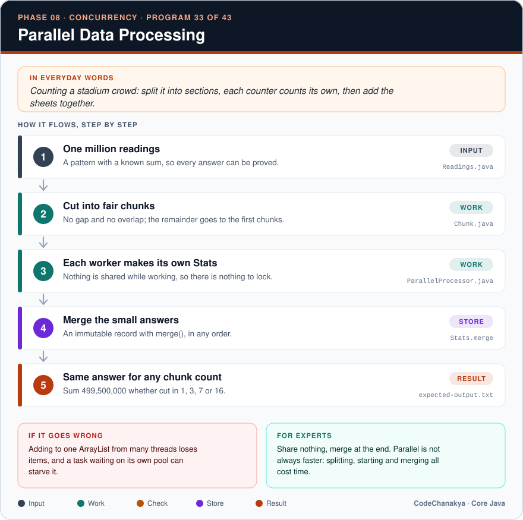
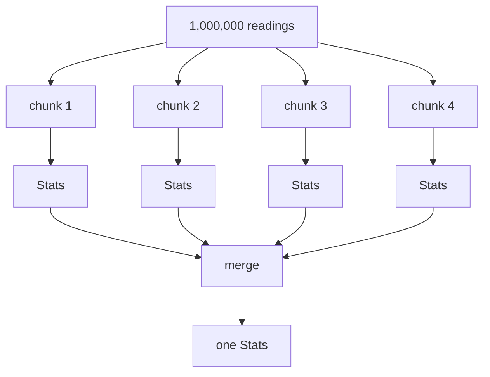

# 33 · Parallel Data Processing

**Phase 08 · Concurrency** &nbsp;|&nbsp; **Level:** Advanced &nbsp;|&nbsp; **Java:** 21 or newer

Concepts: splitting work, `Future`, immutable results, thread-safe totals, parallel streams, timeouts, `ExecutionException`.

---

## The problem

A million sensor readings must be summarised: how many, the total, how many were high, the largest. One thread does it in one pass. If the machine has several cores, the work can be cut into pieces and done at the same time, and the small answers merged.

The tempting version shares one total between all the threads and fights over it with locks. The better version shares **nothing** while working, and merges at the end. This program shows both, and shows how to wait with a deadline and how to cope when one piece fails.

<!--flow-->
## The flow at a glance

<p align="center"><a href="../../docs/flows/program-33.svg"></a></p>

| If you are | Read it like this |
|---|---|
| New to coding | Counting a stadium crowd: split it into sections, each counter counts its own, then add the sheets together. |
| Learning | Follow the numbered cards from top to bottom. Open the file named on each card, run the program, and match its output to the last card. |
| Experienced | Share nothing, merge at the end. Parallel is not always faster: splitting, starting and merging all cost time. |

<details>
<summary>Text version of the flow</summary>

1. **One million readings** (input): A pattern with a known sum, so every answer can be proved. (`Readings.java`)
2. **Cut into fair chunks** (work): No gap and no overlap; the remainder goes to the first chunks. (`Chunk.java`)
3. **Each worker makes its own Stats** (work): Nothing is shared while working, so there is nothing to lock. (`ParallelProcessor.java`)
4. **Merge the small answers** (store): An immutable record with merge(), in any order. (`Stats.merge`)
5. **Same answer for any chunk count** (result): Sum 499,500,000 whether cut in 1, 3, 7 or 16. (`expected-output.txt`)

</details>
<!--/flow-->

## Requirements

**Functional**
1. Summarise a large array: count, sum, readings above a limit, maximum.
2. Cut the work into any number of chunks, with no gap and no overlap.
3. Run the chunks on a pool and merge the answers.
4. Get the same answer however many chunks are used.
5. Wait for a result with a deadline, and give up politely.
6. Report which chunk failed when the data contains a bad reading.

**Non-functional**
- Not a single lock in the data processing.
- Every number can be checked by hand, and is the same on every run.

## Read in this order

| Step | File | What to look for |
|---|---|---|
| 1 | [`Readings.java`](src/main/java/com/codechanakya/parallel/Readings.java) | A pattern with a known sum, so we can prove the answers. |
| 2 | [`Stats.java`](src/main/java/com/codechanakya/parallel/Stats.java) | An immutable record with `merge`. The key idea. |
| 3 | [`Chunk.java`](src/main/java/com/codechanakya/parallel/Chunk.java) | Fair splitting. |
| 4 | [`ParallelProcessor.java`](src/main/java/com/codechanakya/parallel/ParallelProcessor.java) | Tickets out, answers merged. |
| 5 | [`SharedTotals.java`](src/main/java/com/codechanakya/parallel/SharedTotals.java) | Three ways to total on four threads. |
| 6 | [`Main.java`](src/main/java/com/codechanakya/parallel/Main.java) | Nine sections. |

## Run it

```bash
./run.sh            # compile and run
./run.sh --check    # run, then compare with expected-output.txt
```

Run it from this folder (`run.sh` does that for you). Nothing here reads or writes files, so there is nothing to clean up.

Expected output:

```text
--- The data ---
  1000000 readings, the first five are [7, 38, 69, 100, 131]
  Every block of 1000 holds each value from 0 to 999 once, so the sum should be 1000 x 499500.

--- One thread, the plain loop ---
  1000000 readings, sum 499500000, 99000 above 900, highest 999

--- Cutting the work into chunks ---
  1,000,000 in 4 : [Chunk[from=0, to=250000], Chunk[from=250000, to=500000], Chunk[from=500000, to=750000], Chunk[from=750000, to=1000000]]
  10 in 3        : [Chunk[from=0, to=4], Chunk[from=4, to=7], Chunk[from=7, to=10]]   (the remainder goes to the first chunks)

--- Four workers, four tickets ---
  Tickets handed out: 4
  Chunk 1: 250000 readings, sum 124875000, 24750 above 900, highest 999
  Chunk 2: 250000 readings, sum 124875000, 24750 above 900, highest 999
  Chunk 3: 250000 readings, sum 124875000, 24750 above 900, highest 999
  Chunk 4: 250000 readings, sum 124875000, 24750 above 900, highest 999
  Merged: 1000000 readings, sum 499500000, 99000 above 900, highest 999
  Same as the single thread: true

--- Does the number of chunks change the answer? ---
   1 chunks: sum 499500000
   2 chunks: sum 499500000
   3 chunks: sum 499500000
   7 chunks: sum 499500000
  16 chunks: sum 499500000
  Every answer equals the baseline: true

--- Parallel streams do the chunking for you ---
  parallel sum equals the baseline: true
  Readings per band of 100: {0=100000, 1=100000, 2=100000, 3=100000, 4=100000, 5=100000, 6=100000, 7=100000, 8=100000, 9=100000}
  The result is the same however the threads were scheduled; only the speed changes.

--- Three ways to share a total ---
  one AtomicLong  : 499500000
  one LongAdder   : 499500000
  private totals  : 499500000
  All equal the baseline: true

--- Waiting with a deadline ---
  Gave up after 100 ms: TimeoutException
  cancel(true) returned true

--- One bad reading in the data ---
  Chunk 1: ok, 250000 readings
  Chunk 2: ok, 250000 readings
  Chunk 3: failed. Bad reading -1 at position 600000
  Chunk 4: ok, 250000 readings
  Only the chunk that held the bad reading failed.
```

## How the answers can be checked by hand

Reading number `i` is `(i * 31 + 7) % 1000`. Because 31 and 1000 share no factor, each block of 1000 readings holds every value from 0 to 999 exactly once. So for one million readings (1000 blocks):

| Quantity | Working | Result |
|---|---|---|
| Sum | 1000 blocks x (0 + 1 + ... + 999 = 499,500) | 499,500,000 |
| Above 900 | 99 values (901 to 999) per block x 1000 | 99,000 |
| Highest | | 999 |
| Each of four chunks | 250 blocks x 499,500 | 124,875,000 |

When you can predict the output from arithmetic, a wrong answer from a parallel version cannot hide.

## Fork, work, join



It is safe without locks because of three habits:

1. The input array is only **read** once the workers have it. Nobody writes to it.
2. Each worker builds its **own** `Stats`. There is nothing shared to fight over.
3. The answers are combined on **one** thread, after the workers hand them back.

`Stats` is an immutable record, so handing it from one thread to another is always safe. `merge` joins two answers into one, and it gives the same result in any order (addition and `max` do), so it does not matter which chunk finishes first. `Stats.EMPTY` is the neutral starting point, like 0 for addition.

## Cutting fairly

`Chunk.split(10, 3)` gives `[0,4)`, `[4,7)`, `[7,10)`: when the items do not divide evenly, the first chunks take one extra each. A chunk is "from, up to but not including, to", so neighbours meet exactly: nothing is missed and nothing is counted twice. Off-by-one mistakes here are silent, and the "does the number of chunks change the answer?" section is the test that would catch them.

## Three ways to share a total

| Approach | How | Cost |
|---|---|---|
| `AtomicLong` | every thread adds every reading to one number | correct, but all threads queue on one value |
| `LongAdder` | several internal counters, summed when asked | threads rarely collide; good for hot counters |
| Private totals | each chunk returns its own total | no contention at all; usually the best design |

All three print the same sum. The lesson is not which is fastest on your machine; it is that **not sharing** is easier to get right than sharing safely.

## Thread-safe or not?

| Type | Safe from several threads? | Use instead |
|---|---|---|
| `ArrayList`, `HashMap`, `StringBuilder` | no | `CopyOnWriteArrayList`, `ConcurrentHashMap`, or one per thread |
| `ConcurrentHashMap`, `LongAdder`, `AtomicXxx` | yes | |
| `String`, records, `List.of(...)` | yes, they cannot change | |
| A plain array | reading yes; writing the same slot no | give each thread its own slots |

Adding to one `ArrayList` from a parallel stream loses elements ([`broken/SharedArrayList.java`](broken/README.md)).

## Parallel streams

`Arrays.stream(data).parallel()` does the chunking for you on a shared pool, the **common ForkJoinPool**. It is the shortest way to parallelise a pure calculation. `groupingByConcurrent` builds a concurrent map for the bands. Know its limits:

- The work must be independent per element, with no shared writes.
- Small data is slower in parallel, because starting and merging costs time.
- Blocking work (waiting on a network) starves the common pool, which every parallel stream in the program shares. Use your own pool for that.
- On a machine with one or two cores the common pool is very small, and a "parallel" stream may not run in parallel at all.

## Waiting with a deadline, and failing well

`get()` waits forever. In real systems that is a bug waiting to happen, so `get(100, MILLISECONDS)` is the habit: on `TimeoutException`, stop waiting, and `cancel(true)` the task. A failure inside a chunk arrives from `get()` as an `ExecutionException`. Because the results are read per chunk, the program can say **which** chunk failed and that the others were fine. A chunk that sleeps while waiting for another task in the same pool can starve the pool: see [`broken/PoolStarvation.java`](broken/README.md).

## Why the output is the same every time

Threads run in an order nobody can promise. A program whose output depends on that order cannot be checked by comparing it with a file, and it cannot be trusted either. So this program follows two rules, and you should too when you write your own:

1. **Never print from a worker thread** (with the one marked exception). Workers hand back values; the main thread prints them.
2. **Collect results in the order the work was handed out**, not the order it finished.

The program also never prints how long anything took, because timings change from machine to machine. The exercises ask you to measure speed yourself.

## Is parallel always faster?

No. Cutting the work, starting threads, and merging all cost time. A job that takes microseconds is slower in parallel. A job that is mostly waiting can use far more threads than cores; a job that is mostly arithmetic cannot use more threads than cores. The first exercise asks you to measure it on your machine, which is the only honest answer.

## Common mistakes

| Mistake | What you see |
|---|---|
| Writing to one shared list or map from all threads | lost elements, or a crash |
| Sharing one total under a lock when private totals would do | slower, and more to get wrong |
| `get()` with no deadline | a program that can hang for ever |
| A task that waits for another task of the same pool | a starved pool |
| Chunks that overlap or leave a gap | a wrong total, silently |
| Using a parallel stream for blocking calls | the whole program slows down |

## Practice

- [`exercises/`](exercises/README.md): six tasks.
- [`solutions/`](solutions/README.md): one answer to each.

## Verification

Compiled and run with OpenJDK 21.0.13 on Linux. `./run.sh --check` passes. The solution file also compiles and runs. Not yet run on Java 25, Windows or macOS. Every figure in the output matches the hand calculation above. The output was compared across repeated runs, several at once.

## Next

Program 34 is the phase project: many payments in flight at once, written as chains of steps with `CompletableFuture`, so no thread ever waits for another.
