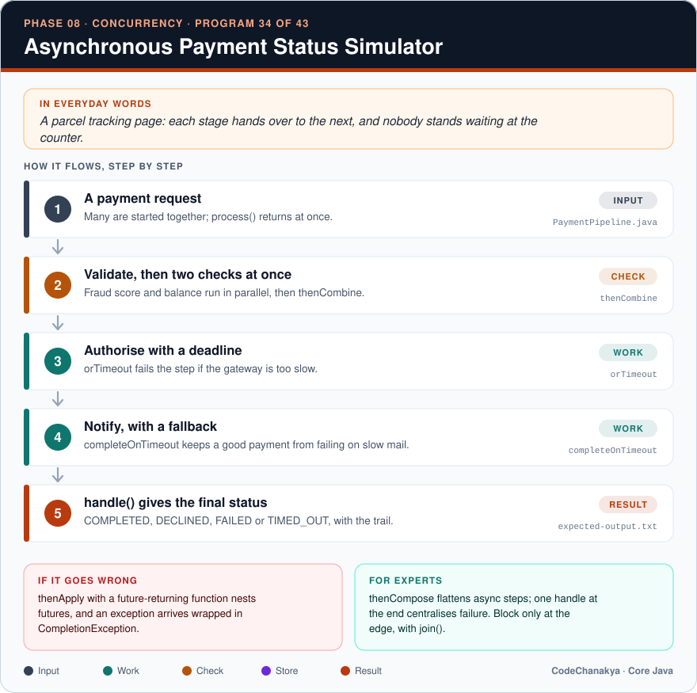
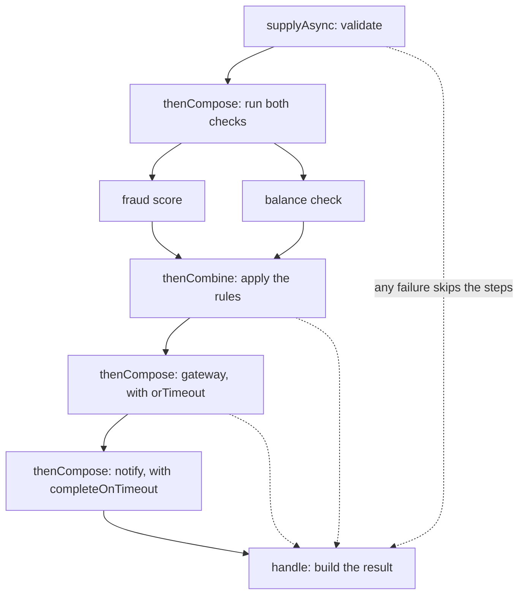

# 34 · Asynchronous Payment Status Simulator

**Phase 08 · Concurrency** &nbsp;|&nbsp; **Level:** Advanced · phase project &nbsp;|&nbsp; **Java:** 21 or newer

Concepts: `CompletableFuture`: `supplyAsync`, `thenApply`, `thenCompose`, `thenCombine`, `handle`, `orTimeout`, `allOf`, retries.

---

## The problem

A payment service receives payments all day. Each one must be validated, checked for fraud and for funds, sent to an outside gateway, and the customer notified. Several of those steps wait on other services. If a thread waits for each step, thousands of waiting threads are needed for thousands of payments.

The answer is to describe a payment as a **chain of steps that run when the previous one finishes**, and let no thread sit idle. The program must also say clearly how every payment ended: completed, declined, failed or timed out.

This is the **phase project**. It uses threads and pools (31), shared state and visibility (32), and independent results merged at the end (33), and adds `CompletableFuture`.

<!--flow-->
## The flow at a glance

<p align="center"><a href="../../docs/flows/program-34.svg"></a></p>

| If you are | Read it like this |
|---|---|
| New to coding | A parcel tracking page: each stage hands over to the next, and nobody stands waiting at the counter. |
| Learning | Follow the numbered cards from top to bottom. Open the file named on each card, run the program, and match its output to the last card. |
| Experienced | thenCompose flattens async steps; one handle at the end centralises failure. Block only at the edge, with join(). |

<details>
<summary>Text version of the flow</summary>

1. **A payment request** (input): Many are started together; process() returns at once. (`PaymentPipeline.java`)
2. **Validate, then two checks at once** (check): Fraud score and balance run in parallel, then thenCombine. (`thenCombine`)
3. **Authorise with a deadline** (work): orTimeout fails the step if the gateway is too slow. (`orTimeout`)
4. **Notify, with a fallback** (work): completeOnTimeout keeps a good payment from failing on slow mail. (`completeOnTimeout`)
5. **handle() gives the final status** (result): COMPLETED, DECLINED, FAILED or TIMED_OUT, with the trail. (`expected-output.txt`)

</details>
<!--/flow-->

## Requirements

**Functional**
1. Validate a payment, then run the fraud check and the balance check **at the same time**.
2. Authorise through a gateway that may be slow or down.
3. Tell the customer, but never fail a payment because the mail server is slow.
4. End every payment with a status, a reason and the steps it went through.
5. Start many payments at once and wait for them all.
6. Use the answer of whichever of two gateways replies first.
7. Retry an action that fails.

**Non-functional**
- Nothing blocks a thread while it waits for a remote service.
- All error handling is in one place at the end of the chain.
- Every output line is identical on every run.

## Read in this order

| Step | File | What to look for |
|---|---|---|
| 1 | [`Status.java`](src/main/java/com/codechanakya/asyncpay/Status.java), [`PaymentRequest.java`](src/main/java/com/codechanakya/asyncpay/PaymentRequest.java), [`PaymentResult.java`](src/main/java/com/codechanakya/asyncpay/PaymentResult.java) | An enum and two records. |
| 2 | the three `...Exception.java` files | Why three kinds of failure. |
| 3 | [`FraudService.java`](src/main/java/com/codechanakya/asyncpay/FraudService.java), [`BalanceService.java`](src/main/java/com/codechanakya/asyncpay/BalanceService.java), [`GatewayService.java`](src/main/java/com/codechanakya/asyncpay/GatewayService.java), [`NotificationService.java`](src/main/java/com/codechanakya/asyncpay/NotificationService.java) | Each returns a `CompletableFuture`. |
| 4 | [`PaymentPipeline.java`](src/main/java/com/codechanakya/asyncpay/PaymentPipeline.java) | The chain. The file to study. |
| 5 | [`Retry.java`](src/main/java/com/codechanakya/asyncpay/Retry.java) | A recursive future. |
| 6 | [`PaymentSystem.java`](src/main/java/com/codechanakya/asyncpay/PaymentSystem.java) | The shared pool, with daemon threads. |
| 7 | [`Main.java`](src/main/java/com/codechanakya/asyncpay/Main.java) | Five sections. |

## Run it

```bash
./run.sh            # compile and run
./run.sh --check    # run, then compare with expected-output.txt
```

Run it from this folder (`run.sh` does that for you). Nothing here reads or writes files, so there is nothing to clean up.

Expected output:

```text
--- One payment, step by step ---
  process() has returned. It did not wait for the payment to finish.
  P-1001 COMPLETED: authorised AUTH-P-1001, notice sent
  Trail: PENDING -> VALIDATED -> CHECKED -> AUTHORISED -> COMPLETED

--- Seven payments started together ---
  P-1001  COMPLETED  authorised AUTH-P-1001, notice sent
          PENDING -> VALIDATED -> CHECKED -> AUTHORISED -> COMPLETED
  P-2001  DECLINED   Declined: insufficient funds
          PENDING -> VALIDATED -> DECLINED
  P-2002  DECLINED   Declined: fraud score 90 is too high
          PENDING -> VALIDATED -> DECLINED
  P-2003  FAILED     Invalid payment: amount must be positive
          PENDING -> FAILED
  P-GATE  FAILED     Gateway unavailable, try again later
          PENDING -> VALIDATED -> CHECKED -> FAILED
  P-SLOW  TIMED_OUT  No answer from the gateway within 400 ms
          PENDING -> VALIDATED -> CHECKED -> TIMED_OUT
  P-MAIL  COMPLETED  authorised AUTH-P-MAIL, notice NOT SENT
          PENDING -> VALIDATED -> CHECKED -> AUTHORISED -> COMPLETED

--- A batch of nine, waiting with allOf ---
  By status: {COMPLETED=4, DECLINED=2, FAILED=2, TIMED_OUT=1}
  Callbacks that fired: 9

--- Two gateways, the faster one wins ---
  Answered by: backup gateway

--- Trying again when the gateway fails ---
  Succeeded after 3 attempts: AUTH-RETRIED
  Gave up after 3 attempts: still down
```

## The idea: a promise you can attach steps to

A `Future` (Program 31) is a ticket you can only wait on. A `CompletableFuture` is a ticket you can **attach steps to**: "when this finishes, do that". No thread has to wait. `process(request)` returns at once, and the chain runs itself as each service answers.



## Choosing the right step

| Method | Use it when | Shape |
|---|---|---|
| `supplyAsync(supplier, pool)` | start work on a pool | nothing in, a future out |
| `thenApply(f)` | transform the value with a plain function | `T` to `U` |
| `thenAccept(c)` | use the value, produce nothing | `T` to nothing |
| `thenCompose(f)` | the next step is **itself asynchronous** | `T` to `CompletableFuture<U>`, flattened |
| `thenCombine(other, f)` | you need **both** of two independent futures | `(T, U)` to `V` |
| `allOf(a, b, c)` | wait for all of many | a future that completes when all have |
| `anyOf` and `applyToEither` | the first one to finish wins | |

`thenApply` versus `thenCompose` is the question beginners get stuck on. If your function returns a plain value, use `thenApply`. If it returns another `CompletableFuture`, use `thenCompose`; with `thenApply` you get a future inside a future, and the compiler tells you so ([`broken/ThenApplyNesting.java`](broken/README.md)).

## Handling errors

An exception thrown in any step makes that future complete **exceptionally**, and every later step is skipped, like a `throw` falling through code until something catches it. Downstream the exception arrives wrapped in a `CompletionException`, and the real problem is the cause ([`broken/JoinWrapsException.java`](broken/README.md)).

| Method | What it does |
|---|---|
| `handle((value, error) -> ...)` | sees success **or** failure, and returns the final result. The program uses this once, at the end. |
| `exceptionally(error -> ...)` | replaces a failure with a value |
| `whenComplete((value, error) -> ...)` | looks at the outcome (for logging or counting) without changing it |

`PaymentPipeline.failure` unwraps the exception and maps it to a status:

| Cause | Status | Why |
|---|---|---|
| `DeclinedException` | `DECLINED` | a business rule said no |
| `InvalidPaymentException` | `FAILED` | the request itself is wrong, retrying is pointless |
| `GatewayUnavailableException` | `FAILED` | the gateway is broken, retrying may help |
| `TimeoutException` | `TIMED_OUT` | no answer in time |

Three kinds of exception, because each calls for a different reaction.

## Time limits

Remote services are slow sometimes. Two tools:

| Method | When time runs out |
|---|---|
| `orTimeout(ms)` | the future **fails** with a `TimeoutException`. Used for the gateway, because a payment with no answer cannot be assumed to be paid. |
| `completeOnTimeout(value, ms)` | the future **completes** with a default. Used for the notice: the money has moved, so a slow mail server shows `NOT SENT` and the payment still completes. |

Choosing between failing and falling back is a business decision, not a technical one.

## Waiting at the end, and only there

`join()` waits for a future and throws unchecked exceptions (a `CompletionException`). `get()` is the checked version. Both block a thread, so call them at the **edge** of the program, as `Main` does, never inside a step. The section with seven payments starts all of them, then joins them in order. The batch section uses `allOf` to wait for nine, and `whenComplete` to count callbacks.

## The pool behind it

Every `supplyAsync` takes an executor argument. Without one it uses the common pool, which is small and shared by the whole program. `PaymentSystem` passes its own cached pool of **daemon** threads: a payment waiting for a slow gateway can never stop the program from ending, and the pool never runs out of threads to start the stage after a sleeping one.

## Why the output is the same every time

Threads run in an order nobody can promise. A program whose output depends on that order cannot be checked by comparing it with a file, and it cannot be trusted either. So this program follows two rules, and you should too when you write your own:

1. **Never print from a worker thread** (with the one marked exception). Workers hand back values; the main thread prints them.
2. **Collect results in the order the work was handed out**, not the order it finished.

The program also never prints how long anything took, because timings change from machine to machine. The exercises ask you to measure speed yourself.

The delays are far apart on purpose: normal answers take tens of milliseconds, the deadlines are 200 and 400 ms, and the rigged slow answers take a second or more. A slow computer would have to be ten times slower before an outcome changed.

## Common mistakes

| Mistake | What you see |
|---|---|
| `thenApply` where `thenCompose` is needed | a compile error about a future inside a future |
| Calling `join()` inside a stage | a blocked thread, which defeats the purpose |
| Not waiting at the end | the program ends and the async work is thrown away |
| Catching `CompletionException` and printing its message | the real cause is hidden |
| No timeout on a remote call | a payment that waits for ever |
| Printing from inside stages | output in a different order each run |

## Practice

- [`exercises/`](exercises/README.md): six tasks.
- [`solutions/`](solutions/README.md): one answer to each.

## Verification

Compiled and run with OpenJDK 21.0.13 on Linux. `./run.sh --check` passes. The solution file also compiles and runs. Not yet run on Java 25, Windows or macOS. The output was compared across repeated runs, several at once, to be sure it does not depend on which thread finishes first.

## Next

Phase 9 is Professional Java: building with Maven, testing with JUnit 5, talking to a database, and the habits (SOLID, Git) that make a project last.
