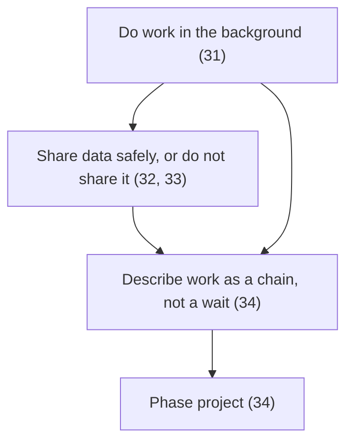

# Phase 08 · Concurrency

Programs 31 to 34 teach how to do several things at once, and how to keep that from going wrong. Phase 7 left you with immutable records and pure functions; they are what make this phase possible.

| No. | Program | New ideas |
|---|---|---|
| 31 | [Background Report Generator](31-background-report-generator) | `Thread`, `Runnable`, `Callable`, `ExecutorService`, `Future`, shutdown |
| 32 | [Concurrent Order Processor](32-concurrent-order-processor) | race conditions, `synchronized`, locks, atomics, `volatile`, queues, deadlock |
| 33 | [Parallel Data Processing](33-parallel-data-processing) | splitting work, merging results, thread-safe collections, parallel streams |
| 34 | [Asynchronous Payment Status Simulator](34-asynchronous-payment-status-simulator) | `CompletableFuture` chains, timeouts, error handling (phase project) |

## How these programs run

None of them reads or writes files. Each has a `run.sh`; use `./run.sh --check` to compare with `expected-output.txt`. Concurrent programs usually print different things on different runs. These do not, on purpose: workers never print, results are collected in a fixed order, no timings are shown, and races are forced rather than left to luck. That is a skill in itself, because only a repeatable program can be tested. Programs 31 to 34 each take a few seconds because they really wait.

## The themes

| Habit | Why |
|---|---|
| Use a pool, not a thread per task | threads are expensive and limited |
| Always shut the pool down | live workers keep the program alive |
| Prefer immutable values and records | nothing to protect |
| Prefer not sharing over sharing safely | each thread works on its own part, then merge |
| Ask: shared? changed? several threads? | all three together are what make a race |
| Make check-then-act one atomic step | a gap between them is a race |
| Lock in a fixed order | stops deadlock |
| Never block inside an async step | it defeats the purpose |
| Give every wait a deadline | a hang is the worst bug |
| Handle failure once, at the end of the chain | one place to look |
| Collect results in the order work was handed out | repeatable output |

## Choosing a tool

| You need to... | Reach for |
|---|---|
| run a few independent jobs and collect the answers | `ExecutorService` and `Future` |
| protect one number | `AtomicInteger`, `LongAdder` |
| protect several fields that change together | `synchronized` or `ReentrantLock` |
| count from many threads | `ConcurrentHashMap` with `LongAdder` |
| hand work from one set of threads to another | `BlockingQueue` |
| split a big calculation | chunks and `merge`, or a parallel stream |
| chain steps that wait on remote services | `CompletableFuture` |
| tell a loop to stop | a `volatile` flag, or `interrupt()` |

## Mastery checkpoint

Build this without looking at the solutions.

**Ticket Booking.** A cinema has 120 seats. Many customers try to book at once.

1. Let 300 customers book one seat each from 12 threads. Exactly 120 must succeed. Do it with `synchronized`, then again with an `AtomicInteger`.
2. Count bookings per film from all threads and print them sorted.
3. A booking has three steps that wait on other services: payment, seat confirmation and e-mail. Write it as a `CompletableFuture` chain. Payment and seat hold must run in parallel. If payment takes more than 300 ms the booking is `TIMED_OUT`; a slow e-mail must not cancel it.
4. Retry a failed payment up to three times.
5. Make the program print the same thing on every run.
6. Add a deliberate deadlock in a separate file, catch it with a timeout, and fix it with a lock order.

You are ready for Phase 9 when you can explain why `count++` is not atomic, why `volatile` does not fix it, why a pool must be shut down, what `thenCompose` flattens, and why the same program can pass a thousand runs and still be wrong.

## Levels

| Level | You can... |
|---|---|
| 1 Understood | explain a thread, a race and a deadlock in plain words |
| 2 Applied | use a pool, a lock, an atomic and a `CompletableFuture` correctly |
| 3 Connected | combine them as Program 34 does |
| 4 Mastered | design the booking system alone and prove it never oversells |
