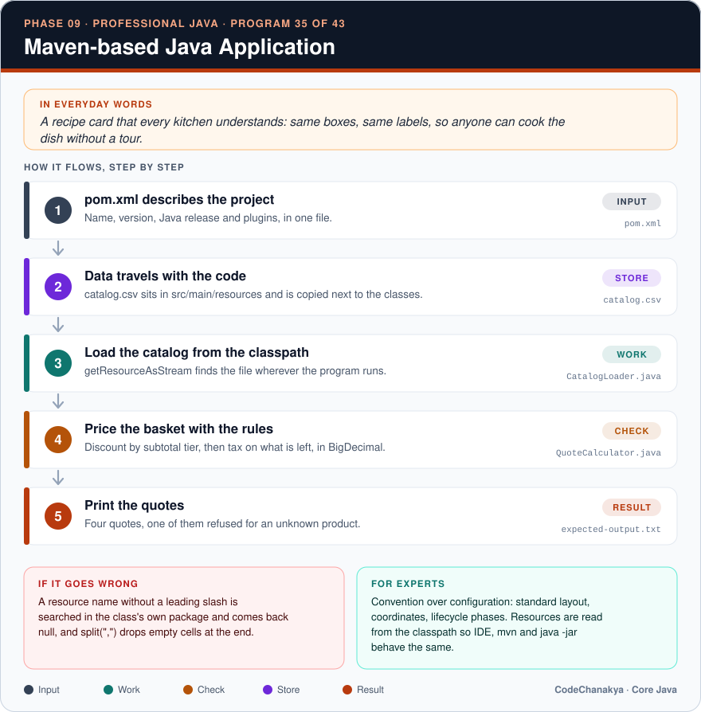
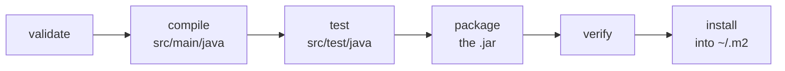

# 35 · Maven-based Java Application

**Phase 09 · Professional Java** &nbsp;|&nbsp; **Level:** Intermediate &nbsp;|&nbsp; **Java:** 21 or newer

Concepts: Maven, `pom.xml`, coordinates, standard directory layout, resources on the classpath, dependencies, the build lifecycle, an executable jar.

---

## The problem

Until now every program was a folder of `.java` files and a `run.sh` that called `javac`. That works for ten files. A real project has hundreds of files, data files that must travel with the code, libraries written by other people, tests, and several people who all need to build it the same way on different machines.

A **build tool** answers one question: how does anybody, on any computer, turn this folder into a running program? Maven answers it with a convention. Every project has the same layout and one description file, `pom.xml`. Learn it once and you can open almost any Java project in the world.

This program is a small quote calculator for a shop. It reads its price list from a file, prices a basket with discounts and tax, and prints the quote. The program is simple on purpose, so the project around it is what you study.

<!--flow-->
## The flow at a glance

<p align="center"><a href="../../docs/flows/program-35.svg"></a></p>

| If you are | Read it like this |
|---|---|
| New to coding | A recipe card that every kitchen understands: same boxes, same labels, so anyone can cook the dish without a tour. |
| Learning | Follow the numbered cards from top to bottom. Open the file named on each card, run the program, and match its output to the last card. |
| Experienced | Convention over configuration: standard layout, coordinates, lifecycle phases. Resources are read from the classpath so IDE, mvn and java -jar behave the same. |

<details>
<summary>Text version of the flow</summary>

1. **pom.xml describes the project** (input): Name, version, Java release and plugins, in one file. (`pom.xml`)
2. **Data travels with the code** (store): catalog.csv sits in src/main/resources and is copied next to the classes. (`catalog.csv`)
3. **Load the catalog from the classpath** (work): getResourceAsStream finds the file wherever the program runs. (`CatalogLoader.java`)
4. **Price the basket with the rules** (check): Discount by subtotal tier, then tax on what is left, in BigDecimal. (`QuoteCalculator.java`)
5. **Print the quotes** (result): Four quotes, one of them refused for an unknown product. (`expected-output.txt`)

</details>
<!--/flow-->

## Requirements

**Functional**
1. Read the product catalog from `catalog.csv`.
2. Price a list of items: quantity times unit price.
3. Give 5 percent off a subtotal of 500 or more, and 10 percent off 1000 or more.
4. Work out tax per product on the discounted amount.
5. Refuse a quote that asks for a product that does not exist.

**Non-functional**
- The catalog is a resource inside the project, never a path on one person's disk.
- All money uses `BigDecimal`, rounded to two decimals with `HALF_UP`.
- The project builds the same way with Maven, with `javac`, and in an IDE.

## The Maven layout

```text
35-maven-based-java-application/
├── pom.xml                      the project description
├── src/
│   ├── main/
│   │   ├── java/                production code (packages become folders)
│   │   └── resources/           files that travel with the code: catalog.csv
│   └── test/
│       └── java/                test code (Program 36 fills this in)
└── target/                      everything Maven builds. Never commit it.
```

Maven does not ask you to describe where things are. It already knows, because everybody agrees. That agreement is called **convention over configuration**.

## Read in this order

| Step | File | What to look for |
|---|---|---|
| 1 | [`pom.xml`](pom.xml) | Coordinates, the Java version, two plugins. Read the comments. |
| 2 | [`Product.java`](src/main/java/com/codechanakya/quotes/Product.java) | A record that checks its own values. |
| 3 | [`src/main/resources/catalog.csv`](src/main/resources/catalog.csv) | The data. Six products. |
| 4 | [`CatalogLoader.java`](src/main/java/com/codechanakya/quotes/CatalogLoader.java) | Finds the file with `getResourceAsStream`, never with a file path. |
| 5 | [`Catalog.java`](src/main/java/com/codechanakya/quotes/Catalog.java), [`UnknownProductException.java`](src/main/java/com/codechanakya/quotes/UnknownProductException.java) | A lookup that fails loudly. |
| 6 | [`QuoteItem.java`](src/main/java/com/codechanakya/quotes/QuoteItem.java), [`QuoteLine.java`](src/main/java/com/codechanakya/quotes/QuoteLine.java), [`Quote.java`](src/main/java/com/codechanakya/quotes/Quote.java) | Three small records: what was asked, one priced row, the whole quote. |
| 7 | [`QuoteCalculator.java`](src/main/java/com/codechanakya/quotes/QuoteCalculator.java) | The rules. Discount first, then tax on what is left. |
| 8 | [`Main.java`](src/main/java/com/codechanakya/quotes/Main.java) | Four quotes, one of them refused. |

## Run it

```bash
./run.sh            # compile and run
./run.sh --check    # run, then compare with expected-output.txt
./run.sh --maven    # the same, built with Maven (needs `mvn` installed)
```

`./run.sh` uses `javac` and copies `src/main/resources` next to the classes, which is what Maven does for you. Compare the script with the Maven route to see how much work Maven takes off your hands. The Maven route needs Maven 3.9 or newer installed.

Expected output:

```text
Catalog loaded from the classpath: 6 products

Quote A
  Notebook        x2  net    240.00  tax    12.00  gross    252.00
  Pen Box         x3  net    136.50  tax     6.83  gross    143.33
  Subtotal : 376.50
  Discount : 0.00 (0%)
  Tax      : 18.83
  Total    : 395.33

Quote B
  Wireless Mouse  x1  net    719.10  tax   129.44  gross    848.54
  Keyboard        x1  net   1349.10  tax   242.84  gross   1591.94
  USB Cable       x2  net    538.20  tax    96.88  gross    635.08
  Subtotal : 2896.00
  Discount : 289.60 (10%)
  Tax      : 469.16
  Total    : 3075.56

Quote C
  Desk Lamp       x1  net    617.50  tax    74.10  gross    691.60
  Notebook        x1  net    114.00  tax     5.70  gross    119.70
  Subtotal : 770.00
  Discount : 38.50 (5%)
  Tax      : 79.80
  Total    : 811.30

Quote D
  Rejected: Unknown product: X-999
```

## Anatomy of pom.xml

| Part | In this project | What it means |
|---|---|---|
| `groupId` | `com.codechanakya` | Who made it. Usually a reversed domain name. |
| `artifactId` | `quote-calculator` | What it is called. |
| `version` | `1.0.0` | Which release. A version ending in `-SNAPSHOT` means "still being worked on". |
| `packaging` | `jar` | What `mvn package` produces. |
| `maven.compiler.release` | `21` | The Java version, the same idea as `javac --release 21`. |
| `plugin` | `maven-jar-plugin` | Extra abilities. Here: write the `Main-Class` into the jar so `java -jar` works. |

Those three values, group, artifact and version, are the **coordinates**. They name this project, and they are how any other project would ask for it as a dependency.

## The build lifecycle

Maven has a fixed list of phases. Asking for a phase runs it and every phase before it.



| Command | What happens |
|---|---|
| `mvn compile` | Compile production code into `target/classes`. Resources are copied there as well. |
| `mvn test` | Compile and run the tests. |
| `mvn package` | Test, then build `target/quote-calculator-1.0.0.jar`. |
| `mvn clean` | Delete `target/`. Use it when something looks stale. |
| `mvn compile exec:java` | Run the program from Maven, using the `exec` plugin. |

Add `-q` for quiet output and `-B` for batch mode (no colours, good for CI).

## Why resources are read from the classpath

`CatalogLoader` never writes a path such as `C:\work\catalog.csv`. It asks the class loader for `/catalog.csv`. A file in `src/main/resources` is copied to the root of `target/classes`, and later packed into the jar, so the same line of code works from the IDE, from Maven and from `java -jar`.

One small rule causes many bugs: a name that starts with `/` is looked up from the root of the classpath, and a name without it is looked up inside the class's own package folder. See [`broken/`](broken/README.md).

## Dependencies, ready for the next programs

This program has none, on purpose. When one is needed, it is a few lines in the `<dependencies>` block, and Maven downloads the library and everything it needs from Maven Central into `~/.m2/repository`:

```xml
<dependency>
  <groupId>org.junit.jupiter</groupId>
  <artifactId>junit-jupiter</artifactId>
  <version>5.11.4</version>
  <scope>test</scope>
</dependency>
```

| Scope | On the classpath when | Example |
|---|---|---|
| `compile` (default) | compiling, testing and running | a JDBC driver |
| `test` | testing only | JUnit |
| `provided` | compiling only; the server supplies it | a servlet API |

Programs 36 and 37 add exactly this kind of block.

## What to remember

1. Follow the layout and Maven needs almost no configuration.
2. Coordinates, the Java version and plugins are most of a small `pom.xml`.
3. Never commit `target/`. It is rebuilt from the source.
4. Data files that travel with the code live in `src/main/resources` and are read from the classpath.
5. Pin plugin and dependency versions, so the same command gives the same result next year.

## How this was checked

While the program was written, it was compiled and run with OpenJDK 21.0.13 on Linux, `./run.sh --check` passed, and the output was the same on every run. The project's GitHub Actions run then confirmed it on Linux with Java 21 and Java 25, including real Maven (`mvn verify`) and the real JUnit jar. Not yet run on Windows or macOS.
