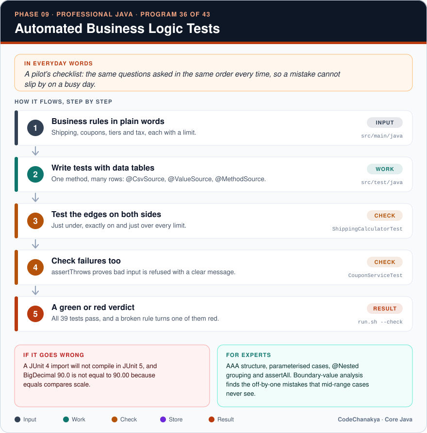

# 36 · Automated Business Logic Tests

**Phase 09 · Professional Java** &nbsp;|&nbsp; **Level:** Intermediate &nbsp;|&nbsp; **Java:** 21 or newer

Concepts: JUnit 5, `@Test`, `@ParameterizedTest`, `@CsvSource`, `@MethodSource`, `@Nested`, `assertAll`, `assertThrows`, boundary values, test-first thinking.

---

## The problem

A shop prices its orders with rules that people argue about: a gold customer gets 10 percent off, a coupon has a cap, shipping is free from 999 but never for express delivery, and tax is worked out after the discounts. Every rule has an edge. Is a subtotal of exactly 999 free? Is 20000 grams still within the limit?

Edges are where bugs live, and a person cannot re-check forty edges by hand after every change. A computer can, in less than a second. An **automated test** is a small program that calls your code with a known input and checks the answer. Run the whole set after every change, and a broken rule is caught the minute it breaks, not by a customer.

Program 9 introduced JUnit with one small class. This program uses it on rules like the ones real shops have.

<!--flow-->
## The flow at a glance

<p align="center"><a href="../../docs/flows/program-36.svg"></a></p>

| If you are | Read it like this |
|---|---|
| New to coding | A pilot's checklist: the same questions asked in the same order every time, so a mistake cannot slip by on a busy day. |
| Learning | Follow the numbered cards from top to bottom. Open the file named on each card, run the program, and match its output to the last card. |
| Experienced | AAA structure, parameterised cases, @Nested grouping and assertAll. Boundary-value analysis finds the off-by-one mistakes that mid-range cases never see. |

<details>
<summary>Text version of the flow</summary>

1. **Business rules in plain words** (input): Shipping, coupons, tiers and tax, each with a limit. (`src/main/java`)
2. **Write tests with data tables** (work): One method, many rows: @CsvSource, @ValueSource, @MethodSource. (`src/test/java`)
3. **Test the edges on both sides** (check): Just under, exactly on and just over every limit. (`ShippingCalculatorTest`)
4. **Check failures too** (check): assertThrows proves bad input is refused with a clear message. (`CouponServiceTest`)
5. **A green or red verdict** (result): All 39 tests pass, and a broken rule turns one of them red. (`run.sh --check`)

</details>
<!--/flow-->

## Requirements

**Rules under test**
1. Standard delivery costs 40 plus 20 for each started kilogram. It is free from a subtotal of 999. Express adds a flat 100 and is never free.
2. `WELCOME10` gives 10 percent off, capped at 200. `FLAT50` gives 50 off from a subtotal of 300. A blank code means no coupon. Anything else is an error.
3. Gold customers get 10 percent off, silver 5, standard none.
4. The order price applies the tier, then the coupon, then 18 percent tax on the goods, then shipping.

**What the tests must do**
- Check the boundary on both sides: just under, exactly on, just over.
- Check that bad input is refused with a clear message.
- Read like a description of the rule, so the next person knows what the rule is.

## Read in this order

| Step | File | What to look for |
|---|---|---|
| 1 | [`Money.java`](src/main/java/com/codechanakya/pricing/Money.java) | One helper, so every amount has two decimals. |
| 2 | [`ShippingCalculator.java`](src/main/java/com/codechanakya/pricing/ShippingCalculator.java) | The first rule, with its boundaries. |
| 3 | [`ShippingCalculatorTest.java`](src/test/java/com/codechanakya/pricing/ShippingCalculatorTest.java) | `@CsvSource`: one test method, seven cases. |
| 4 | [`CouponService.java`](src/main/java/com/codechanakya/pricing/CouponService.java) | A cap and a minimum spend. |
| 5 | [`CouponServiceTest.java`](src/test/java/com/codechanakya/pricing/CouponServiceTest.java) | `@Nested` groups, `@ValueSource`, `assertThrows`. |
| 6 | [`CustomerTier.java`](src/main/java/com/codechanakya/pricing/CustomerTier.java), [`OrderPricer.java`](src/main/java/com/codechanakya/pricing/OrderPricer.java) | The rules combined. |
| 7 | [`OrderPricerTest.java`](src/test/java/com/codechanakya/pricing/OrderPricerTest.java) | `assertAll`, `@MethodSource`, `@EnumSource`. |

## Run it

```bash
./run.sh            # compile, run every test, show the report
./run.sh --check    # the same, with a one-line verdict (used by CI)
./run.sh --maven    # run the tests with Maven (`mvn test`)
```

`run.sh` downloads one jar, the JUnit console launcher, into `lib/` the first time. Git ignores `lib/`. The Maven route needs no manual download: `pom.xml` lists JUnit as a dependency with `<scope>test</scope>` and Maven fetches it.

There is no `expected-output.txt` here. The "output" of a test run is a verdict, and the program under test has no `main`. A passing run ends with a line like `39 tests successful, 0 tests failed` and the words `OK: all tests passed`.

## The shape of a good test

Every test has three parts. Read them as a sentence: given this, when that happens, then expect this.

```java
@Test
@DisplayName("exactly 20 kg is allowed")
void atTheLimit() {
    // Arrange: build what the test needs
    ShippingCalculator calculator = new ShippingCalculator();

    // Act: do the one thing being tested
    BigDecimal cost = calculator.cost(new BigDecimal("100"), 20_000, false);

    // Assert: say what must be true
    assertEquals(new BigDecimal("440.00"), cost);
}
```

That sample is Exercise B1. The tests in this program skip the comments and keep the same three parts.

## The tools, in the order you meet them

| Tool | Where | What it does |
|---|---|---|
| `@Test` | all three | Marks a method as a test. |
| `@DisplayName` | all three | A readable name for reports. Write it as a sentence about the rule. |
| `@BeforeEach` | `ShippingCalculatorTest`, `OrderPricerTest` | Runs before every test. JUnit also creates a new test object for every test, so fields never leak from one test to the next. |
| `@ParameterizedTest` with `@CsvSource` | `ShippingCalculatorTest` | One method, many rows of data. A new rule case is one new line. |
| `@ValueSource` | `CouponServiceTest` | A list of single values, such as blank strings or bad weights. |
| `@MethodSource` | `OrderPricerTest` | Cases built by a static method. Use it when a case needs objects such as enums. |
| `@EnumSource` | `OrderPricerTest` | Runs the test once per enum constant. |
| `@Nested` | `CouponServiceTest` | Groups related tests inside one class. |
| `assertEquals`, `assertTrue` | all three (`assertTrue` in `OrderPricerTest`) | Compare a result with what you expect. The expected value comes first. |
| `assertThrows` | all three | Passes only if the code throws the named exception, and hands it back so you can check its message. |
| `assertAll` | `OrderPricerTest` | Runs several checks and reports every failure, not just the first. |

## Boundary values

The most useful habit in testing: for every limit in a rule, test the value just below it, exactly on it, and just above it.

| Rule | Below | On the line | Above |
|---|---|---|---|
| Free shipping from 999 | 998.99 costs 60 | 999.00 is free | 5000.00 is free |
| `FLAT50` from 300 | 299.99 gives 0 | 300.00 gives 50 | 1000.00 gives 50 |
| `WELCOME10` capped at 200 | 100 gives 10 | 2000 gives 200 | 9999 gives 200 |
| A started kilogram | 1000 g is 1 kg | 1001 g is 2 kg | 2500 g is 3 kg |

Mistakes such as `>` instead of `>=` do not show up in the middle of a range. They only show up on the line. Try it in exercise C1.

## Why BigDecimal tests compare with the right scale

`assertEquals` uses `equals`. For `BigDecimal`, `new BigDecimal("90.0")` and `new BigDecimal("90.00")` are not equal, because their scales differ. The production code always returns two decimals (through `Money.round`), so the tests write expected values with two decimals, such as `"90.00"`. See [`broken/BigDecimalScale.java`](broken/README.md).

## What to remember

1. A test is a small program with a known input and a known answer.
2. One test checks one rule. Name it so that a failure reads like a bug report.
3. Test the boundaries, not the middle.
4. Test the failures too: bad input must be refused, and the message is part of the behaviour.
5. Tests must not depend on each other or on the order they run in.
6. When you find a bug, write the failing test first, then fix the code.

## How this was checked

While the program was written, it was compiled and run with OpenJDK 21.0.13 on Linux, `./run.sh --check` passed, and the output was the same on every run. The tests were also run on a small stand-in for the JUnit 5 API, and they failed when the code was deliberately broken, so they catch mistakes. The project's GitHub Actions run then confirmed it on Linux with Java 21 and Java 25, including real Maven (`mvn verify`) and the real JUnit jar. Not yet run on Windows or macOS.
