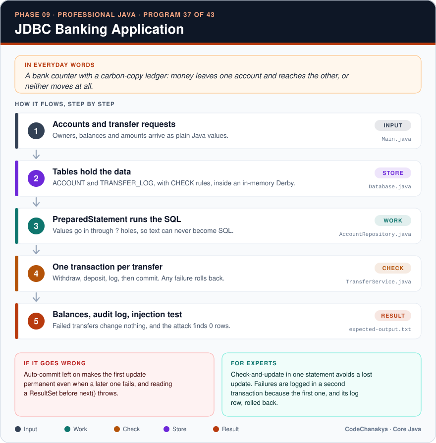
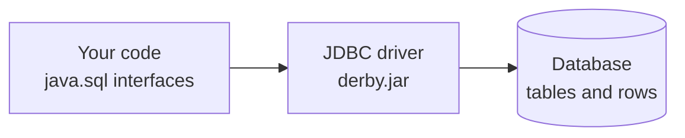
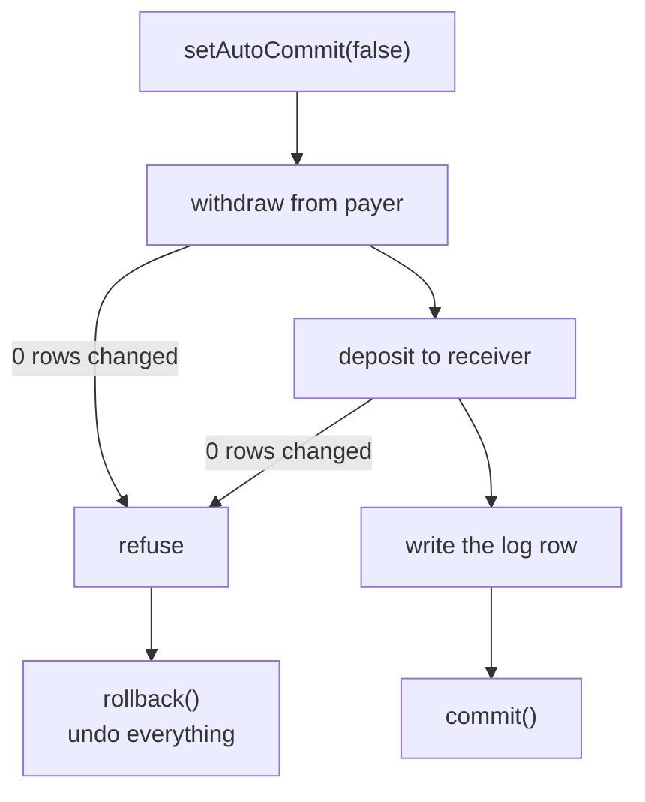

# 37 · JDBC Banking Application

**Phase 09 · Professional Java** &nbsp;|&nbsp; **Level:** Advanced &nbsp;|&nbsp; **Java:** 21 or newer

Concepts: JDBC, `DriverManager`, `Connection`, `PreparedStatement`, `ResultSet`, transactions (`commit`, `rollback`), batch updates, generated keys, SQL injection.

---

## The problem

Every program so far forgot everything when it ended. A bank cannot. Balances must live in a **database**: a separate program that stores tables of rows safely, lets many users read and write at once, and answers questions in a language called SQL.

**JDBC** (Java Database Connectivity) is the standard way for Java to talk to one. It is a set of interfaces in `java.sql`. Each database vendor supplies a **driver** that implements them. Your code uses only the interfaces, so the same code can work with Derby, MySQL, PostgreSQL or Oracle.

A bank adds one hard requirement: **a transfer must never half happen.** If the money leaves one account and the program fails before it reaches the other, money has vanished. A **transaction** makes several statements succeed or fail as one.

<!--flow-->
## The flow at a glance

<p align="center"><a href="../../docs/flows/program-37.svg"></a></p>

| If you are | Read it like this |
|---|---|
| New to coding | A bank counter with a carbon-copy ledger: money leaves one account and reaches the other, or neither moves at all. |
| Learning | Follow the numbered cards from top to bottom. Open the file named on each card, run the program, and match its output to the last card. |
| Experienced | Check-and-update in one statement avoids a lost update. Failures are logged in a second transaction because the first one, and its log row, rolled back. |

<details>
<summary>Text version of the flow</summary>

1. **Accounts and transfer requests** (input): Owners, balances and amounts arrive as plain Java values. (`Main.java`)
2. **Tables hold the data** (store): ACCOUNT and TRANSFER_LOG, with CHECK rules, inside an in-memory Derby. (`Database.java`)
3. **PreparedStatement runs the SQL** (work): Values go in through ? holes, so text can never become SQL. (`AccountRepository.java`)
4. **One transaction per transfer** (check): Withdraw, deposit, log, then commit. Any failure rolls back. (`TransferService.java`)
5. **Balances, audit log, injection test** (result): Failed transfers change nothing, and the attack finds 0 rows. (`expected-output.txt`)

</details>
<!--/flow-->

## Requirements

**Functional**
1. Store accounts (an id the database chooses, an owner, a balance) and a log of every transfer tried.
2. Open accounts one at a time and in a batch.
3. Look up one account, all accounts, and accounts by the start of the owner name.
4. Transfer money between two accounts as one transaction.
5. Refuse a transfer for a missing account, a payer without enough money, a zero or negative amount, or the same account on both sides.
6. Log every outcome, including the failures that were rolled back.

**Non-functional**
- Every value reaches the database through a `?` placeholder. No SQL is ever built by gluing strings.
- Every connection, statement and result set is closed (try-with-resources).
- A balance can never go below zero, even if the Java code has a bug: the table itself has a `CHECK` rule.
- The output is identical on every run, and nothing is left on disk.

## Read in this order

| Step | File | What to look for |
|---|---|---|
| 1 | [`Account.java`](src/main/java/com/codechanakya/jdbcbank/Account.java) | A record: one row as an object. |
| 2 | [`Database.java`](src/main/java/com/codechanakya/jdbcbank/Database.java) | The URL, the connection, and the two `CREATE TABLE` statements. |
| 3 | [`AccountRepository.java`](src/main/java/com/codechanakya/jdbcbank/AccountRepository.java) | All the SQL about accounts. Every method takes the `Connection`. |
| 4 | [`AuditLog.java`](src/main/java/com/codechanakya/jdbcbank/AuditLog.java) | A second table, written the same way. |
| 5 | [`TransferService.java`](src/main/java/com/codechanakya/jdbcbank/TransferService.java) | The transaction. The file to study. |
| 6 | [`InjectionDemo.java`](src/main/java/com/codechanakya/jdbcbank/InjectionDemo.java) | The one class that does it wrong, on purpose. |
| 7 | The four exception classes | SQL errors become the bank's own errors. |
| 8 | [`Main.java`](src/main/java/com/codechanakya/jdbcbank/Main.java) | The story, in the order of the output. |

## Run it

```bash
./run.sh            # compile and run
./run.sh --check    # run, then compare with expected-output.txt
./run.sh --maven    # the same, with Maven (the pom lists the driver)
```

The first run downloads two small jars (Apache Derby 10.16.1.1) into `lib/`. Git ignores `lib/`. Derby runs inside your program, so there is no server to install, and it needs Java 17 or newer.

Expected output:

```text
== Opening accounts
  1  Asha      1000.00
  2  Bilal      250.00
  3  Chitra     100.00
  4  Dev        100.00
  5  Anita      100.00

== Search by owner prefix "A" (placeholder)
  1  Asha      1000.00
  5  Anita      100.00

== Transfers
  1 -> 2  300.00  done
  2 -> 3  5000.00  refused: Account 2 cannot pay 5000.00
  1 -> 99  50.00  refused: No account with id 99
  4 -> 4  10.00  refused: Cannot transfer to the same account
  3 -> 4  -5.00  refused: A transfer must be for a positive amount, but was -5.00

== Balances afterwards (the failed transfers changed nothing)
  1  Asha       700.00
  2  Bilal      550.00
  3  Chitra     100.00
  4  Dev        100.00
  5  Anita      100.00
Total money in the bank: 1550.00

== Audit log
  #1 1 -> 2  300.00  SUCCESS
  #2 2 -> 3  5000.00  FAILED  (Account 2 cannot pay 5000.00)
  #3 1 -> 99  50.00  FAILED  (No account with id 99)

== SQL injection
Input text           : nobody' OR '1'='1
Glued into the SQL   : 5 rows leaked
Through a placeholder: 0 rows
```

## A database inside the program

`Database.java` uses the URL `jdbc:derby:memory:bank`. The word `memory` makes Derby keep the whole database in the program's memory and throw it away at the end. That is ideal for learning: nothing to install, nothing left on disk, and every run starts from an empty bank. For a real file, the URL would be `jdbc:derby:bankdb` and the data would survive. For another database, only the URL, the driver jar and a few SQL type names change.



## The five steps of every JDBC call

```java
try (Connection connection = database.connect();                       // 1. open
     PreparedStatement statement = connection.prepareStatement(sql)) { // 2. prepare the SQL, with ? holes
    statement.setInt(1, id);                                           // 3. fill the holes (they count from 1)
    try (ResultSet rows = statement.executeQuery()) {                  // 4. run it
        while (rows.next()) { ... }                                    // 5. read row by row
    }
}   // everything is closed here, even after an exception
```

| Call | Use it for |
|---|---|
| `executeQuery()` | a `SELECT`; returns a `ResultSet` |
| `executeUpdate()` | `INSERT`, `UPDATE`, `DELETE` and `CREATE TABLE`; returns the number of rows changed |
| `getGeneratedKeys()` | the id the database made for a new row |
| `addBatch()` and `executeBatch()` | many similar statements in one trip |

A `ResultSet` starts **before** the first row. `next()` moves to the next row and says whether there is one. Reading before the first `next()` is an error ([`broken/`](broken/README.md)).

## Why PreparedStatement

A `Statement` built from text is dangerous. Look at `InjectionDemo`:

```java
"SELECT owner FROM account WHERE owner = '" + owner + "'"
```

If `owner` is `nobody' OR '1'='1`, the database receives `... WHERE owner = 'nobody' OR '1'='1'`, and every row matches. The text typed by a user became part of the SQL command. That attack is called **SQL injection**, and it has leaked millions of real customer records.

With a placeholder the SQL is fixed first and the value is sent separately, so a value can never be read as SQL:

```java
"SELECT id, owner, balance FROM account WHERE owner LIKE ?"
```

The last section of the output shows both: 5 rows leaked through the glued string, and 0 through the placeholder. Rule: **never concatenate a value into SQL.** A prepared statement is also faster when it runs many times, because the database prepares it once.

## Transactions

A new connection is in **auto-commit** mode: every statement is its own transaction and becomes permanent at once. For a transfer that is wrong, so `TransferService` turns it off and decides when to commit.



Three details worth studying in `TransferService` and `AccountRepository.withdraw`:

1. **The check and the change are one statement.** `UPDATE account SET balance = balance - ? WHERE id = ? AND balance >= ?` takes the money only if it is there. If the program read the balance first and updated later, two transfers could both pass the check and then both spend the same money.
2. **The rollback really helps.** A transfer from account 1 to the missing account 99 has already taken the money out of account 1 when the deposit fails. `rollback()` puts it back. The output shows Asha's balance unchanged by that attempt.
3. **A failure is logged in a second transaction.** The first transaction was rolled back, and its log row with it. So `recordFailure` opens a fresh connection and writes the `FAILED` row there.

The `CHECK (balance >= 0)` in the table is a safety net below the Java code. Even a bug in `TransferService` could not make a balance negative.

## What to remember

1. Use `PreparedStatement` for every statement that has a value in it.
2. Close everything with try-with-resources.
3. Parameter numbers start at 1. Column numbers also start at 1.
4. Turn auto-commit off for work that must succeed as a unit. Commit on success, roll back on any failure.
5. Let the database check rules (`CHECK`, `UNIQUE`, `NOT NULL`) as well as your code.
6. Turn a checked `SQLException` into your own exception at the edge of the data layer, and keep the original as the cause.
7. Money is `DECIMAL` in the table and `BigDecimal` in Java. Never `double`.

## How this was checked

Compiled and run with OpenJDK 21.0.13 on Linux against the real Apache Derby 10.16.1.1 jars. `./run.sh --check` passes and the output is the same on every run. The download part of `run.sh` was tested against a local folder laid out like Maven Central, not against Maven Central itself, and `./run.sh --maven` could not be tried because Maven had no route to Maven Central where this program was written. Not yet run on Java 25, Windows or macOS.
