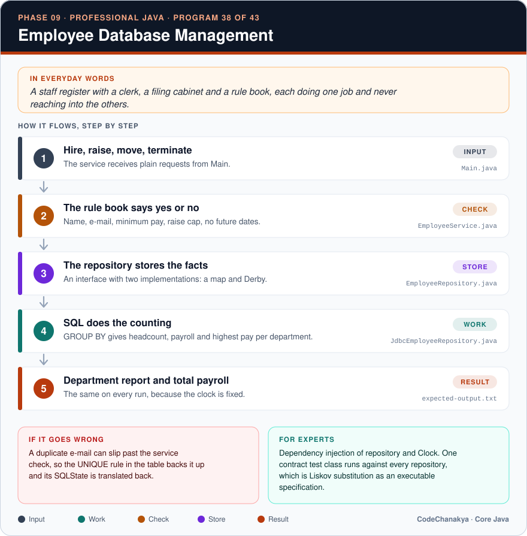
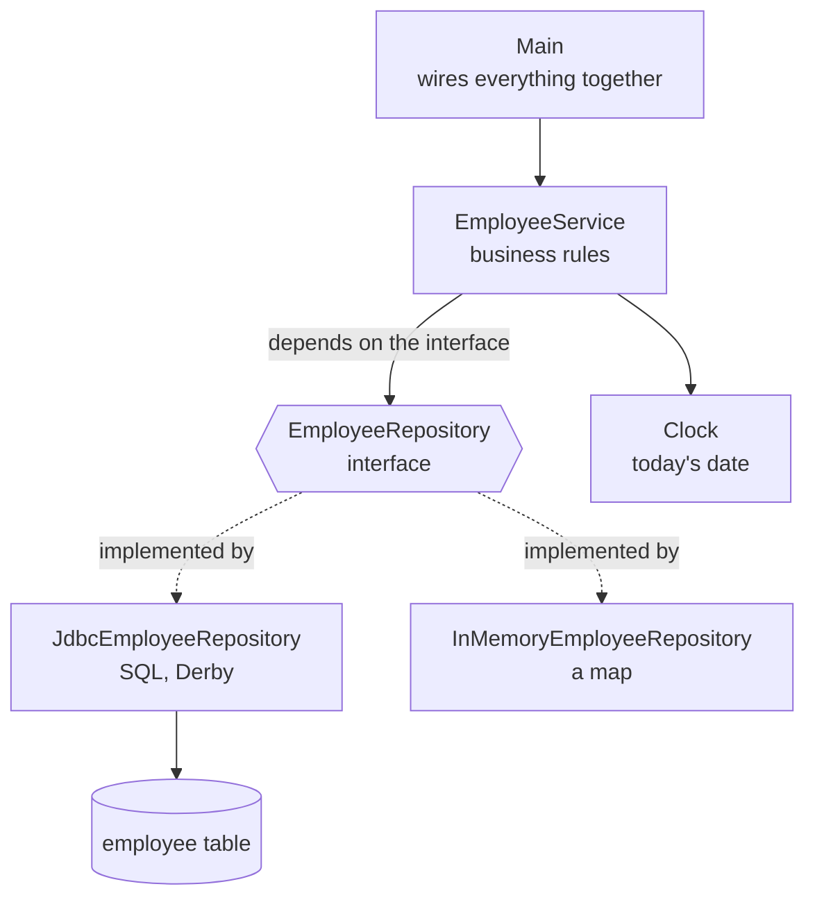

# 38 · Employee Database Management

**Phase 09 · Professional Java** &nbsp;|&nbsp; **Level:** Advanced &nbsp;|&nbsp; **Java:** 21 or newer

Concepts: CRUD, the repository pattern, the SOLID principles, dependency injection, a service layer, contract tests, Maven, JDBC, JUnit 5, Git workflow.

---

## The problem

This is the Phase 9 project. It joins everything in the phase: a Maven project (Program 35), with automated tests (Program 36), that stores its data in a database through JDBC (Program 37). New in this program is the design. The goal is code that a team can change for years without breaking it.

The task sounds ordinary: keep a list of employees. Hire, look up, search, raise, move, remove, and report on pay per department. Program 10 did something like it with a `List` in memory. Here the data lives in a table, there are real rules that must hold, and the code is split so that each part has one reason to change.

<!--flow-->
## The flow at a glance

<p align="center"><a href="../../docs/flows/program-38.svg"></a></p>

| If you are | Read it like this |
|---|---|
| New to coding | A staff register with a clerk, a filing cabinet and a rule book, each doing one job and never reaching into the others. |
| Learning | Follow the numbered cards from top to bottom. Open the file named on each card, run the program, and match its output to the last card. |
| Experienced | Dependency injection of repository and Clock. One contract test class runs against every repository, which is Liskov substitution as an executable specification. |

<details>
<summary>Text version of the flow</summary>

1. **Hire, raise, move, terminate** (input): The service receives plain requests from Main. (`Main.java`)
2. **The rule book says yes or no** (check): Name, e-mail, minimum pay, raise cap, no future dates. (`EmployeeService.java`)
3. **The repository stores the facts** (store): An interface with two implementations: a map and Derby. (`EmployeeRepository.java`)
4. **SQL does the counting** (work): GROUP BY gives headcount, payroll and highest pay per department. (`JdbcEmployeeRepository.java`)
5. **Department report and total payroll** (result): The same on every run, because the clock is fixed. (`expected-output.txt`)

</details>
<!--/flow-->

## Requirements

**Functional (CRUD and more)**
1. **Create:** hire an employee with a name, an e-mail, a department, a salary and a hire date.
2. **Read:** find one by id, list everyone, list a department.
3. **Update:** give a raise, move to another department.
4. **Delete:** terminate an employee.
5. **Report:** headcount, payroll, average and highest salary for each department, and the total payroll.

**Business rules**
- A name is required. An e-mail must look like an e-mail and be unique, ignoring case.
- The minimum salary is 15000.00. A hire date cannot be in the future.
- A raise is more than 0 and at most 20 percent.

**Non-functional**
- Business rules never touch SQL, and SQL code never decides business rules.
- The rules can be tested without a database and without waiting for a real calendar.
- The program output is identical on every run.

## The design



`EmployeeService` is the heart. It does not know whether employees are stored in a database or a map. It receives an `EmployeeRepository` and a `Clock` through its constructor. That one decision is what makes the program easy to test and easy to change.

## SOLID in this program

SOLID is five habits of design that keep code easy to change. Each one has a place you can open and point to.

| Letter | Principle | Where to see it |
|---|---|---|
| **S** | **Single responsibility.** A class has one reason to change. | `EmployeeService` holds rules, `JdbcEmployeeRepository` holds SQL, `Schema` holds table definitions, `Main` only wires. |
| **O** | **Open for extension, closed for modification.** Add behaviour without editing working code. | Exercise C1: a `CountingEmployeeRepository` wraps any repository and changes no existing class. |
| **L** | **Liskov substitution.** Any implementation can stand in for its interface. | `EmployeeRepositoryContract` is run against both repositories. If one broke a promise, a test fails. |
| **I** | **Interface segregation.** Do not force a class to depend on methods it does not use. | `ConnectionProvider` has one method. `EmployeeRepository` has only what the service needs. |
| **D** | **Dependency inversion.** Depend on abstractions, not on concrete classes. | `EmployeeService` takes the interface and a `Clock`; only `Main` names `JdbcEmployeeRepository`. |

SOLID is advice, not a law. A ten-line script does not need an interface. Reach for these when a program is going to grow, be tested, or be worked on by several people. Every time you add an interface, ask what it buys you. Here it buys a fast test suite and a replaceable database.

## Read in this order

| Step | File | What to look for |
|---|---|---|
| 1 | [`Employee.java`](src/main/java/com/codechanakya/empdb/Employee.java), [`Department.java`](src/main/java/com/codechanakya/empdb/Department.java), [`DepartmentStats.java`](src/main/java/com/codechanakya/empdb/DepartmentStats.java) | Immutable data. A change creates a new `Employee`. |
| 2 | [`EmployeeRepository.java`](src/main/java/com/codechanakya/empdb/EmployeeRepository.java) | The interface. Its comments are promises. |
| 3 | [`InMemoryEmployeeRepository.java`](src/main/java/com/codechanakya/empdb/InMemoryEmployeeRepository.java) | The simplest implementation. Read it first to see what the promises mean. |
| 4 | [`Schema.java`](src/main/java/com/codechanakya/empdb/Schema.java), [`ConnectionProvider.java`](src/main/java/com/codechanakya/empdb/ConnectionProvider.java) | The table, and a one-method interface for getting a connection. |
| 5 | [`JdbcEmployeeRepository.java`](src/main/java/com/codechanakya/empdb/JdbcEmployeeRepository.java) | The same promises, kept with SQL. Note `translate`. |
| 6 | [`EmployeeService.java`](src/main/java/com/codechanakya/empdb/EmployeeService.java) | The rules. The file to study. |
| 7 | The three exception classes | The program's own errors. |
| 8 | [`Main.java`](src/main/java/com/codechanakya/empdb/Main.java) | The composition root: the only place that chooses implementations. |
| 9 | [`src/test/java`](src/test/java/com/codechanakya/empdb) | `EmployeeRepositoryContract` and the tests built on it. |

## Run it

```bash
./run.sh            # run the demonstration
./run.sh --check    # run it and compare with expected-output.txt
./run.sh --test     # run the JUnit 5 tests
./run.sh --maven    # run the demonstration with Maven; `mvn test` runs the tests
```

The first run downloads the two Derby jars (and, for `--test`, the JUnit console jar) into `lib/`. Git ignores `lib/`.

Expected output:

```text
== Hiring
  #1 Asha Rao     asha@example.com     ENGINEERING    90000.00  hired 2021-04-12
  #2 Bilal Khan   bilal@example.com    QA             60000.00  hired 2022-01-03
  #3 Chitra Nair  chitra@example.com   QA             72000.50  hired 2020-09-21
  #4 Dev Mehta    dev@example.com      SALES          48000.00  hired 2023-07-17
  #5 Esha Iyer    esha@example.com     HR             55000.00  hired 2019-11-04
  #6 Farhan Ali   farhan@example.com   ENGINEERING    84000.00  hired 2024-02-26

== Rules that say no
  Duplicate e-mail: E-mail already in use: ASHA@example.com
  Low salary: Salary must be at least 15000.00, but was 9000.00
  Bad e-mail: Not a valid e-mail address: hari-at-example
  Future hire date: Hire date 2026-01-01 is in the future.
  Raise too big: A raise must be above 0 and at most 20 percent, but was 35
  Unknown employee: No employee with id 99

== Changes
  Raise 10% for #2    : 66000.00
  Move #4 to ENGINEERING: ENGINEERING
  Terminated #5, headcount now 5

== Engineering team
  #1 Asha Rao     asha@example.com     ENGINEERING    90000.00  hired 2021-04-12
  #4 Dev Mehta    dev@example.com      ENGINEERING    48000.00  hired 2023-07-17
  #6 Farhan Ali   farhan@example.com   ENGINEERING    84000.00  hired 2024-02-26

== Department report
  ENGINEERING  people 3  payroll  222000.00  average  74000.00  highest  90000.00
  QA           people 2  payroll  138000.50  average  69000.25  highest  72000.50
  Total payroll: 360000.50
```

## How the tests are organised

| Test class | What it proves | Needs a database |
|---|---|---|
| `EmployeeRepositoryContract` (abstract) | The promises every repository must keep: ids, ordering, uniqueness, statistics. It has no constructor of its own and runs nothing by itself. | no |
| `InMemoryEmployeeRepositoryTest` | The contract, against the in-memory version. | no |
| `JdbcEmployeeRepositoryTest` | The very same contract, against Derby. Each test gets its own database name, so tests cannot see each other's rows. | yes |
| `EmployeeServiceTest` | Every business rule, using the in-memory repository and a clock frozen on 30 June 2025. | no |

The idea of a **contract test** is worth keeping: write the behaviour once, as tests in an abstract class, and give every implementation a small subclass that says how to create one. A new implementation gets all the tests for free, and a difference between two implementations shows up as a failing test instead of a surprise in production.

The `Clock` matters too. A rule such as "hire date cannot be in the future" depends on today. Reading the real date inside the rule would make the test pass today and fail tomorrow. The service asks an injected `Clock`, and the tests hand it a fixed one.

## Working with Git

The professional habit has little to do with commands. It is small steps, named clearly, and reviewed before they reach the main line. [`GIT-WORKFLOW.md`](GIT-WORKFLOW.md) walks through one complete cycle for this project: branch, change, test, commit, push, pull request, merge, and what to do when a merge conflicts. It also lists what belongs in `.gitignore` for a Maven project.

## What to remember

1. Split by reason to change: rules, storage and wiring live in different classes.
2. Depend on interfaces, and pass the dependencies in through the constructor.
3. Two implementations of one interface should pass the same tests.
4. Anything that depends on the outside world (time, a database, the network) is injected so a test can replace it.
5. Let the database enforce the rules it can (`UNIQUE`, `CHECK`), and translate its errors into your own.
6. Commit small, test before you commit, and never commit `target/`, `lib/` or `out/`.

## How this was checked

The demonstration was compiled and run with OpenJDK 21.0.13 on Linux against the real Apache Derby 10.16.1.1 jars; `./run.sh --check` passes and the output is the same on every run. The 51 tests were run with a small stand-in for JUnit 5 that was written only for checking (the real JUnit jar could not be downloaded where this program was written). They pass, including the 12 contract tests against a real Derby database, and 3 of them fail when the code is deliberately broken. The real JUnit jar and Maven have **not** been run on this program yet, so run `./run.sh --test` once on your machine. Not yet run on Java 25, Windows or macOS.
