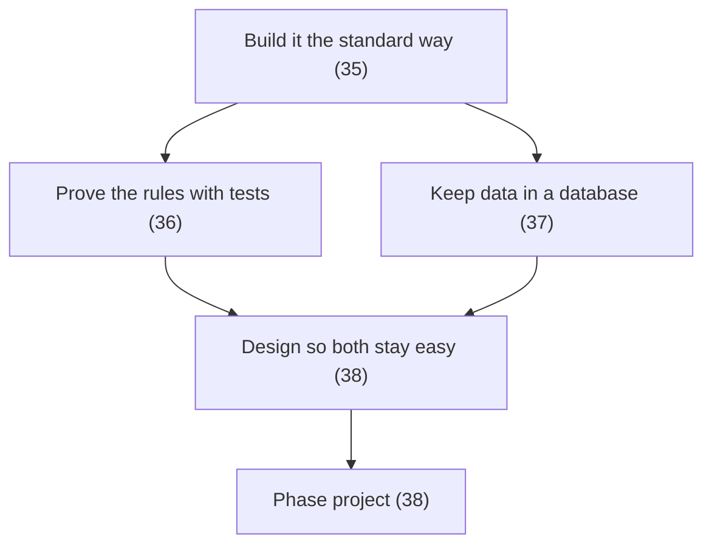

# Phase 09 · Professional Java

Programs 35 to 38 turn the code you have been writing into a project that a team can build, test, store data for and change for years. Phase 8 made programs fast. This phase makes them dependable.

| No. | Program | New ideas |
|---|---|---|
| 35 | [Maven-based Java Application](35-maven-based-java-application) | `pom.xml`, standard layout, resources on the classpath, lifecycle, dependencies |
| 36 | [Automated Business Logic Tests](36-automated-business-logic-tests) | JUnit 5, parameterized tests, boundary values, `assertThrows`, `@Nested` |
| 37 | [JDBC Banking Application](37-jdbc-banking-application) | JDBC, `PreparedStatement`, transactions, SQL injection |
| 38 | [Employee Database Management](38-employee-database-management) | CRUD, repository pattern, SOLID, dependency injection, contract tests, Git (phase project) |

## How these programs run

Every program has a `run.sh`. Programs 36, 37 and 38 download a few small jars into a `lib/` folder the first time (JUnit for tests, Apache Derby for the database). Git ignores `lib/`. Every program also has a `pom.xml`, so `./run.sh --maven` builds it with Maven if you have Maven 3.9 or newer installed. The scripts work without Maven on purpose: you see what Maven does for you by doing it by hand first.

The database is Apache Derby in memory mode. It runs inside the program, needs no server, leaves nothing on disk and starts empty on every run, so the output is the same each time.

## The themes

| Habit | Why |
|---|---|
| Keep to the standard layout | any developer knows where everything is |
| Pin versions in `pom.xml` | the same command gives the same result next year |
| Never commit `target/`, `out/` or `lib/` | they can be rebuilt |
| Test the edges, not the middle | off-by-one mistakes only live on the line |
| Write the failing test first when fixing a bug | it proves the bug is fixed and stays fixed |
| Use `PreparedStatement` for every value | text can never become SQL |
| Put several statements that must succeed together in one transaction | no half-finished work |
| Let the database enforce `UNIQUE` and `CHECK` as well | a bug in Java cannot corrupt the data |
| Depend on interfaces and inject what is outside your control | tests become fast and the storage becomes replaceable |
| Commit small, test before you commit | review is easy and history is useful |

## Choosing a tool

| You need to... | Reach for |
|---|---|
| build, test and package the same way everywhere | Maven |
| bring in a library | a `<dependency>` with the right `<scope>` |
| check many cases of one rule | `@ParameterizedTest` with `@CsvSource` or `@MethodSource` |
| group tests that share a setup | `@Nested` |
| report every failed check, not just the first | `assertAll` |
| read or write rows | `PreparedStatement`, never string concatenation |
| make several writes succeed or fail together | `setAutoCommit(false)`, `commit()`, `rollback()` |
| test business rules without a database | an in-memory implementation of the repository interface |
| make the date or time repeatable in a test | an injected `Clock` |

## What was checked, and what was not

Be clear about this when you rely on the phase. Everything below was run on OpenJDK 21.0.13 on Linux.

| Part | Status |
|---|---|
| Programs 35, 37 and 38 compile, run and match `expected-output.txt` | checked |
| Program 37 and 38 against the real Apache Derby 10.16.1.1 jars | checked |
| Jar download in `run.sh` (against a local folder laid out like Maven Central) | checked |
| Program 36 and 38 tests, on a small stand-in for the JUnit 5 API written only for checking | checked, and broken code makes them fail |
| The tests on the real JUnit 5 jar | **not yet run** |
| `mvn` on any `pom.xml` (the files are well-formed XML) | **not yet run** |
| Java 25, Windows, macOS | **not yet run** |

The CI file now runs the Maven projects with real Maven and runs the Program 38 tests with the real JUnit jar, so the first green build on GitHub will close the two open items.

## Mastery checkpoint

Build this without looking at the solutions.

**Library Members.** A library keeps members and their loans.

1. Create a Maven project with the standard layout. Put the list of membership types and their loan limits in a file under `src/main/resources` and read it from the classpath.
2. Define `MemberRepository` as an interface. Write an in-memory version and a JDBC version, and one abstract contract test class that both pass.
3. Write `MemberService` with these rules: a name is required, an e-mail is unique, a member may borrow at most the number of books their type allows. Inject the repository and a `Clock`.
4. Test every limit on both sides with `@ParameterizedTest`.
5. Record each loan and its return in one transaction, and prove with a test that a failed return leaves the loan count unchanged.
6. Do the work on a branch, with at least three commits and a pull request description.

You are ready for the capstones when you can explain what a `pom.xml` is for, why a test should check the edge of a rule, why a value must go through a `?` placeholder, why a transfer needs a transaction, and what it means that the service "depends on an abstraction".

## Levels

| Level | You can... |
|---|---|
| 1 Understood | explain Maven, a test, a transaction and an interface in plain words |
| 2 Applied | write a `pom.xml`, a parameterized test and a JDBC query correctly |
| 3 Connected | combine them as Program 38 does |
| 4 Mastered | design the library system alone and show the tests catch a broken rule |
