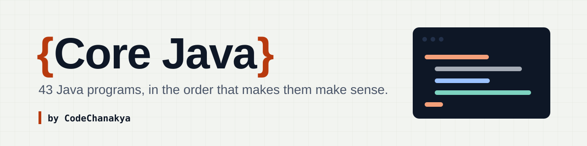

<p align="center">
  <picture>
    <source media="(prefers-color-scheme: dark)" srcset="assets/banner-dark.svg">
    
  </picture>
</p>

<p align="center">
  
  
  
  <a href="https://github.com/codechanakya/core-java/actions/workflows/ci.yml"></a>
</p>

<p align="center">
  <a href="https://codechanakya.github.io/core-java/"><b>Browse the site</b></a> &nbsp;·&nbsp;
  <a href="https://codespaces.new/codechanakya/core-java"><b>Open in Codespaces</b></a>
</p>

---

**Core Java** is a set of 43 Java programs for learners, from a first `System.out.println` to a concurrent order-processing system. Each program has a reading order, a sample run, exercises you attempt before you open the solution, and files with one planted bug so you meet compiler errors on your own terms.

It follows a fixed path: smallest building block first, then the next concept that depends on it, until you can design and test a small system yourself.

> **Status:** Phases 1, 2, 3 and 4 are ready (17 of 43 programs). Program 9 downloads the JUnit launcher on its first run, so it needs an internet connection once. The other programs are planned and appear below as they are built. Each ready program lists the Java version and platform it was run on.

## Start here

1. Install a JDK, version 21 or newer, and check it with `java -version` and `javac -version`.
2. Clone this repository.
3. Run the first program:

```bash
cd 01-getting-started/01-personal-profile-generator
./run.sh --check
```

You should see the profile card and then `OK: output matches expected-output.txt`.

On Windows, use Git Bash or WSL for the `run.sh` scripts, or run the two `javac` and `java` commands written in each program's README.

## The roadmap


Each phase ends with a project that uses everything taught before it. Frameworks such as Spring Boot come only after the Core Java foundation is solid.

## All programs

<details open>
<summary><b>Phase 01 · Getting Started</b> (1 program)</summary>

| No. | Program | Concepts | Status |
|---|---|---|---|
| 01 | [Personal Profile Generator](01-getting-started/01-personal-profile-generator) | `javac` and `java`, `System.out` | Ready |

</details>

<details>
<summary><b>Phase 02 · Core Fundamentals</b> (6 programs)</summary>

| No. | Program | Concepts | Status |
|---|---|---|---|
| 02 | [Employee Salary Calculator](02-core-fundamentals/02-employee-salary-calculator) | variables, operators, casting | Ready |
| 03 | [Money Handling Mini-Lab](02-core-fundamentals/03-money-handling-mini-lab) | `BigDecimal`, rounding | Ready |
| 04 | [Electricity Bill Generator](02-core-fundamentals/04-electricity-bill-generator) | `if` / `else`, constants, methods | Ready |
| 05 | [ATM Menu Simulation](02-core-fundamentals/05-atm-menu-simulation) | `switch`, loops, `Scanner` | Ready |
| 06 | [Student Marks Analyzer](02-core-fundamentals/06-student-marks-analyzer) | arrays, method overloading | Ready |
| 07 | [Shopping Cart Calculator](02-core-fundamentals/07-shopping-cart-calculator) | strings, `StringBuilder` | Ready |

</details>

<details>
<summary><b>Phase 03 · Object-Oriented Programming</b> (6 programs)</summary>

| No. | Program | Concepts | Status |
|---|---|---|---|
| 08 | [Banking Application](03-object-oriented-programming/08-banking-application) | classes, encapsulation | Ready |
| 09 | [JUnit Starter Lab](03-object-oriented-programming/09-junit-starter-lab) | JUnit 5, assertions | Ready |
| 10 | [Employee Management System](03-object-oriented-programming/10-employee-management-system) | inheritance, polymorphism | Ready |
| 11 | [Vehicle Rental System](03-object-oriented-programming/11-vehicle-rental-system) | abstract classes, interfaces | Ready |
| 12 | [Payment Processing System](03-object-oriented-programming/12-payment-processing-system) | interfaces, composition | Ready |
| 13 | [E-commerce Order Management](03-object-oriented-programming/13-ecommerce-order-management) | object relationships | Ready |

</details>

<details>
<summary><b>Phase 04 · Java Essentials</b> (4 programs)</summary>

| No. | Program | Concepts | Status |
|---|---|---|---|
| 14 | [Order Status Management](04-java-essentials/14-order-status-management) | enums, `static`, `final` | Ready |
| 15 | [Banking Exception Management](04-java-essentials/15-banking-exception-management) | custom exceptions, `try` / `catch` | Ready |
| 16 | [Generic Repository](04-java-essentials/16-generic-repository) | generics, bounded types | Ready |
| 17 | [Plugin Discovery Demonstration](04-java-essentials/17-plugin-discovery-demonstration) | annotations, reflection | Ready |

</details>

<details>
<summary><b>Phase 05 · Collections</b> (5 programs)</summary>

| No. | Program | Concepts | Status |
|---|---|---|---|
| 18 | Online Shopping Cart | `List`, `Iterator`, `Comparator` | Planned |
| 19 | Customer Search | `Set`, `Comparable` | Planned |
| 20 | Order Processing Queue | `Queue`, `Deque` | Planned |
| 21 | Employee Directory | `HashMap`, `equals` / `hashCode` | Planned |
| 22 | Product Inventory | `Map` and `List` together, generics | Planned |

</details>

<details>
<summary><b>Phase 06 · Files, I/O and Date</b> (4 programs)</summary>

| No. | Program | Concepts | Status |
|---|---|---|---|
| 23 | Employee File Management | streams, buffered I/O | Planned |
| 24 | Log File Analyzer | NIO, `Path` and `Files` | Planned |
| 25 | Daily Transaction Report | `LocalDate`, formatting | Planned |
| 26 | Appointment Scheduler | `ZonedDateTime`, file persistence | Planned |

</details>

<details>
<summary><b>Phase 07 · Modern Java</b> (4 programs)</summary>

| No. | Program | Concepts | Status |
|---|---|---|---|
| 27 | Customer Data Processing | lambdas, `filter` / `map` | Planned |
| 28 | Transaction Reporting | records, `Optional` | Planned |
| 29 | Sales Analytics | `groupingBy`, collectors | Planned |
| 30 | Product Recommendation Filtering | sealed classes, pattern matching | Planned |

</details>

<details>
<summary><b>Phase 08 · Concurrency</b> (4 programs)</summary>

| No. | Program | Concepts | Status |
|---|---|---|---|
| 31 | Background Report Generator | threads, `ExecutorService` | Planned |
| 32 | Concurrent Order Processor | `synchronized`, race conditions | Planned |
| 33 | Parallel Data Processing | `Future`, thread safety | Planned |
| 34 | Asynchronous Payment Status Simulator | `CompletableFuture` | Planned |

</details>

<details>
<summary><b>Phase 09 · Professional Java</b> (4 programs)</summary>

| No. | Program | Concepts | Status |
|---|---|---|---|
| 35 | Maven-based Java Application | Maven, project structure | Planned |
| 36 | Automated Business Logic Tests | JUnit 5, parameterized tests | Planned |
| 37 | JDBC Banking Application | `PreparedStatement`, transactions | Planned |
| 38 | Employee Database Management | CRUD, SOLID, Git | Planned |

</details>

<details>
<summary><b>Capstones</b> (5 programs)</summary>

| No. | Program | Concepts | Status |
|---|---|---|---|
| 39 | Enterprise Banking System | JDBC, collections, tests | Planned |
| 40 | E-commerce Order Management | streams, interfaces, database | Planned |
| 41 | Employee Management System | CRUD, date and time, JUnit | Planned |
| 42 | Concurrent Order Processing System | `CompletableFuture`, thread safety | Planned |
| 43 | Library Management System | built on your own, graded by a rubric | Planned |

</details>

## Inside every program

Open one program and you know where everything is in all of them:

```text
01-personal-profile-generator/
├── README.md             problem, concepts, how to run
├── run.sh                one command, no setup  (--check compares with expected output)
├── src/main/java/        the program, in reading order
├── expected-output.txt   what a correct run prints
├── exercises/            tasks with progressive hints, no solutions
├── broken/               files with one deliberate bug each
└── solutions/            open after you have tried
```

From Program 9 on, each program also has `src/test/java/` with JUnit tests.

## How to know you have learned something

Reading a program does not count. Each topic moves up a level only when your own code shows it.

| Level | Name | You can... |
|---|---|---|
| 1 | Understood | explain the concept in your own words |
| 2 | Applied | write a program that uses it |
| 3 | Connected | combine it with what you learned earlier |
| 4 | Mastered | solve a new problem alone, explain your design choices and test the result |

## Check everything

```bash
./scripts/check-all.sh
```

This compiles and runs every ready program and compares each with its `expected-output.txt`. The same script runs in GitHub Actions on Java 21 and 25.

## About

Built by **CodeChanakya** · [codechanakya.github.io](https://codechanakya.github.io/)

Released under the [MIT License](LICENSE).
