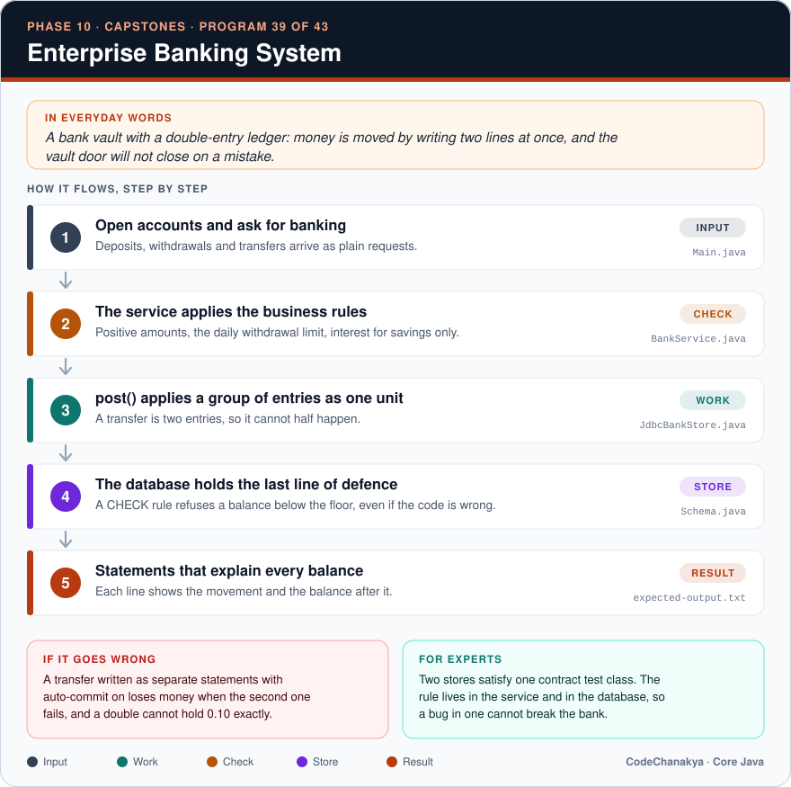

# 39 · Enterprise Banking System

**Phase 10 · Capstones** &nbsp;|&nbsp; **Level:** Capstone &nbsp;|&nbsp; **Java:** 21 or newer

Concepts: JDBC, collections, transactions, BigDecimal, interfaces, contract tests, JUnit 5.

---

A small bank that keeps its accounts in a real database. Customers open savings and current accounts,
deposit, withdraw and transfer money, and receive interest. Every rule a real bank cares about is in
here, and every one of them has a test.

This is the first capstone. It uses nothing new. It puts together what Phases 3 to 9 taught: records and
enums, collections, exceptions, `BigDecimal`, JDBC with transactions, interfaces, and tests.

## The problem

A bank has three promises it must never break.

1. **Money is never lost or invented.** A transfer either moves the money or does nothing at all.
2. **No account goes below its floor.** A savings account keeps at least 500.00. A current account may
   go into overdraft, down to -10,000.00, and no further.
3. **The history always explains the balance.** Every change leaves a line in the account's statement,
   with the balance right after it.

On top of that sit ordinary business rules: amounts must be positive, a customer may withdraw at most
50,000 per account per day, and savings accounts earn 4% a year, paid monthly.

<!--flow-->
## The flow at a glance

<p align="center"><a href="../../docs/flows/program-39.svg"></a></p>

| If you are | Read it like this |
|---|---|
| New to coding | A bank vault with a double-entry ledger: money is moved by writing two lines at once, and the vault door will not close on a mistake. |
| Learning | Follow the numbered cards from top to bottom. Open the file named on each card, run the program, and match its output to the last card. |
| Experienced | Two stores satisfy one contract test class. The rule lives in the service and in the database, so a bug in one cannot break the bank. |

<details>
<summary>Text version of the flow</summary>

1. **Open accounts and ask for banking** (input): Deposits, withdrawals and transfers arrive as plain requests. (`Main.java`)
2. **The service applies the business rules** (check): Positive amounts, the daily withdrawal limit, interest for savings only. (`BankService.java`)
3. **post() applies a group of entries as one unit** (work): A transfer is two entries, so it cannot half happen. (`JdbcBankStore.java`)
4. **The database holds the last line of defence** (store): A CHECK rule refuses a balance below the floor, even if the code is wrong. (`Schema.java`)
5. **Statements that explain every balance** (result): Each line shows the movement and the balance after it. (`expected-output.txt`)

</details>
<!--/flow-->

## How it is built

```
Main ──► BankService ──► BankStore (interface) ◄── InMemoryBankStore   (tests, fast)
         business rules                        ◄── JdbcBankStore       (real database)
         daily limit, interest                          │
         injected Clock                                 ▼
                                                  Derby tables, with a CHECK rule
```

| Class | Job |
|---|---|
| `AccountType` | SAVINGS and CURRENT, each with its minimum balance and overdraft limit. `floor()` is the lowest balance allowed. |
| `Account`, `Transaction`, `Entry` | Records. `Account` is immutable; a balance change gives a new one. `Entry` is one signed movement waiting to be posted. |
| `BankStore` | The one interface the rest of the bank sees. `post(date, entries)` applies a group of entries as one unit. |
| `InMemoryBankStore` | Maps and lists. Works on copies and publishes them only when every entry was accepted. |
| `JdbcBankStore` | One transaction per `post`. `UPDATE ... SET balance = balance + ?` so two writers cannot overwrite each other. |
| `Schema` | Creates the tables. The `balance_above_floor` CHECK rule is the last line of defence. |
| `BankService` | The rules. No SQL in it. Takes today's date from an injected `Clock`. |
| `StatementPrinter` | A pure function that turns a history into lines of text. |

Four ideas carry the design:

- **A transfer is two entries posted together.** `transfer` builds one entry out and one entry in, then
  calls `post` once. There is no moment where the money has left one account and not arrived.
- **The rule lives in two places on purpose.** The in-memory store and the database both refuse a balance
  below the floor. If a future bug in `BankService` forgets the rule, the database still holds the line.
- **Two stores, one contract.** `BankStoreContract` is an abstract test class. `InMemoryBankStoreTest`
  and `JdbcBankStoreTest` both extend it, so the two stores must behave the same way.
- **Money is `BigDecimal`, scale 2.** Never `double`. See `broken/DoubleForMoney.java`.

## Run it

```
./run.sh              # run the demonstration
./run.sh --check      # run it and compare with expected-output.txt
./run.sh --test       # compile and run the 36 JUnit 5 tests
./run.sh --maven      # the same demonstration through Maven (needs mvn); mvn test runs the tests
```

The first run downloads the Derby database driver (and, for `--test`, the JUnit console jar) into `lib/`,
which Git ignores. The program prints the same thing on every run: the clock is fixed at 30 June 2025 and
the database lives in memory only, so nothing is written to disk.

### What you should see

The program opens three accounts, tries ten everyday actions and four transfers (several of them
refused on purpose), pays interest, and prints two statements. The complete output is in
[`expected-output.txt`](expected-output.txt). Two lines worth looking at:

```
Withdraw 5000 more from Bilal (past the overdraft): refused, Account 2 would go below its lowest allowed balance
Transfer 100 from Chitra to account 99: refused, No account with id 99
```

The second one matters. The first half of that transfer (taking 100 from Chitra) really ran inside the
database before the second half failed. The rollback undid it, and the later interest payment shows
Chitra's balance was never touched.

## Tests

36 tests. The store tests run twice, once on each store.

| Class | What it proves |
|---|---|
| `BankStoreContract` (run twice) | Opening, ids, overdraft limit, savings floor, unknown account, all-or-nothing posting, the daily withdrawal sum. |
| `InMemoryBankStoreTest`, `JdbcBankStoreTest` | The contract on each store. The JDBC test also checks that the database's own CHECK rule fires (SQLState 23513) and that SQL typed as a customer name is stored as plain text. |
| `BankServiceTest` | Positive amounts only, daily limit, transfers keep the total, interest maths and rounding, opening rules. |
| `StatementPrinterTest` | The exact text of a statement. |

To check that the tests are worth having, four deliberate mistakes were made one at a time (a wrong daily
limit comparison, rounding down instead of half up, `<=` instead of `<` on the floor, and `commit` where
`rollback` belongs). Each one made at least one test fail.

## Break it on purpose

Three small programs in [`broken/`](broken/) show what goes wrong when you skip a rule. Each has its real
output in [`broken/README.md`](broken/README.md).

## Exercises and solutions

Six tasks in [`exercises/`](exercises/README.md). Solutions for two of them (a monthly fee and a statement
between two dates) are in [`solutions/`](solutions/README.md), with tests.

## How this was checked

While the program was written, it was compiled and run with OpenJDK 21.0.13 on Linux, `./run.sh --check`
passed, and the output was the same on every run. The database is real Apache Derby 10.16.1.1. The tests
were run on a small stand-in for the JUnit runner while writing, and four deliberate mistakes were caught.
The project's GitHub Actions run is the check on Java 21 and 25 with the real JUnit jar and Maven. Not yet
run on Windows or macOS.
