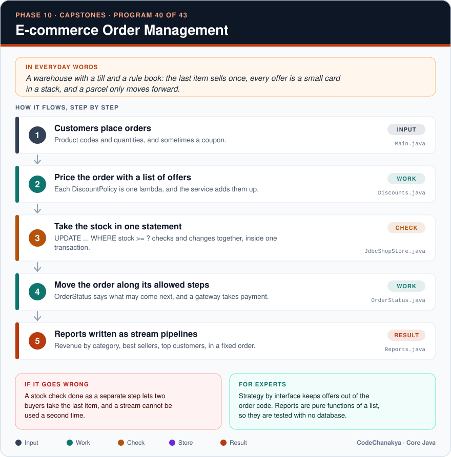

# 40 · E-commerce Order Management

**Phase 10 · Capstones** &nbsp;|&nbsp; **Level:** Capstone &nbsp;|&nbsp; **Java:** 21 or newer

Concepts: Streams, interfaces, the strategy pattern, JDBC transactions, an enum state machine, JUnit 5.

---

A small online shop. Customers place orders for products in a catalogue, the shop prices them with several
discount offers, takes payment, and moves each order through its life: new, paid, shipped, delivered, or
cancelled. At the end, a set of reports written as streams tells the owner how the shop is doing.

## The problem

A shop has to answer three questions correctly, every time.

1. **Can we really sell this?** Two customers must not both buy the last keyboard. If an order has three
   lines and the third is out of stock, nothing is sold at all, and the first two lines' stock is untouched.
2. **What does this order cost?** Offers change often: bulk prices, big-order prices, coupons. Adding an offer
   should not mean editing the order code.
3. **What is allowed next?** A shipped order cannot be cancelled. An unpaid order cannot be shipped. These
   rules should be written down once.

<!--flow-->
## The flow at a glance

<p align="center"><a href="../../docs/flows/program-40.svg"></a></p>

| If you are | Read it like this |
|---|---|
| New to coding | A warehouse with a till and a rule book: the last item sells once, every offer is a small card in a stack, and a parcel only moves forward. |
| Learning | Follow the numbered cards from top to bottom. Open the file named on each card, run the program, and match its output to the last card. |
| Experienced | Strategy by interface keeps offers out of the order code. Reports are pure functions of a list, so they are tested with no database. |

<details>
<summary>Text version of the flow</summary>

1. **Customers place orders** (input): Product codes and quantities, and sometimes a coupon. (`Main.java`)
2. **Price the order with a list of offers** (work): Each DiscountPolicy is one lambda, and the service adds them up. (`Discounts.java`)
3. **Take the stock in one statement** (check): UPDATE ... WHERE stock >= ? checks and changes together, inside one transaction. (`JdbcShopStore.java`)
4. **Move the order along its allowed steps** (work): OrderStatus says what may come next, and a gateway takes payment. (`OrderStatus.java`)
5. **Reports written as stream pipelines** (result): Revenue by category, best sellers, top customers, in a fixed order. (`Reports.java`)

</details>
<!--/flow-->

## How it is built

```
Main ──► OrderService ──► ShopStore (interface) ◄── JdbcShopStore ──► Derby (4 tables)
         prices, pays,     │
         moves status      ├──► DiscountPolicy (interface): BULK, BIG_ORDER, COUPON   (a list, added up)
                           └──► PaymentGateway (interface): FakeGateway               (swapped in tests)

Reports ──► pure stream functions over a List<Order>
```

| Class | Job |
|---|---|
| `Product`, `Customer`, `Order`, `OrderLine` | Records. `Order` copies its list of lines with `List.copyOf`, so nobody can change a placed order from outside. |
| `OrderStatus` | An enum that knows its own allowed next steps. `canMoveTo` is the only place the rules are written. |
| `DiscountPolicy`, `Discounts` | One method, so each offer is a lambda. `OrderService` adds up every policy and never takes off more than the subtotal. |
| `PaymentGateway`, `FakeGateway` | The outside world behind an interface. The fake declines card 0000, so a refusal can be tested. |
| `ShopStore`, `JdbcShopStore` | All SQL lives here. Stock is taken with `UPDATE ... WHERE stock >= ?`, and an order is saved in one transaction. |
| `OrderService` | Looks up prices, applies discounts, charges, and changes status. Takes the date from an injected `Clock`. |
| `Reports` | Eight pure functions. They take a list and return a map or list, so tests need no database. |

Three ideas worth keeping:

- **Check and change in one statement.** `UPDATE product SET stock = stock - ? WHERE sku = ? AND stock >= ?`
  cannot be beaten by a second buyer. If it changed no row, the stock was not there. See `broken/StockCheckThenUpdate.java`.
- **Strategy by interface.** `DiscountPolicy` is a functional interface. A new offer is one new lambda in
  `Discounts.standard()`.
- **Streams for reports.** `groupingBy` into a `TreeMap` or `EnumMap` keeps the output in a fixed order, so
  the report is the same on every run.

## Run it

```
./run.sh              # run the demonstration
./run.sh --check      # run it and compare with expected-output.txt
./run.sh --test       # compile and run the 42 JUnit 5 tests
./run.sh --maven      # the same demonstration through Maven (needs mvn); mvn test runs the tests
```

The first run downloads the Derby driver (and, for `--test`, the JUnit console jar) into `lib/`, which Git
ignores. The clock is fixed at 30 June 2025 and the database is in memory, so the output is the same every run.

### What you should see

Five products, three customers, eight order attempts (four refused for different reasons), a full order life
with some steps refused on purpose, the stock after a cancellation, and the reports. The full text is in
[`expected-output.txt`](expected-output.txt). A few lines to look for:

```
Asha: 12 notebooks, 2 lamps: order 1, subtotal 7900.00, discount 935.00, total 6965.00
Asha: 6 keyboards (only 4 left): refused, Not enough stock of EL-202 for 6
Cancel order 3 (paid, stock goes back): done
```

The first discount is two offers at once: ten percent off the 12 notebooks (540) plus five percent off the
whole 7,900 order (395).

## Tests

42 tests in five classes.

| Class | What it proves |
|---|---|
| `JdbcShopStoreTest` | Orders round-trip with their lines, stock is taken, a later out-of-stock line rolls back an earlier one, cancel restocks, the CHECK rule fires, duplicate sku is reported, SQL in a name is harmless. |
| `OrderServiceTest` | Prices come from the catalogue, every bad order has a clear message, the last item sells once, the whole life of an order, a declined payment changes nothing, the gateway gets exactly the total. |
| `DiscountsTest` | Boundaries of every offer (9, 10 and 11 units; 4,999.99 and 5,000; a null coupon). |
| `OrderStatusTest` | The allowed moves, and that end states go nowhere. |
| `ReportsTest` | Every report on a small hand-made list, with no database. |

To check the tests catch mistakes, six deliberate changes were made one at a time: skipping the out-of-stock
check, `commit` instead of `rollback`, `> 10` instead of `>= 10`, letting NEW jump to SHIPPED, counting
cancelled orders as sales, and a broken stock query. Each one made tests fail.

## Break it on purpose

[`broken/`](broken/README.md) has three small programs with their real output: a stock check done in two
steps, a stream used twice, and a record that lets its list be changed from outside.

## Exercises and solutions

Six tasks in [`exercises/`](exercises/README.md). Two of them (sales per day, repeat customers) are solved
in [`solutions/`](solutions/README.md), with tests.

## How this was checked

While the program was written, it was compiled and run with OpenJDK 21.0.13 on Linux, `./run.sh --check`
passed, and the output was the same on every run. The database is real Apache Derby 10.16.1.1. The tests
were run on a small stand-in for the JUnit runner while writing, and the deliberate mistakes above were
caught. The project's GitHub Actions run is the check on Java 21 and 25 with the real JUnit jar and Maven.
Not yet run on Windows or macOS.
