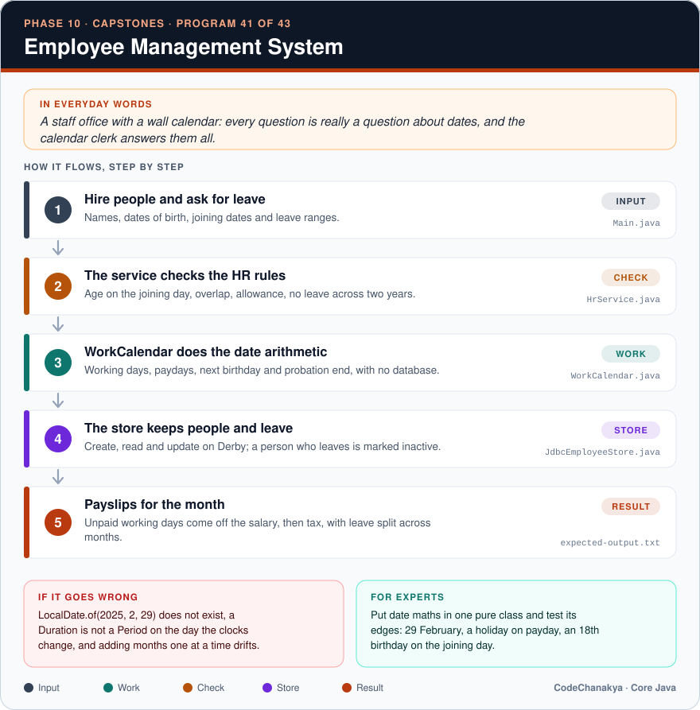

# 41 · Employee Management System

**Phase 10 · Capstones** &nbsp;|&nbsp; **Level:** Capstone &nbsp;|&nbsp; **Java:** 21 or newer

Concepts: CRUD, LocalDate, Period, YearMonth, soft delete, JDBC, nested JUnit 5 tests.

---

An HR system for a small company. It hires and updates employees, tracks leave with real working-day
arithmetic, works out birthdays, tenure, probation and paydays, and produces payslips. Most of the hard
parts of this program are about **dates**, and most of its tests are too.

Program 38 was about a database. This one is about the rules that sit on top of it, and about the Java
date and time API doing real work.

## The problem

HR questions sound simple and are full of corner cases.

1. **How many days of leave is that?** Monday to Friday of a week with a public holiday is four days, not five. A request
   over a weekend is zero days. A request may not overlap another, and may not use more than the year allows.
2. **What is the date?** Someone born on 29 February has a birthday every year. Someone who joined on 29 February
   has a work anniversary every year. Payday is the last *working* day of the month, so it moves back from a weekend.
   Probation is six months, and if that lands on a weekend it moves forward.
3. **What are they paid?** Unpaid leave takes off a share of the month's salary, by working days. A leave that
   crosses a month end is split between the two months.

<!--flow-->
## The flow at a glance

<p align="center"><a href="../../docs/flows/program-41.svg"></a></p>

| If you are | Read it like this |
|---|---|
| New to coding | A staff office with a wall calendar: every question is really a question about dates, and the calendar clerk answers them all. |
| Learning | Follow the numbered cards from top to bottom. Open the file named on each card, run the program, and match its output to the last card. |
| Experienced | Put date maths in one pure class and test its edges: 29 February, a holiday on payday, an 18th birthday on the joining day. |

<details>
<summary>Text version of the flow</summary>

1. **Hire people and ask for leave** (input): Names, dates of birth, joining dates and leave ranges. (`Main.java`)
2. **The service checks the HR rules** (check): Age on the joining day, overlap, allowance, no leave across two years. (`HrService.java`)
3. **WorkCalendar does the date arithmetic** (work): Working days, paydays, next birthday and probation end, with no database. (`WorkCalendar.java`)
4. **The store keeps people and leave** (store): Create, read and update on Derby; a person who leaves is marked inactive. (`JdbcEmployeeStore.java`)
5. **Payslips for the month** (result): Unpaid working days come off the salary, then tax, with leave split across months. (`expected-output.txt`)

</details>
<!--/flow-->

## How it is built

```
Main ──► HrService ──► EmployeeStore (interface) ◄── JdbcEmployeeStore ──► Derby (employee, leave_request)
         the rules     │
                       └──► WorkCalendar: weekends, holidays, paydays, birthdays, probation  (no database)
```

| Class | Job |
|---|---|
| `Employee`, `LeaveRequest`, `Payslip` | Records. `Employee` keeps `active` rather than being deleted: a person who leaves stays in the records. |
| `Department`, `LeaveType`, `LeaveStatus` | Enums. `LeaveType` carries its own yearly allowance (annual 18, sick 10, unpaid unlimited). |
| `WorkCalendar` | All date arithmetic in one pure class: `workingDaysBetween`, `lastWorkingDay`, `nextBirthday`, `probationEnds`. |
| `EmployeeStore`, `JdbcEmployeeStore` | Create, read and update. Dates go in as `java.sql.Date` and come out as `LocalDate`. A duplicate email is SQLState 23505, translated to `DuplicateEmailException`. |
| `HrService` | Validation, leave rules, payslips. Takes today's date from an injected `Clock`. |

Ideas worth keeping:

- **Put date maths in one pure class.** `WorkCalendar` needs no database and no clock. Its tests are the
  fastest and most numerous.
- **Soft delete.** `terminate` marks the employee inactive and rejects their pending leave. Approved leave and the
  payroll history stay.
- **Dates as the right type.** `LocalDate` for a day, `YearMonth` for a pay month, `Period` for tenure. No
  strings, no `int` day counts passed around.
- **Test the edges.** 18th birthday on the joining day, 50,000 exactly, the last day of the month, 29 February.

## Run it

```
./run.sh              # run the demonstration
./run.sh --check      # run it and compare with expected-output.txt
./run.sh --test       # compile and run the 63 JUnit 5 tests
./run.sh --maven      # the same demonstration through Maven (needs mvn); mvn test runs the tests
```

The first run downloads the Derby driver (and, for `--test`, the JUnit console jar) into `lib/`, which Git
ignores. "Today" is fixed at Monday 30 June 2025 through a `Clock`, and the database is in memory, so the
output is the same on every run and on every day you run it.

### What you should see

Four hires and four refusals, tenure and probation dates, birthdays, paydays, nine leave requests (six
refused), approvals, changes, and July payslips. The full text is in [`expected-output.txt`](expected-output.txt).
Some lines to look for:

```
Asha annual 11 to 15 Aug (15 Aug is a holiday): request 1, 4 working days
Bilal was born on 29 February; his next birthday is celebrated on 2026-02-28
Payday for 2025-08: 2025-08-29 (FRIDAY)
Chitra Nair  gross  38000.00  unpaid days 5  deduction  8260.87  tax  1486.96  net  28252.17
```

Check the last one by hand: 38,000 × 5 ÷ 23 working days = 8,260.87; 5 percent of what is left is 1,486.96.

## Tests

63 tests in three classes.

| Class | What it proves |
|---|---|
| `WorkCalendarTest` | Working days, month lengths, paydays (including a holiday on the last day), next birthdays (including 29 February), probation (including a holiday). No database. |
| `HrServiceTest` | In nested groups: hiring rules and the exact age boundary, dates, leave rules (overlap, allowance, holidays, past dates), changes, and payslips (tax rates, unpaid days, a leave across two months). |
| `JdbcEmployeeStoreTest` | Create, read and update with every field, duplicate email on add and update, the salary CHECK rule, leave ordering, SQL in a value stored as text. |

Writing these tests found a real bug before the program was finished: `workingDaysBetween` threw an exception when
the end date was before the start date, although it was meant to return zero. A payslip for September would have
crashed for leave that ended in August. The test for it is `workingDaysBetween[2025-07-07, 2025-07-04, 0]`.

Six deliberate mistakes were then made one at a time (the birthday boundary, five months of probation instead of
six, `<= 18`, `>=` on the leave allowance, counting unpaid leave that was not approved, and the tax threshold).
Each one made a test fail.

## Break it on purpose

[`broken/`](broken/README.md) has three small programs with their real output: an impossible date, "24 hours"
against "one day" on the day the clocks change, and adding months one at a time.

## Exercises and solutions

Six tasks in [`exercises/`](exercises/README.md). Two (probation reminders, work anniversaries) are solved in
[`solutions/`](solutions/README.md), with tests.

## How this was checked

While the program was written, it was compiled and run with OpenJDK 21.0.13 on Linux, `./run.sh --check`
passed, and the output was the same on every run. The database is real Apache Derby 10.16.1.1. The tests
were run on a small stand-in for the JUnit runner while writing, and the deliberate mistakes above were
caught. The project's GitHub Actions run is the check on Java 21 and 25 with the real JUnit jar and Maven.
Not yet run on Windows or macOS.
