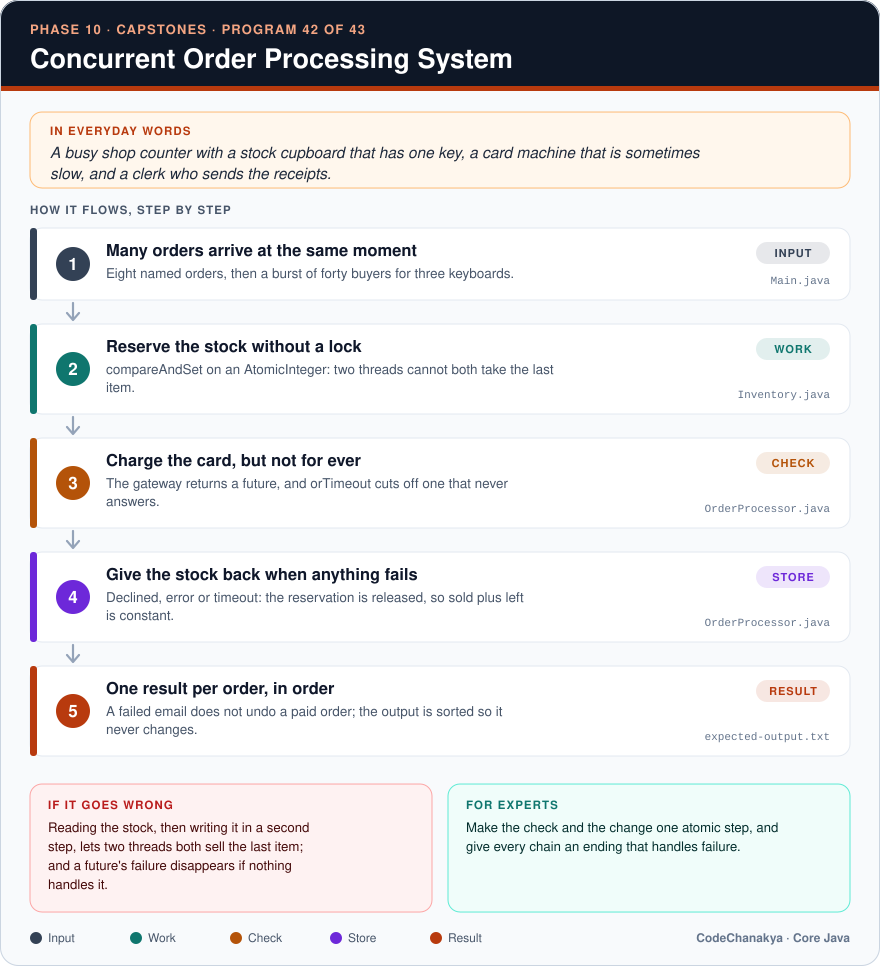

# 42 · Concurrent Order Processing System

**Phase 10 · Capstones** &nbsp;|&nbsp; **Level:** Capstone &nbsp;|&nbsp; **Java:** 21 or newer

Concepts: `CompletableFuture`, thread pools, `AtomicInteger` and `compareAndSet`, `ConcurrentHashMap`, timeouts, error handling in async chains, deterministic output from concurrent code, JUnit 5.

---

## The problem

A shop gets many orders at the same moment. Each order must reserve stock, charge a card (which takes time and
may fail), and send a confirmation. Doing them one after another leaves every customer waiting behind the one
with the slow card. Doing them all at once is fast, and it is also where the bugs live.

The system has to keep five promises while hundreds of orders run at once.

1. **Never oversell.** Forty buyers for the last three keyboards: exactly three succeed.
2. **Never lose stock.** An order that is declined, fails or times out gives its stock back. What was sold plus
   what is left always equals what the shop started with.
3. **Never wait forever.** A payment gateway that does not answer is cut off after a timeout.
4. **One order, one answer.** Whatever goes wrong, every order ends with exactly one result.
5. **A failed email does not undo a paid order.**

<!--flow-->
## The flow at a glance

<p align="center"><a href="../../docs/flows/program-42.svg"></a></p>

| If you are | Read it like this |
|---|---|
| New to coding | A busy shop counter with a stock cupboard that has one key, a card machine that is sometimes slow, and a clerk who sends the receipts. |
| Learning | Follow the numbered cards from top to bottom. Open the file named on each card, run the program, and match its output to the last card. |
| Experienced | Make the check and the change one atomic step, and give every chain an ending that handles failure. |

<details>
<summary>Text version of the flow</summary>

1. **Many orders arrive at the same moment** (input): Eight named orders, then a burst of forty buyers for three keyboards. (`Main.java`)
2. **Reserve the stock without a lock** (work): compareAndSet on an AtomicInteger: two threads cannot both take the last item. (`Inventory.java`)
3. **Charge the card, but not for ever** (check): The gateway returns a future, and orTimeout cuts off one that never answers. (`OrderProcessor.java`)
4. **Give the stock back when anything fails** (store): Declined, error or timeout: the reservation is released, so sold plus left is constant. (`OrderProcessor.java`)
5. **One result per order, in order** (result): A failed email does not undo a paid order; the output is sorted so it never changes. (`expected-output.txt`)

</details>
<!--/flow-->

## How it is built

```
Order ──► OrderProcessor.process
            1. Inventory.reserve        compareAndSet, so two threads cannot both take the last item
            2. gateway.charge           a CompletableFuture<Boolean>, with .orTimeout
            3. thenCompose              accepted: send the confirmation; declined: give the stock back
            4. exceptionally            any failure or timeout: give the stock back, report one result
          processAll(orders)            all orders at once, results in the order they were given
```

| Class | Job |
|---|---|
| `Order`, `OrderResult`, `OrderStatus` | Immutable records and an enum. Immutable data needs no locks. |
| `Inventory` | A `ConcurrentHashMap` of `AtomicInteger`. `reserve` is a read, check and `compareAndSet` loop, so check and change are one step. |
| `PaymentGateway`, `FakeGateway` | The outside world, returning a future. The fake declines card `0000`, throws for `ERR` and answers late for `SLOW`. |
| `Notifier` | Records messages in a `ConcurrentLinkedQueue`. The address `bad` always fails. |
| `OrderProcessor` | The chain. `unwrap` finds the real cause inside a `CompletionException`. |

Ideas worth keeping:

- **Compare and set instead of a lock.** If another thread changed the value between your read and your write,
  the swap fails and you try again with the new value. Nothing ever waits.
- **Do not block inside the chain.** Each step starts when the one before it finishes. `join()` appears only at the
  very edge, where the results are collected. See `broken/PoolStarvation.java`.
- **Errors travel down the chain.** A failure in one stage skips the stages after it and lands in `exceptionally` or
  `handle`. It arrives wrapped, so the code unwraps it before reading the message.
- **Concurrent output must be sorted or counted.** Threads finish in no fixed order. This is how the program prints
  the same text on every run.

## Run it

```
./run.sh              # run the demonstration
./run.sh --check      # run it and compare with expected-output.txt
./run.sh --test       # compile and run the 17 JUnit 5 tests
./run.sh --maven      # the same demonstration through Maven (needs mvn); mvn test runs the tests
```

This program needs no database. Only `--test` downloads something: the JUnit launcher, once, into `lib/`.
The demonstration finishes in a fraction of a second, although one order waits out its timeout.

### What you should see

Eight named orders processed at once, a burst of 40 buyers for 3 keyboards, and the stock at the end. The full
text is in [`expected-output.txt`](expected-output.txt). Lines to look for:

```
order 5: TIMED_OUT    no answer from the payment gateway
order 7: COMPLETED    paid, but the confirmation failed
{COMPLETED=3, OUT_OF_STOCK=37}  (which three buyers won is not fixed, but the count always is)
EL-202   0
```

Which three of the forty buyers win changes from run to run. The program prints only what does not change: the
count, never the names.

## Tests

17 tests in two classes.

| Class | What it proves |
|---|---|
| `InventoryTest` | Reserve, release, exact amount, bad input, a sorted snapshot that is a copy, and two many-thread tests: 200 threads for 50 items, repeated 50 times, and 400 reserve-and-release pairs that must end where they started. |
| `OrderProcessorTest` | Each ending (completed, out of stock, declined, gateway error with its real message, timeout, failed confirmation), results in submission order, a burst of 60 buyers for 10 items, and stock conservation across mixed outcomes. |

**A note on testing races.** A test of concurrent code can fail by luck of timing, and it can also pass by luck. A
failing run proves there is a bug. A passing run does not prove there is none. To see how well the many-thread test
works, the `compareAndSet` loop was replaced with a plain `set` (the bug it exists to prevent). On a 2-core test
machine the test caught it in 2 of 3 runs, and only after being changed from one round to 50 rounds. A single round
missed it. That is why the test repeats, and why the forced demonstration in `broken/LostUpdate.java` exists: it uses
a short sleep to make the race happen every time.

The other deliberate mistakes (not giving stock back on a decline, not giving it back on an error, removing the
timeout, reporting the wrapper's message instead of the real one) each made tests fail on every run. The timeout
tests use a 300 ms limit against a 3 second delay, so a slow machine does not make them fail.

## Break it on purpose

[`broken/`](broken/README.md) has three small programs with their real output: a lost update, a thread pool that
waits for itself, and an exception that nobody sees.

## Exercises and solutions

Six tasks in [`exercises/`](exercises/README.md). Two of them (a retrying gateway and a summary of results) are
solved in [`solutions/`](solutions/README.md), with tests.

## What to remember

- Shared mutable state is the problem. Immutable records and atomic variables remove most of it.
- Check-then-act is a bug unless the check and the act are one atomic step.
- A future carries a failure as well as a value. Always give the chain somewhere to end: `exceptionally` or `handle`.
- Never `join()` or `get()` on a thread of the pool that will run the work you are waiting for.
- Give every wait a timeout, and every failure path a way to give back what it took.

## How this was checked

While the program was written, it was compiled and run with OpenJDK 21.0.13 on Linux, `./run.sh --check` passed, and
the output was identical on eight runs in a row. The tests were run on a small stand-in for the JUnit runner while
writing, several times in a row, with the deliberate mistakes described above. The project's GitHub Actions run is the
check on Java 21 and 25 with the real JUnit jar and Maven. Not yet run on Windows or macOS.
