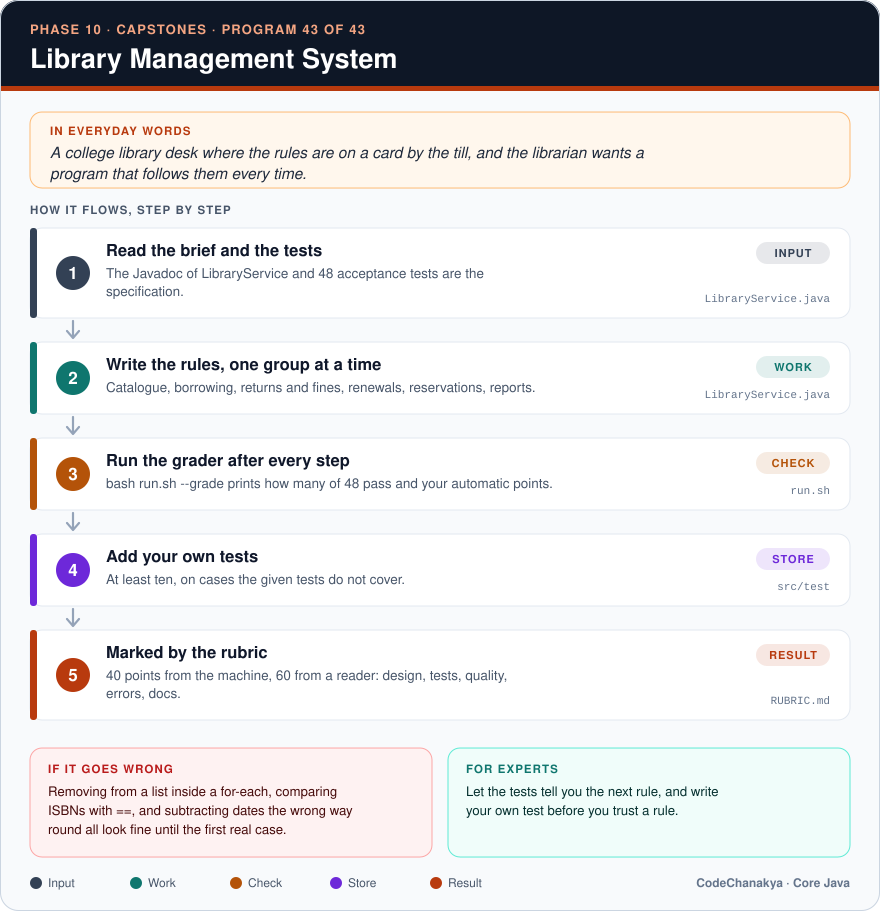

# 43 · Library Management System

**Phase 10 · Capstones** &nbsp;|&nbsp; **Level:** Capstone &nbsp;|&nbsp; **Java:** 21 or newer

Concepts: everything so far, built on your own: classes and interfaces, collections, `java.time`, `BigDecimal`, exceptions, a `Clock` for testable dates, and JUnit 5. Graded by a rubric.

---

## The problem

This is the last program, and it is different from the other 42. There is no walkthrough. You get a brief, a
set of tests that describe the rules, and a project with the answer left out. You build it yourself.

A small college library needs software for its desk. The librarian must be able to:

1. **Keep a catalogue.** Add books (with a number of copies), search by title or author.
2. **Keep members.** Students and faculty, with different rules.
3. **Lend and take back books.** Students keep a book for 14 days and may hold 3. Faculty keep it for 30 days and may hold 10.
4. **Charge fines.** A late return costs a fine per day (2.00 for students, 1.00 for faculty). Someone who owes more than 50.00 cannot borrow.
5. **Renew.** A book can be renewed once, for 7 days, but not when it is overdue or when someone is waiting for it.
6. **Reserve.** When every copy is out, a member can join the queue. The first in the queue borrows first.
7. **Report.** What a member holds, what they owe, and which loans are overdue today.

<!--flow-->
## The flow at a glance

<p align="center"><a href="../../docs/flows/program-43.svg"></a></p>

| If you are | Read it like this |
|---|---|
| New to coding | A college library desk where the rules are on a card by the till, and the librarian wants a program that follows them every time. |
| Learning | Follow the numbered cards from top to bottom. Open the file named on each card, run the program, and match its output to the last card. |
| Experienced | Let the tests tell you the next rule, and write your own test before you trust a rule. |

<details>
<summary>Text version of the flow</summary>

1. **Read the brief and the tests** (input): The Javadoc of LibraryService and 48 acceptance tests are the specification. (`LibraryService.java`)
2. **Write the rules, one group at a time** (work): Catalogue, borrowing, returns and fines, renewals, reservations, reports. (`LibraryService.java`)
3. **Run the grader after every step** (check): bash run.sh --grade prints how many of 48 pass and your automatic points. (`run.sh`)
4. **Add your own tests** (store): At least ten, on cases the given tests do not cover. (`src/test`)
5. **Marked by the rubric** (result): 40 points from the machine, 60 from a reader: design, tests, quality, errors, docs. (`RUBRIC.md`)

</details>
<!--/flow-->

## The requirements

| # | Requirement |
|---|---|
| R1 | Add a book: the ISBN and title are required, at least one copy, no duplicate ISBN. |
| R2 | Add a member: the name is required. |
| R3 | Search by title or author, ignoring case, sorted by title. Blank text finds nothing. |
| R4 | Borrow, with the seven refusal rules in the Javadoc of `LibraryService.borrow`. |
| R5 | Return a book and compute the fine from the member's daily rate. |
| R6 | Renew once, for 7 days, under the conditions in the Javadoc. |
| R7 | Reserve a book with no copy on the shelf, and keep a first-come queue. |
| R8 | Pay fines in full or in part, but never more than is owed. |
| R9 | Report a member's loans and the library's overdue loans in a stated order. |
| R10 | Every refusal throws a `LibraryException` with a message a librarian would understand. |
| R11 | Today's date comes only from the injected `Clock`. |

The exact wording of each rule is in the Javadoc of [`starter/.../LibraryService.java`](starter/src/main/java/com/codechanakya/library/LibraryService.java).
The 48 acceptance tests in `starter/src/test` are the rest of the specification. Read them before you write code.

## How to work

```
cd starter
bash run.sh --compile    # does it compile?
bash run.sh --grade      # your automatic score, from the acceptance tests
```

At the start, `--grade` says 0 of 48. That is correct. Work in this order, and run `--grade` after each step:

1. Catalogue and members (`addBook`, `join`, `availableCopies`, `search`).
2. Borrowing.
3. Returns and fines.
4. Renewals.
5. Reservations.
6. Reports.

Stuck? The [hints](hints/README.md) are staged and contain no code. Take one at a time.

Write your own tests as you go (at least ten) in classes whose names do not end in `AcceptanceTest`, and write a
short `Main` that shows your library working.

## What to hand in

- Your `starter/` folder with `LibraryService.java`, `Main.java`, your tests, and a short README of your own.
- The given tests untouched. The grader uses the original files.

## How long it takes

Plan for two to three days of evenings, or one long weekend. The rules are small. The time goes into reading the
tests carefully and into the edge cases.

## How it is marked

[RUBRIC.md](RUBRIC.md) has the full breakdown: 40 points from the acceptance tests, then design, your own tests,
code quality, error handling, documentation, and stretch goals, with a description of each level.
[GRADING-SHEET.md](GRADING-SHEET.md) is the form a marker fills in. If you work alone, mark yourself with it,
and be harder on yourself than a stranger would be.

## What is in the folder

| Folder | What it is |
|---|---|
| `starter/` | The project you build in. Given classes are done. `LibraryService` and `Main` are yours. |
| `reference/` | A finished solution with the same tests plus six of its own. Do not open it until you are done. |
| `hints/` | Staged hints, no code. |
| `exercises/` | Stretch goals. |
| `broken/` | Three mistakes this kind of program invites, with real output. |

The top-level `run.sh` runs the reference. Use the one in `starter/` for your own work.

## Break it on purpose

[`broken/`](broken/README.md) has three small programs with their real output: removing from a list while looping
over it, comparing text with `==`, and a date subtraction the wrong way round.

## What to remember

- Read the tests as a specification. They say what the author meant.
- Keep the rules in one class and the storage behind an interface.
- Never ask the system for the time inside the rules. Receive a `Clock`.
- Money is `BigDecimal`. Compare it with `compareTo`.
- Write the test for a rule before the rule, and watch it fail first.

## How this was checked

The reference solution passes all 48 acceptance tests and its 6 own tests. The starter compiles and fails all 48,
which shows the tests are not satisfied by an empty project. Fourteen deliberate mistakes were placed into the
reference one at a time (for example, removing the sort of overdue loans, or allowing exactly 50.00), and each was
caught by at least one acceptance test. The tests were run on a small stand-in for the JUnit runner; the `--grade`
summary parser was tested against a stand-in for the console launcher and against sample reports in its format.
It has not yet run against the real console jar, and Maven has not been run on this program. The project's GitHub
Actions run is that check, on Java 21 and 25. Not yet run on Windows or macOS.
